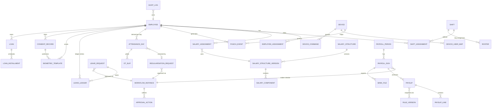
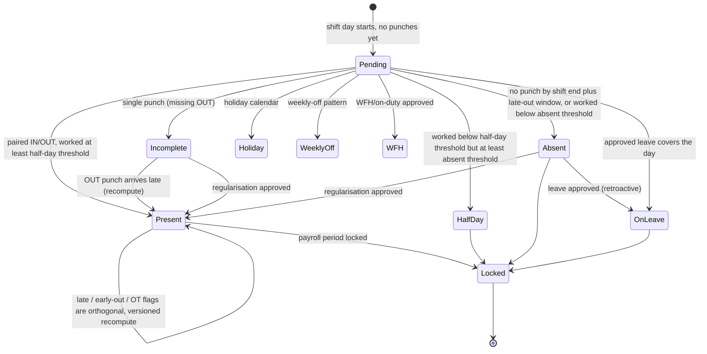
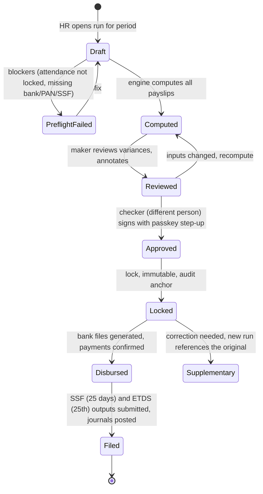

# Hajiri: In-House Multi-Biometric Attendance, HR and Payroll Platform — Master Plan

| Field | Value |
|---|---|
| Version | Draft v1.0 |
| Date | 2026-10-13 |
| Status | Draft v1.0 — for engineering and owner review |
| Owner | Company owner / executive sponsor (named in Section 18, decision 14) |
| Assumptions | The company is a private company in Nepal; 50–500 employees at launch, scaling to several thousand employees across multiple branches; self-hosted on the company's own Kubernetes (the team already runs RKE2 + Cilium on-prem); Nepal labour, tax, social-security and privacy law applies; no FIPS or banking-regulator obligation unless stated in Section 18. |
| Figures | NPR unless stated. Anything marked "(estimate)" or "(inference)" is the plan's own reasoning, not a sourced fact. Legal figures carry the fiscal year they apply to. |

---

## 0. How to use this document

This is a working plan, not a research report: read Sections 1–4 to decide, Sections 5–13 to specify, Sections 14–16 to execute, and Sections 17–19 to manage risk and close gaps. Every statutory figure, price, protocol detail and standard carries an inline citation so the engineering team can verify it before encoding it; where sources disagreed the plan says which one it trusted and why. Section 6 is the compliance rulebook the payroll engine must encode (with both the FY 2082/83 and FY 2083/84 tax schedules); Section 12 is the security architecture and is intentionally the longest section because "as close to unbreakable as realistically achievable" is the hardest requirement; Section 18 lists the decisions only the owner can make.

| Section | What it answers |
|---|---|
| 1 Executive summary | What, how, how much, how long, top risks |
| 2 Goals & success criteria | How we will know it works |
| 3 Personas | Who uses it and their day-one screens |
| 4 Build vs fork vs buy | The core decision and the hedge |
| 5 Feature catalogue | Full scope tagged MVP / R2 / R3 / Later |
| 6 Nepal compliance rulebook | Exact figures, citations, effective dates, rule versioning |
| 7 Biometric strategy | Devices, protocols, liveness, hardening, procurement |
| 8 System architecture | Services, stack, data stores, event flow, scale |
| 9 Data model | Entities, ER sketch, state machines |
| 10 Attendance/OT/leave computation | Algorithms in pseudocode with worked examples |
| 11 Payroll engine | Component graph, formula DSL, tax method, run lifecycle, outputs |
| 12 Security architecture | Layers, crypto, identity, devices, platform, audit, DR, privacy, tiers |
| 13 UX plan | Screens, flows, copy, localisation, accessibility, testing |
| 14 Delivery roadmap | Phases, team, effort, cost, lean vs full path |
| 15 Testing & quality | Golden data, property tests, simulators, parallel run |
| 16 Operations runbook outline | Deployment, SOPs, FY rollover, incident response |
| 17 Risks | Likelihood / impact / mitigation / owner |
| 18 Open questions | Decisions needed from the owner |
| 19 Appendices | Quick-reference cards, cheat-sheets, checklists, glossary, gaps |

---

## 1. Executive summary

**What we are building.** A self-hosted platform, working name "Hajiri", that captures attendance from fingerprint, face, palm and card terminals plus mobile and kiosk punches, turns punches into auditable attendance days, computes overtime and leave under the Labour Act 2074, and runs a Nepal-compliant payroll (SSF 11%/20%, PF/gratuity alternative, CIT, fiscal-year-versioned income-tax slabs, festival allowance, Bonus Act, loans, final settlement, bilingual payslips, per-bank bulk files, ETDS and SSF filings, accounting export) through a maker-checker workflow, with self-service for employees and one-tap approvals for managers, in Nepali and English, on the company's own RKE2 cluster.

**Recommended approach: build the core, use Frappe HRMS as the reference and parallel-run oracle.** Section 4 decides to build the attendance engine, device gateway, workflow engine, payroll engine and all user-facing surfaces in-house, reusing Frappe HRMS's proven document model (Shift Type → Employee Checkin → Attendance → Overtime Slip → Additional Salary → Salary Slip → Payroll Entry → Journal Entry) as the design specification and running Frappe HRMS v16 with the community `yarsa/nepal-compliance` app as an independent oracle during the two parallel payroll cycles ([GitHub frappe/hrms](https://github.com/frappe/hrms); [DeepWiki yarsa/nepal-compliance](https://deepwiki.com/yarsa/nepal-compliance)). Buying a Nepali SaaS fails the self-hosting, API and security-ceiling requirements (the incumbent RigoHR is criticised for limited APIs and no webhooks ([Leave Balance buyer guide](https://www.leavebalance.com/blog/nepal-payroll-software-buyer-guide-2026/))); forking Frappe would bolt a hostile-device gateway, passkeys, envelope encryption and a non-technical UX onto a GPL-3 Python/MariaDB stack whose skills are scarce in Nepal, where Laravel (57.5%) and Next.js (13.1%) dominate and Django ranks tenth ([wmtips Nepal](https://www.wmtips.com/technologies/backend-frameworks/country/np/)). The hedge: if the payroll engine slips, Phase 3 can drive Frappe payroll through its REST API from our attendance data for a cycle or two.

**Headline architecture (Section 8).** A TypeScript/NestJS 12 modular monolith (alternative: Django 6) on PostgreSQL 18 (temporal constraints, RLS, partitioning, `uuidv7()`) via CloudNativePG 1.30, Valkey 9, MinIO and Keycloak; a separate Go device gateway that terminates ZKTeco ADMS/PUSH, Hikvision ISAPI and (later) Suprema G-SDK inside an isolated VLAN and emits signed, idempotent punch events; React 19 admin web; Expo/React Native employee app; Android lock-task kiosk. Raw punches are immutable, attendance days are a recomputable pure function, and payroll runs snapshot their inputs and become immutable once locked.

**Security posture in one paragraph (Section 12).** Terminals are hostile IoT (Kaspersky found 24 vulnerabilities in ZKTeco terminals, including SQL injection via QR code and root-level code execution ([Kaspersky](https://www.kaspersky.com/about/press-releases/2024_kaspersky-finds-24-vulnerabilities-in-chinese-biometric-access-systems))), so they live on a no-internet VLAN behind a gateway we control. Encryption is layered the way the NSA CSfC "Rule of Two" means it — independent layers with independent keys at different architectural levels (TLS 1.3 with hybrid X25519MLKEM768 in transit; XChaCha20-Poly1305 envelope encryption with per-record DEKs wrapped by an OpenBao/Vault Transit KEK and a YubiHSM 2 root; pg_tde and LUKS at rest) — never as a naive cipher cascade, which cryptographers advise against ([Latacora](https://www.latacora.com/blog/cryptographic-right-answers/); [IACR ePrint 2009/093](https://eprint.iacr.org/2009/093)). Privileged roles use phishing-resistant passkeys per NIST SP 800-63B-4, payroll is maker-checker with signed approvals, the audit log is hash-chained and externally anchored, backups are object-locked, and templates are stored per ISO/IEC 24745 (encrypted, renewable, crypto-shreddable). "Unbreakable" is not achievable; the goal is to make compromise economically irrational and reliably detectable.

**Timeline and cost (Section 14).** Full build: roughly 10–12 months with a 7–8 FTE core team, ≈75–95 person-months, ≈NPR 11–13.5 million fully loaded at 2026 Nepal salary bands (estimate derived from NecoJobs bands: mid NPR 50–90k, senior 90–150k, lead 150–300k+ per month ([NecoJobs](https://www.necojobs.com.np/blogs/career-tips/software-engineer-salary-in-nepal))); plus a device budget of roughly NPR 12–16k per fingerprint+card terminal, NPR 19–28k per face terminal and NPR 42–45k per face+fingerprint+card unit at Kathmandu retail ([PasalNepal](https://pasalnepal.com/attendance-machine-in-nepal); [Quality Computer](https://qualitycomputer.com.np/shop/category/security-and-surveillance-e-attendance-837)); Tier 2 security hardware ≈USD 1–3k; running cost ≈15–25% of build cost per year ([SpdLoad](https://spdload.com/blog/cost-to-build-your-own-hr-software/)). A lean, fork-based path is 3–5 person-months for a device gateway plus localisation on Frappe, at the cost of control and ceiling.

**Top five risks (Section 17).** (1) Payroll mis-computation at go-live — mitigated by ≥60 SME-signed golden payslips and two parallel cycles; (2) statutory change every Ashadh — mitigated by dated, versioned rule records and a FY-rollover SOP; (3) device-protocol surprises (the official ZKTeco PUSH spec is distributed only to partners) — mitigated by a wire-captured simulator and distributor documentation; (4) biometric-data breach and Privacy Act 2075 exposure (up to three years' imprisonment) — mitigated by envelope encryption, consent records and crypto-shredding; (5) hiring and key-person risk — mitigated by a TypeScript-first stack and documentation discipline.

---

## 2. Goals, non-goals and success criteria

### 2.1 Goals
1. One source of truth for who worked when, computed from tamper-evident raw punches.
2. Payroll that is correct under Nepal law every month, explainable to every employee, and reproducible years later.
3. Usable by non-technical HR staff, supervisors and shop-floor employees without training beyond 15 minutes.
4. Security that an external penetration tester, a rogue insider and a compromised terminal all fail to defeat silently.
5. Full control: self-hosted, API-first, no per-seat licence, no vendor lock-in at the data layer.

### 2.2 Measurable success criteria

| # | Criterion | Target | How measured |
|---|---|---|---|
| S1 | Punch-to-record latency (terminal punch visible in "Today" view) | p95 ≤ 2 s when online; ≤ 60 s after reconnect for buffered punches (estimate; devices poll `getrequest` roughly every 10 s ([tanemrahman/zkteco-adms](https://packagist.org/packages/tanemrahman/zkteco-adms))) | Gateway OTel traces; synthetic test punch per device daily |
| S2 | Device sync reliability | ≥ 99.9% of device punches ingested exactly once per month; zero silent losses (daily reconciliation diff = 0) | Nightly `DATA QUERY ATTLOG` / `AcsEvent` reconciliation job |
| S3 | Payroll accuracy vs parallel run | 100% of payslip lines match the incumbent process (or an explained, SME-approved difference) for 2 consecutive cycles | Line-by-line diff report |
| S4 | Golden-test coverage | ≥ 60 SME-signed payslip cases pass in CI; zero regressions | CI |
| S5 | Usability (non-technical users) | SUS ≥ 72 at launch, ≥ 78 after one iteration (68 = 50th percentile; ≈71 = "Good" ([MeasuringU](https://measuringu.com/interpret-sus-score/))); task success ≥ 90% for employee tasks 1–3 | Usability protocol, Section 13.12 |
| S6 | Security | Zero critical and zero high findings open at go-live from an independent pentest; ASVS 5.0 L2 globally, L3 for auth/authz/crypto/payroll/biometric chapters | Pentest report; ASVS evidence sheet |
| S7 | RPO / RTO | Attendance events RPO ≤ 1 h (WAL shipping), HR/payroll RPO ≤ 24 h; RTO ≤ 8 h (illustrative targets; no published HR/payroll benchmark exists — Gap G-10) | Quarterly restore drill |
| S8 | Statutory deadlines | SSF deposit file ready ≥ 5 days before the 25-day deadline; ETDS ready before the 25th of the following month | Payroll close SOP |
| S9 | Regularisation load | ≤ 5% of attendance days need manual correction after month 3 | Exceptions queue metrics |
| S10 | Availability | 99.5% monthly for the API; kiosk and terminals keep working offline | Prometheus SLOs |

### 2.3 Explicit non-goals for v1
- No recruitment/ATS, performance management, LMS, asset or expense modules (Later).
- No continuous GPS tracking of employees — only a location check at the moment of a mobile punch.
- No on-server 1:N face identification across the whole company in v1; terminals do matching, the server verifies and audits.
- No multi-country payroll; Nepal only.
- No homomorphic-encryption matching, FIPS 140-3 validation or network HSM in v1 (Tier 3 options, Section 12.12).
- No public internet exposure of the device gateway.

---

## 3. Users and personas

| Persona | Jobs-to-be-done | Devices | Day-one screens |
|---|---|---|---|
| **Employee** (office, factory, field) | Punch in/out reliably; see today's status and late minutes; fix a missed punch; apply for leave and see balance; read and understand the payslip; switch to Nepali | Terminal, kiosk, low-end Android phone (1–2 GB RAM), occasionally web | Home/Today card; My Attendance month view; Leave (balances, apply, requests, team-off, holidays); Payslips; Profile & "My data"; Notifications |
| **Supervisor / line manager** | Know who is in, late or absent by 10:30; approve leave/regularisation/OT/shift swaps in one tap; fix a punch on behalf of a worker; build next week's roster | Phone (push, WhatsApp/Slack), web | Approvals inbox; Team Today; Team calendar; Fix punch (audited); Roster builder |
| **HR admin** | Keep the employee master right; run the exceptions queue; configure shifts, holidays, leave and rules in plain language; import from Excel; enrol biometrics with consent; run the payroll wizard | Web (long sessions) | Setup checklist; Employee directory/profile; Exceptions queue; Shifts & rosters; Holidays (BS); Leave policies; Payroll wizard; Audit log; Bulk import |
| **Finance / payroll approver** | Review variances, approve the run (checker), export bank files, reconcile payments, export journals | Web, security key | Payroll approval (variance summary, blockers); Disbursement (bank files, payment status); Cost reports; Journal export |
| **Owner / executive** | One-screen view of headcount, attendance, OT cost, payroll cost, pending approvals, exceptions | Phone, web (read-mostly) | Executive dashboard (≤ 6 KPI tiles + one trend + "needs attention") |
| **IT / security admin** | Onboard devices, watch device health and firmware CVEs, manage keys and secrets, respond to alerts, run restores | Web, CLI, security key | Device registry & health; Key/secret status; SIEM alerts; Backup/restore status; Break-glass |
| **Device / kiosk** (non-human) | Verify a face/finger/palm/card locally, push the event, buffer offline, accept commands (users, templates, time sync), never accept commands from anyone but our gateway | ZKTeco/eSSL, Hikvision terminals; Android kiosk tablet | Kiosk state machine (Section 13.3); device command queue |

The screen lists follow the pattern in the best-documented mobile HR home (Keka: one "today" card with one-tap clock-in, quick actions for leave/payslips/regularisation, "off this week", holidays and announcements ([Keka Help](https://help.keka.com/hc/en-us/articles/39946833086481-Exploring-the-All-in-One-Homepage-on-Keka-s-Mobile-App))) and the Gusto payroll hub-and-spoke (configuration → blockers → overview → receipts ([Gusto Embedded SDK](https://sdk.gusto.com/docs/reference/payroll/payroll-execution-flow))).

---

## 4. Build vs fork vs buy decision

### 4.1 Options compared

| Criterion | (a) Build from scratch | (b) Fork Frappe HRMS + yarsa/nepal-compliance + custom device gateway | (c) Horilla | (d) Buy Nepali SaaS (RigoHR, NepalHRM, RealHRsoft, Leave Balance) |
|---|---|---|---|---|
| Upfront cost | ≈NPR 11–13.5M fully loaded (estimate, Section 14) | 3–5 person-months for gateway + localisation fit (estimate) plus ongoing upgrade friction | Similar to (b) but more gap-filling | Leave Balance + PayrollApp proposed Rs 2,490/month flat; RealHRsoft est. NPR 3,000–8,000/month for 10–50 staff; NepalHRM free ≤ 10 employees ([Leave Balance buyer guide](https://www.leavebalance.com/blog/nepal-payroll-software-buyer-guide-2026/); [Leave Balance vs RealHRsoft](https://www.leavebalance.com/compare/leave-balance-vs-realhrsoft/); [OnlineKhabar](https://english.onlinekhabar.com/nepalhrm-launches-hr-and-payroll-software-built-for-nepali-businesses.html)) |
| Time to first payroll | First parallel-run cycle ≈ month 8 (Phase 3); payroll go-live ≈ month 10 (Phase 4, Section 14.1) | Weeks for payroll; months to harden attendance | Months | 2–4 weeks onboarding (NepalHRM) |
| Control / self-hosting | Total | High (self-hosted), but inside Frappe's doctype/override model | High | None (vendor cloud); data sovereignty unlikely |
| Security ceiling | ASVS L3 feasible; envelope encryption, passkeys, signed events, RLS by design | Medium: Frappe's auth/session/permission model is fixed; field-level envelope encryption and AAL3 passkeys need deep overrides | Medium-low: v1→v2 churn, sparse docs ([GitHub horilla](https://github.com/horilla-opensource/horilla)) | Unknown; vendor claims "encryption, RBAC, daily backups" ([OnlineKhabar](https://english.onlinekhabar.com/nepalhrm-launches-hr-and-payroll-software-built-for-nepali-businesses.html)) |
| UX ceiling (non-technical) | Full control; mobile-first | Frappe Desk is complex for line managers; needs a thin custom front-end anyway | htmx/jQuery UI; weaker mobile | RigoHR criticised for dated UI and HR-centric flows ([Leave Balance buyer guide](https://www.leavebalance.com/blog/nepal-payroll-software-buyer-guide-2026/)) |
| Nepal compliance | Must be built (Section 6 is the spec) | Best starting point: BS dates, SSF/EPF, tax slabs, BS-month leave already in `yarsa/nepal-compliance` ([DeepWiki](https://deepwiki.com/yarsa/nepal-compliance)); HRMS v16 compatibility unverified | None native | Strongest out of the box (SSF, TDS, bank files) |
| Biometric integration | Push-based gateway designed for hostile devices | Official sync tool is a poll-based Python script with 29 open issues ([frappe/biometric-attendance-sync-tool](https://github.com/frappe/biometric-attendance-sync-tool)); auto-attendance "last sync" fragility documented in many forum threads ([Frappe forum](https://discuss.frappe.io/t/auto-attendance-not-working-as-expected-requires-manual-marking/141633)) | ZKTeco/Anviz sync built in ([Horilla docs](https://docs.horilla.com/hr/functional/v1.0/attendance/)) | ZKTeco/Anviz/Realand/Hikvision (NepalHRM) |
| Lock-in | None | GPL-3.0 (internal use fine), Frappe framework + MariaDB skills scarce locally | LGPL-2.1 (more permissive) | Per-seat pricing, no APIs/webhooks (RigoHR critique) |
| Hiring fit | TypeScript/JS pool is the largest non-PHP pool in Nepal ([wmtips Nepal](https://www.wmtips.com/technologies/backend-frameworks/country/np/)) | Python/Frappe pool thin (Django ranks 10th) | Python/Django | n/a |

### 4.2 Decision

**Build the core.** The requirements that matter most to the owner — self-hosting on RKE2, a security ceiling well above any commercial Nepali product, a non-technical UX, multi-vendor biometrics behind a hardened gateway, and API-first integration — are exactly the areas where forking or buying is weakest. Published build-vs-buy guidance favours hybrids (vendor core plus custom modules) ([Outsail](https://www.outsail.co/post/should-you-build-or-buy-solving-the-hr-tech-dilemma-in-2025)); our hybrid is "build the product, borrow the model".

**The hedge (do all three):**
1. **Reuse Frappe's semantics as the specification.** Shift Type's auto-attendance knobs (alternating vs strict IN/OUT, first-in/last-out vs every-pair, early-in/late-out windows, half-day/absent thresholds, grace periods, night shift when end < start) ([Frappe HR docs: Shift Type](https://docs.frappe.io/hr/shift-type)) and its salary-component model (earning/deduction/statistical/employer-contribution, formula + condition, "depends on payment days", TDS variable on taxable salary) ([Frappe HR Salary Component](https://docs.frappe.io/erpnext/v14/user/manual/en/human-resources/salary-component)) are adopted wholesale in Sections 9–11.
2. **Run Frappe HRMS v16 + nepal-compliance as the parallel-run oracle** in Phase 3 alongside the incumbent spreadsheet/vendor process, so every payslip line has two independent references.
3. **Keep an API escape hatch.** If the payroll engine is late, push our attendance days into Frappe's Employee Checkin/Additional Salary via REST and let it produce payroll for one or two cycles; cut over when golden tests pass.

**Lean path for a smaller budget** (Section 14.6): option (b) with our device gateway and a thin React front-end over Frappe's REST API. It reaches payroll fastest but caps security and UX; the owner should choose it only if the budget tier in Section 18 forces it.

---

## 5. Complete feature catalogue (scope)

Release tags: **MVP** (Phases 1–2, attendance go-live), **R2** (Phase 3, payroll go-live), **R3** (Phase 5), **Later**. Items observed in reference products are cited; the rest are standard practice (inference).

### 5.1 Organisation & employee master
| Feature | Release |
|---|---|
| Company → branch → department → team; positions and grades; multi-manager reporting lines; effective-dated assignments (PG18 `WITHOUT OVERLAPS`) | MVP |
| Employee master: personal, Nepali + English names, job, employment type (regular, work-based, time-based, casual ≤ 7 days/month, part-time < 35 h/week per Labour Act 2074 Sec 10 ([Labour Act 2074](https://faolex.fao.org/docs/pdf/NEP225978.pdf))), probation (6 months, Sec 13), bank, PAN, SSF/PF/CIT IDs, device enrolment IDs, OT-eligibility flag per grade | MVP |
| Documents with expiry, policy acknowledgement, announcements | MVP |
| Onboarding/probation/confirmation, transfers, promotions, exit with F&F trigger | R2 |
| Compulsory retirement at 58 (Sec 147) flag and alert ([nepallaws Sec 147](https://nepallaws.com/Laws/labour-act-2074/chapter-21-provisions-relating-to-termination-of-employment/section-147-compulsory-retirement/)) | R2 |
| Multi-legal-entity | Later |

### 5.2 Attendance capture
| Feature | Release |
|---|---|
| ZKTeco/eSSL ADMS push adapter (`/iclock/cdata`, `getrequest`, `devicecmd`, `fdata`, `registry`) with HTTPS + comm key ([tanemrahman/zkteco-adms](https://packagist.org/packages/tanemrahman/zkteco-adms)) | MVP |
| Hikvision ISAPI HTTP-listening-host adapter (JSON/XML, multipart picture) ([uchkunr/hikvision-best-practices](https://github.com/uchkunr/hikvision-best-practices)) | MVP |
| Verify mode captured per punch (fingerprint, face, palm, card, PIN, mobile) | MVP |
| Immutable raw punch log; device→employee mapping table with audit; unmapped-punch queue; duplicate/clock-skew handling; device heartbeat and offline alerts; daily test-punch health check | MVP |
| Mobile punch: foreground geofence (allow but flag outside), selfie, platform-biometric presence proof (`biometricsSecurityLevel: 'strong'` ([Expo LocalAuthentication](https://docs.expo.dev/versions/latest/sdk/local-authentication.md))), mocked-location rejection, offline queue with idempotency key | MVP (Phase 2) |
| Web punch with IP restriction (Zoho pattern ([Zoho People pricing](https://www.zoho.com/people/pricing.html))) | R2 |
| Kiosk tablet (lock task mode) with PIN/QR + photo audit; QR punch with signed rotating codes | R2 |
| Suprema BioStar/G-SDK adapter; Anviz CrossChex webhook adapter | R3 |
| Optional server-side face verification (InsightFace 1:1 against enrolment photo) for kiosk/mobile with certified PAD | Later |
| Manual entry by HR with reason | MVP |

### 5.3 Shifts & rosters
| Feature | Release |
|---|---|
| Fixed shifts; night shifts crossing midnight (end < start); early-in / late-out windows; grace in/out; break minutes; half-day/absent thresholds (Frappe semantics ([Frappe HR docs: Shift Type](https://docs.frappe.io/hr/shift-type))) | MVP |
| Weekly-off pattern per employee (default Saturday) | MVP |
| Rotational patterns, roster calendar on a BS grid, bulk assign, copy last week, publish with notify, change log ([Leave Balance roster](https://www.leavebalance.com/blog/shift-roster-calendar-nepal-bs/)) | R2 |
| Shift swap & find replacement with manager approval and rest/OT-cap validation (Deputy pattern ([Capterra Deputy](https://capterra.com/p/167811/Deputy/pricing/))) | R2 |
| Split shifts, flexible/core hours, open shifts, shift differential allowance | R3 |

### 5.4 Attendance processing
| Feature | Release |
|---|---|
| Statuses: Present, Late, Early-out, Half-day, Absent, On-leave, Holiday, Weekly-off, WFH/On-duty, Pending; late/early as orthogonal flags | MVP |
| Pairing: alternating vs strict log type; working hours first-in/last-out vs every pair | MVP |
| Cross-midnight attribution to shift start date; recompute-by-day on late punches; nightly 3-day sweep | MVP |
| Break handling (fixed deduction or paired punches) | MVP |
| Regularisation: missed punch, WFH, on-duty, half-day, shift change; back-date window, monthly cap, mandatory reason, multi-level approval, lock after payroll cut-off (Keka knobs ([Keka help: regularisation](https://help.keka.com/hc/en-us/articles/39946525180305-How-can-we-configure-edit-the-settings-of-attendance-regularisation))) | MVP |
| Late-penalty ladder (e.g., 3 lates = ½-day absence deduction under Sec 38(e)) as configurable policy | R2 |
| Anomaly queue (missing OUT, out-of-shift punches, impossible travel) | MVP |

### 5.5 Overtime
| Feature | Release |
|---|---|
| Auto-detect OT from processed attendance; minimum threshold; rounding | R2 |
| Pre-approval request (advance, max hours, past-dated window) and only approved hours flow to pay (Keka ([Keka help: OT](https://help.keka.com/hc/en-us/articles/39946620393361-Creating-Overtime-Policies-on-Keka))) | R2 |
| Hard caps 4 h/day and 24 h/week (Sec 30(1)) with override + audit; 1.5× basic (Sec 31(1)) ([Labour Act 2074](https://faolex.fao.org/docs/pdf/NEP225978.pdf)) | R2 |
| Rates by day type (working day, weekly-off, public holiday) and optional night-window premium (company policy, not statutory — see 6.1) | R2 |
| Comp-off (substitute leave within 21 days, Sec 42) credited to leave ledger with expiry | R2 |
| OT slip approval → payroll line (Frappe Overtime Slip model ([Frappe HR docs: Overtime](https://docs.frappe.io/hr/overtime))) | R2 |

### 5.6 Leave management
| Feature | Release |
|---|---|
| Statutory types: home leave (1 per 20 days worked, cap 90), sick (12/yr, cap 45, certificate > 3 consecutive days, pro-rated first year), maternity (14 weeks, 60 days paid), maternity-care/paternity (15 days), mourning (13 days), substitute leave (21-day expiry), special unpaid ([Labour Act 2074](https://faolex.fao.org/docs/pdf/NEP225978.pdf)) | MVP |
| Company types: casual, LWP, comp-off, WFH, half-day (not statutory) | MVP |
| Accrual engine (worked-days based), carry-forward caps, annual payout of excess over cap (Sec 49(3)), encashment at last basic on separation (Sec 49(2)) | MVP/R2 |
| Sandwich rule, probation restriction, max continuous days, negative-balance limit, documents | MVP |
| Double-entry leave ledger; balance projection; adjustments with audit | MVP |
| Request → multi-level approval → per-day attendance writes → payroll reads LWP; cancellation reverses ledger | MVP |
| Team calendar, coverage threshold warning | MVP |

### 5.7 Holidays
| Feature | Release |
|---|---|
| Multi-location holiday lists on the BS calendar (Kathmandu-valley-only Gaijatra/Indra Jatra/Ghode Jatra) ([Merokalam holidays 2083](https://merokalam.com/blog/nepal-public-holidays/)) | MVP |
| Employer picks 13 paid days (14 for women incl. Women's Day, Sec 41) from the MoHA list; women-only Teej/Jitiya; multi-day festivals; optional/restricted holidays | MVP |
| Holiday work → substitute leave or pay per policy | R2 |

### 5.8 Approval workflow engine
| Feature | Release |
|---|---|
| Configurable multi-level chains per request type; delegation/out-of-office; SLA reminders (24 h) and escalation (48 h); bulk approve; one-tap approve from push/WhatsApp/Slack with signed expiring links | MVP |
| Maker-checker for payroll runs, salary edits, bank-detail changes (RigoHR controls ([RigoHR](https://rigohr.com/rigohr-new-payroll-and-shift-release/))) | R2 |
| Auto-approve policies (e.g., device outage confirmed by device log) | R2 |

### 5.9 Payroll
| Feature | Release |
|---|---|
| Salary structures/components/formulas with versioning; employer-contribution and statistical components; proration by BS calendar days; rounding policy per run | R2 |
| SSF 11%/20% of basic with scheme allocation; PF 10%+10% and gratuity 8.33% alternative; CIT; insurance deductions; SST waiver for SSF contributors; female 10% rebate; income-tax slabs by fiscal year (FY 2082/83 six-band single/couple AND FY 2083/84 five-band) | R2 |
| Festival allowance (Sec 37, one month's basic, pro-rated); Bonus Act 10% pool with 8/6-month caps; arrears/retro; loans/advances with EMI schedules; mid-month join/exit proration; full & final settlement within 15 days (Sec 148) | R2 |
| Payslips bilingual PDF (BS + AD), password-protected, "explain this pay"; bank bulk files per bank (NMB, Nabil, NIC Asia, Everest, Prabhu); ETDS and SSF monthly outputs; accounting journal export; variance checks; locked periods; supplementary runs | R2 |
| Self-service tax declarations; annual TDS certificate | R2 |
| Timesheet/project-based pay | Later |

### 5.10 Employee self-service, manager dashboards, reports, notifications
| Feature | Release |
|---|---|
| ESS: today card, month view with raw punches, leave, payslips, "My data & privacy", notifications inbox | MVP |
| Manager: approvals inbox, Team Today, team calendar, fix punch on behalf, roster builder | MVP |
| Reports: daily attendance, monthly muster/attendance register (inspector-ready: name, date, arrival/departure, OT hours, leave, breaks ([LeaveBalance attendance guide](https://www.leavebalance.com/blog/nepal-labour-act-attendance-requirements/))), OT register, late/early, leave balance & liability, headcount, payroll register, statutory summaries; scheduled exports; custom report builder (R3) | MVP/R2 |
| Notifications: push, in-app, email, SMS (Sparrow/NTC/Ncell), WhatsApp utility templates, Slack/Google Chat; per-event channel matrix with Nepal cost notes (Section 13.9) | MVP |

### 5.11 Documents, audit, admin, integrations
| Feature | Release |
|---|---|
| Onboarding/offboarding checklists; document store (MinIO) | R2 |
| Privacy Act 2075 consent records at enrolment (purpose, retention, withdrawal), retention schedule, DSAR export/delete, employee transparency page | MVP |
| Hash-chained audit log on every mutation; employee-visible audit of their own records | MVP |
| Plain-language rule builder with simulation preview and effective dating; Excel import with row-level validation; guided setup checklist | MVP |
| RBAC + ABAC, SSO (Keycloak), passkeys, field-level permissions, multi-branch scoping via RLS | MVP |
| Versioned REST API (OpenAPI 3.1), webhooks (`attendance.day.updated`, `payroll.run.locked`, `device.offline`), service accounts | MVP/R2 |
| Accounting export (ERPNext JSON, Tally XML, CSV) | R2 |
| Later/optional: performance, expenses, assets, recruitment, LMS, helpdesk | Later |

---

## 6. Nepal compliance rulebook (what the engine must encode)

Every figure below becomes a dated, versioned configuration record (see 6.13). "Verify" marks items where only secondary sources were available.

### 6.1 Working hours and overtime (Labour Act 2074)
| Rule | Value | Citation |
|---|---|---|
| Normal hours | 8 h/day, 48 h/week; half-hour rest after 5 continuous hours; employer fixes start/finish times | Sec 28, 32 ([Labour Act 2074](https://faolex.fao.org/docs/pdf/NEP225978.pdf)) |
| OT compulsion | May not compel beyond Sec 28(1) except to avoid risk to life/safety/health or serious loss | Sec 29 ([nepallaws Sec 29](https://nepallaws.com/Laws/labour-act-2074/chapter-7-provisions-relating-to-working-hours/section-29-not-to-compel-to-work-overtime)) |
| OT caps | 4 h/day and 24 h/week | Sec 30(1) ([Labour Act 2074](https://faolex.fao.org/docs/pdf/NEP225978.pdf)) |
| OT rate | 1.5 × basic remuneration; collective agreement may substitute other benefits for managerial staff | Sec 31(1)–(2) (same) |
| Night work | No general ban; employer must arrange transport for women starting after sunset/before sunrise (Sec 33). The vendor claim that 22:00–04:00 work attracts the OT rate is **not supported by the Act text** ([LeaveBalance attendance guide](https://www.leavebalance.com/blog/nepal-labour-act-attendance-requirements/)) — implement as optional company policy, default off | Sec 33 |
| Employment types | Regular, work-based, time-based, casual (≤ 7 days/month), part-time (< 35 h/week); consent needed to move full-time → part-time (Sec 19) | Sec 10, 19 |
| Probation | 6 months | Sec 13 |
| Annual increment | ≥ half a day's basic remuneration after one year | Sec 36 |
| Hourly-basic divisor | Not prescribed; Gazette ratio implies ≈193 h/month; make configurable, default 26 × 8 = 208 h, alternative 240 h (inference) | — |

### 6.2 Leave entitlements (Chapter 9)
| Leave | Entitlement | Citation |
|---|---|---|
| Weekly | 1 day per week (Saturday by convention) | Sec 40 ([nepallaws Sec 40](https://nepallaws.com/Laws/labour-act-2074/chapter-9-provisions-relating-to-leave/section-40-weekly-leave/)) |
| Public holidays | 13 paid days incl. May Day; 14 for women incl. International Women Labour Day | Sec 41(1) ([Labour Act 2074](https://faolex.fao.org/docs/pdf/NEP225978.pdf)) |
| Substitute leave | For work on weekly/public leave days; within 21 days | Sec 42 |
| Home leave | 1 paid day per 20 days worked; accumulate ≤ 90; excess paid yearly; lump sum at separation on last basic pay | Sec 43, 49 |
| Sick | 12 paid days/yr; certificate if > 3 consecutive days; pro-rated for ≤ 1 year service; accumulate ≤ 45 | Sec 44, 49 |
| Maternity | 14 weeks (98 days); 2 weeks before to 6 weeks after delivery; 60 days full pay; +1 month unpaid on medical advice; SSF pays 60% up to 98 days if employer does not ([CollegeNP SSF](https://www.collegenp.com/institute/social-security-fund-ssf)) | Sec 45 |
| Maternity-care (paternity) | 15 paid days | Sec 45(7) |
| Mourning | 13 days, paid | Sec 48 |
| Special unpaid | Infectious disease when sick leave insufficient | Sec 80(3) |
| Leave as right | Only sick, mourning, maternity are rights; others discretionary | Sec 51(1) |
| Half-day | Not statutory; company policy | — |
| Gap | Sec 50 (leave year = fiscal vs anniversary) not retrieved; default to fiscal year, configurable | — |

### 6.3 Minimum remuneration (Notice 2082)
| Item | NPR | Effective | Citation |
|---|---|---|---|
| Monthly: basic 12,170 + DA 7,380 = **19,550** | 19,550 | 17 July 2025 (Shrawan 1, 2082); Gazette 21 July 2025 | [Pradhan & Associates](https://pradhanlaw.com/publications/minimum-remuneration-notice-2082-2025-ad); [The Himalayan Times](https://thehimalayantimes.com/nepal/govt-hikes-workers-minimum-wage-to-rs-19550-per-month) |
| Daily 470 + 284 = 754; hourly 63 + 38 = 101; part-time hourly 107 | — | same | same |
| Previous 17,300 (Gazette 17 Aug 2023) — **superseded** | 17,300 | until 16 July 2025 | [Pradhan & Associates](https://pradhanlaw.com/publications/minimum-remuneration-notice-2082-2025-ad) |

Conflict resolution: the Pradhan page prints DA 7,370 which does not sum to 19,550; the Himalayan Times figure 7,380 does, so the engine stores 12,170/7,380. The Law Bhandari summary's 17,300 (10,820 + 6,480) is the old regime ([Law Bhandari](https://lawbhandari.com/publication/labor-law-in-nepal:-highlights-of-labor-act-2017-(2074))). Reviews are biennial (Sec 106–107), so expect a new notice around Shrawan 2084 (July 2027).

### 6.4 Social Security Fund (CBSS Act 2074 as amended 30 July 2025)
| Rule | Value | Citation |
|---|---|---|
| Contribution | 31% of basic: employee 11% (PF 10% + SST 1%), employer 20% (PF 10% + gratuity 8.33% + 1.67%) | [Pioneer Law, 50 Queries](https://pioneerlaw.com/?p=198) |
| Scheme allocation | Medical/health/maternity 1%; accident/disability 1.40%; dependent family 0.27%; old age 28.33% (20% pension + 8.33% retirement) | [CollegeNP SSF](https://www.collegenp.com/institute/social-security-fund-ssf); [Pioneer Law SSF directives](https://pioneerlaw.com/?p=131) |
| **Deposit deadline** | **Within 25 days of the end of the month** (Sec 4(4), amended from 15 days by the Act to Amend Some Nepal Acts 2082, gazetted 30 July 2025) | [nepallaws CBSS Act Sec 4](https://nepallaws.com/Laws/the-contribution-based-social-security-act-2074/chapter-2-provision-related-to-contribution-based-social-security-scheme/section-4-contribution-to-be-deposited/); [Pioneer Law amendments](https://pioneerlaw.com/?p=1337) |
| Penalties | 10% interest on late deposit; bank-account and passport freezing (now also for failure to enlist); employer liable for benefit if worker injured/dies while unpaid (new Sec 9(6)); misappropriation fine up to amount (or NPR 100,000) and/or 1 year | [Pioneer Law amendments](https://pioneerlaw.com/?p=1337); [Pioneer Law, 50 Queries](https://pioneerlaw.com/?p=198) |
| Enrolment | New hires within 3 months; termination notice within 1 month; accident within 7 days; SOSYS at ssf.gov.np; 11-digit SSF IDs | [Pioneer Law, 50 Queries](https://pioneerlaw.com/?p=198); [CollegeNP SSF](https://www.collegenp.com/institute/social-security-fund-ssf) |
| Continuation | Contributions continue ≥ 3 months after regular pay stops (Sec 8) | [Pioneer Law SSI](https://pioneerlaw.com/?p=1472) |
| Ceiling | Vendor claim of a NPR 50,000 basic ceiling is **unverified**; no ceiling appears in Sec 4 of the Act or in any law-firm source — do not encode | [Asanify](https://asanify.com/global-employer-of-record/nepal/salary-structure/) (vendor claim only) |
| Compliance check | From FY 2082/83 SSF compliance checked at business-registration renewal | [Frontline](https://www.frontline.com.np/blog/payroll-in-nepal-is-more-complicated-than-you-think-heres-how-to-get-it-right/) |

Conflict resolution: Frontline and other pre-amendment practitioner guides cite "15 days"; that figure predates the 30 July 2025 amendment. The engine uses **25 days** keyed from the BS month end, stored as a dated rule version so the older 15-day rule remains available for historical periods.

### 6.5 Non-SSF regime (PF, gratuity, CIT)
| Rule | Value | Citation |
|---|---|---|
| Provident fund | Employee 10% of basic + employer 10% | Sec 52(1) ([Labour Act 2074](https://faolex.fao.org/docs/pdf/NEP225978.pdf)) |
| Gratuity | 8.33% of basic per month; not for those entitled to pension | Sec 53 |
| Exclusivity | SSF and PF are mutually exclusive per employee ([Leave Balance buyer guide](https://www.leavebalance.com/blog/nepal-payroll-software-buyer-guide-2026/)); after joining SSF, continued CIT/EPF is voluntary ([Pioneer Law, 50 Queries](https://pioneerlaw.com/?p=198)) | — |
| Insurance | SSF-enrolled employers exempt from separate medical/accident insurance (Sec 57) | [Pioneer Law SSI](https://pioneerlaw.com/?p=1472) |

### 6.6 Income tax on employment income — versioned schedules

**FY 2082/83 (17 July 2025 – 16 July 2026), Finance Act 2082** ([Law Alpine 2082/83](https://lawalpine.com/blog/salary-tax-calculator-nepal-2082-83); [Global IME Bank](https://www.globalimebank.com/blog/chargeable-income-under-employment/))

| Band | Single (NPR) | Couple (NPR) | Rate |
|---|---|---|---|
| 1 | first 500,000 | first 600,000 | 1% (SST; waived for SSF/approved retirement fund contributors) |
| 2 | next 200,000 | next 200,000 | 10% |
| 3 | next 300,000 | next 300,000 | 20% |
| 4 | next 1,000,000 | next 900,000 | 30% |
| 5 | next 3,000,000 | next 3,000,000 | 36% |
| 6 | above 5,000,000 | above 5,000,000 | 39% |

**FY 2083/84 (17 July 2026 – 16 July 2027), Finance Act 2083, gazetted 30 Ashadh 2083** — single schedule for all resident individuals, couple table removed ([Frontline FY 2083/84](https://frontline.com.np/blog/nepal-income-tax-slabs-fy-2083-84/); [Niti Partners](https://nitipartners.com/?p=8891); [KumariJob 2083/84](https://www.kumarijob.com/blog/general-information/salary-tax-slab-in-nepal-2083-84); [Notary Nepal](https://notarynepal.com/blog/tax-rate-in-nepal))

| Band | Taxable income (NPR) | Rate | Max tax in band |
|---|---|---|---|
| 1 | up to 1,000,000 | 1% (SST; waived for SSF/approved retirement fund contributors) | 10,000 |
| 2 | 1,000,001 – 1,500,000 | 10% | 50,000 |
| 3 | 1,500,001 – 2,500,000 | 20% | 200,000 |
| 4 | 2,500,001 – 4,000,000 | 27% | 405,000 |
| 5 | above 4,000,000 | 29% (27% + 2% surcharge) | — |

Conflict resolution: Frontline's 2082/83 table omits the 39% band and is treated as incomplete; Law Alpine's date of 16 July 2026 for Shrawan 1, 2083 ([Law Alpine budget 2083/84](https://lawalpine.com/blog/budget-2083-84-tax-changes-in-nepal)) conflicts with the BS calendar (Baishakh 31 + Jestha 31 + Ashadh 32 = 94 days from 14 April 2026 = 17 July 2026), so 17 July is used. **The engine must carry both schedules keyed by fiscal year and switch on the pay period's fiscal year.** The budget was presented 29 May 2026 ([ShareSansar](https://www.sharesansar.com/newsdetail/nepal-budget-208384-personal-income-tax-threshold-raised-to-rs-10-lakh-maximum-rate-cut-to-29-2026-05-29)); the new slabs do not apply to sole-proprietorship, pension income, pension funds or SSF contributions ([Republica](https://myrepublica.nagariknetwork.com/news/individuals-couples-get-tax-free-income-threshold-up-to-rs-1-million-28-39.html)). No IRD primary circular was retrievable — verify before FY 2083/84 payroll (Gap G-1).

**Deductions, rebates and mechanics (both years unless noted)**
| Item | Value | Citation |
|---|---|---|
| Retirement contributions (SSF/EPF/CIT combined) | lower of one-third of assessable income or NPR 500,000 (KumariJob's 300,000 figure rejected as outdated) | [Notary Nepal](https://notarynepal.com/blog/tax-rate-in-nepal); [Global IME Bank](https://www.globalimebank.com/blog/chargeable-income-under-employment/) |
| Life insurance premium | up to NPR 40,000 | same |
| Health insurance premium | up to NPR 20,000 | same |
| Female rebate | 10% of tax for a resident woman filing individually whose only income is remuneration | [Law Alpine 2082/83](https://lawalpine.com/blog/salary-tax-calculator-nepal-2082-83) |
| Remote-area allowance | Class A 50,000, B 40,000, C 30,000 (verify — sources conflict), D 10,000 | [Global IME Bank](https://www.globalimebank.com/blog/chargeable-income-under-employment/) |
| Disability | additional 50% of statutory limit | same |
| Medical tax credit | 15% of approved cost, cap NPR 1,500 (verify; 750 in some sources) | same |
| Inclusions | wages, leave pay, OT, bonuses, allowances (cost-of-living, rent, transport…), employer retirement-fund contribution, vehicle/house, soft-loan benefit; festival allowance taxable | [Global IME Bank](https://www.globalimebank.com/blog/chargeable-income-under-employment/); [Law Alpine 2082/83](https://lawalpine.com/blog/salary-tax-calculator-nepal-2082-83) |
| Exclusions | TADA, meeting allowance, small payments ≤ NPR 500 | same |
| Non-resident | flat 25% | [Frontline](https://www.frontline.com.np/blog/payroll-in-nepal-is-more-complicated-than-you-think-heres-how-to-get-it-right/) |
| TDS method | Sec 87: project annual taxable salary, apply slabs, divide by 12, true up | [Law Alpine 2082/83](https://lawalpine.com/blog/salary-tax-calculator-nepal-2082-83) |
| TDS deposit + e-filing | within 25 days after the end of the Nepali month on the IRD portal; annual return by end of Ashwin; 15% annual interest on late payment | [Law Alpine TDS](https://lawalpine.com/blog/tds-in-nepal); [Frontline](https://www.frontline.com.np/blog/payroll-in-nepal-is-more-complicated-than-you-think-heres-how-to-get-it-right/) |

### 6.7 Festival allowance (Sec 37) and Bonus Act 2030
| Rule | Value | Citation |
|---|---|---|
| Festival allowance | One month's basic per year; at Dashain unless employee requests in writing another main festival; pro-rated for < 1 year; taxable through TDS | Sec 37 ([Labour Act 2074](https://faolex.fao.org/docs/pdf/NEP225978.pdf)); [KumariJob Dashain](https://www.kumarijob.com/blog/general-information/dashain-bonus-nepal) |
| Formula (practice) | basic × months worked / 12; Ghatasthapana 11 Oct 2026 opens the Dashain window | [KumariJob Dashain](https://www.kumarijob.com/blog/general-information/dashain-bonus-nepal) |
| Bonus pool | 10% of net income (as assessed under the Income Tax Act) for profit-making enterprises | Bonus Act Sec 5 ([nepallaws Bonus Act Sec 5](https://nepallaws.com/Laws/bonus-act-2030/section-5-bonus-to-be-distributed-by-the-profit-making-enterprise/)) |
| Eligibility | worked ≥ half the fiscal year's working days; casual and disciplinary dismissals excluded | Sec 6, 8 ([AHN Legal](https://www.ahnlegal.com/legal-updates/legal/prevalence-of-the-bonus-act-in-nepal)) |
| Caps | ≤ 8 months' salary if monthly pay ≤ 2 × minimum wage (= NPR 39,100); ≤ 6 months otherwise | Sec 7(3) ([nepallaws Bonus Act Sec 7](https://nepallaws.com/Laws/bonus-act-2030/section-7-amount-to-be-obtained-for-bonus-and-its-assessment/)) |
| Timing | cash, within 8 months of fiscal year end (extendable 3 months) | Sec 9 ([nepallaws Bonus Act Sec 9](https://nepallaws.com/Laws/bonus-act-2030/section-9-types-of-bonus-and-period-of-distribution-thereof/)) |

### 6.8 Notice, termination, retrenchment, retirement, final settlement
| Rule | Value | Citation |
|---|---|---|
| Notice | ≥ 1 day (≤ 4 weeks' service), ≥ 7 days (4 weeks–1 year), ≥ 30 days (> 1 year); pay/deduct in lieu | Sec 144 ([nepallaws Sec 144](https://nepallaws.com/Laws/labour-act-2074/chapter-21-provisions-relating-to-termination-of-employment/section-144-notice-to-be-given/)) |
| Retrenchment | 30 days' notice to Labour Office/union; 1 month's basic per year of service (pro-rata < 1 yr); not if entitled to unemployment allowance; not for ≤ 10 employees | Sec 145 ([nepallaws Sec 145](https://nepallaws.com/Laws/labour-act-2074/chapter-21-provisions-relating-to-termination-of-employment/section-145-retrenchment-may-be-made/)) |
| Compulsory retirement | 58 years | Sec 147 ([nepallaws Sec 147](https://nepallaws.com/Laws/labour-act-2074/chapter-21-provisions-relating-to-termination-of-employment/section-147-compulsory-retirement/)) |
| Final settlement | all dues within 15 days of termination; otherwise remuneration continues | Sec 148 ([nepallaws Sec 148](https://nepallaws.com/Laws/labour-act-2074/chapter-21-provisions-relating-to-termination-of-employment/section-148-payment-of-benefits/)) |
| Pay timing | per contract; gaps ≤ 1 month; < 1 month work paid within 3 days; casual immediately | Sec 35 |

### 6.9 Permitted deductions, records, payslips
| Rule | Value | Citation |
|---|---|---|
| Permitted deductions (closed list) | (a) taxes; (b) PF/insurance/social security; (c) court/arbitration orders; (d) facility charges; (e) absence; (f) deliberate loss; (g) collective agreement; (h) union dues; (i) loans/advances; (c)–(i) from pay remaining after (a)–(b); unpaid deductions recoverable from final dues | Sec 38 ([nepallaws Sec 38](https://nepallaws.com/Laws/labour-act-2074/chapter-8-provisions-relating-to-remuneration/section-38-prohibition-on-deduction-of-remuneration/)) |
| Deduction caps | Current Labour Rules 2075 caps not retrievable; old Rules 2050 r.12 (fines ≤ 33%, damage 25%, advances 25%, court 50%) for reference only ([FNCCI Labour Rules 1993](https://employers.fncci.org/laws_rules/document/labour_rule_english.pdf)) — encode as configurable caps, verify (Gap G-2) | — |
| Labour audit | by end of Poush yearly; false audit fine NPR 20,000 | [B360 Labour Rules 2075](https://www.b360nepal.com/detail/7290/labour-rules-2075) |
| Attendance register | name, day, arrival/departure, OT, leave, breaks; at workplace for inspection; vendor says ≥ 2 years retention (recommend 5) | [LeaveBalance attendance guide](https://www.leavebalance.com/blog/nepal-labour-act-attendance-requirements/) |
| Payroll records | keep ≥ 7 years (practice) | [Frontline](https://www.frontline.com.np/blog/payroll-in-nepal-is-more-complicated-than-you-think-heres-how-to-get-it-right/) |
| Payslip contents | No statutory format found; practitioner sample carries EMP code, PAN, SSF deduction, TDS, net paid, attendance and pay-table breakdowns ([Mauve Group sample payslip](https://help.mauvegroup.com/en/articles/9336071-nepal-sample-payslip)) | — |
| Bank bulk files | NMB CSV (account, name, amount 2 dp, 3-digit branch, narration; UTF-8 no BOM); Nabil TSV (account, name ≤ 50, amount, branch, reference ≤ 12); NIC Asia CSV (branch per row, optional mobile/email); Everest fixed-width 80-char (14/35/15 implied-2dp/4/12, ASCII, no header); Prabhu CSV (check-digit account) — single vendor source, confirm with each bank | [LeaveBalance bank file guide](https://www.leavebalance.com/blog/nepal-bank-file-payroll-guide/) |

### 6.10 Bikram Sambat calendar facts
| Fact | Value | Citation |
|---|---|---|
| Month lengths BS 2082 | 31, 31, 32, 31, 31, 31, 30, 29, 30, 29, 30, 30 (365) | [nepali-datetime calendar_bs.csv](https://raw.githubusercontent.com/arneec/nepali-datetime/master/nepali_datetime/data/calendar_bs.csv) |
| Month lengths BS 2083 | identical to 2082 (365) | same |
| BS 2084 | 31, 31, 32, 31, 31, 30, 30, 30, 29, 30, 30, 30 (365) — projection until official patro | same |
| Anchors | Baishakh 1, 2082 = 14 Apr 2025; Baishakh 1, 2083 = 14 Apr 2026; Chaitra 30, 2082 = 13 Apr 2026 | [Merokalam calendar guide](https://merokalam.com/blog/why-nepali-months-have-different-days/) |
| Fiscal year | Shrawan 1 – Ashadh end; FY 2082/83 = 17 Jul 2025 – 16 Jul 2026; FY 2083/84 = 17 Jul 2026 – 16 Jul 2027 (Ashadh has 32 days both years) | derived from the above; [Notary Nepal](https://notarynepal.com/blog/tax-rate-in-nepal) |
| Weekend | Saturday; Sunday is a working day; holiday on Saturday normally no substitute | [Merokalam holidays 2083](https://merokalam.com/blog/nepal-public-holidays/) |
| Time zone | Nepal Standard Time UTC+5:45, no DST (general knowledge; tender spec requires device support) ([Damak Municipality spec](https://www.damakmun.gov.np/sites/damakmun.gov.np/files/Technical%20Compliance%20Sheet.pdf)) | — |
| Government office hours | Summer Sun–Thu 10:00–17:00, Fri 10:00–15:00; winter (Kartik 16–Magh 15) Sun–Thu 10:00–16:00 | [Merokalam holidays 2083](https://merokalam.com/blog/nepal-public-holidays/) |
| Key 2083 holidays | New Year 14 Apr 2026; Buddha Jayanti/Labour Day 1 May; Republic Day 29 May; Constitution Day 19 Sep; Dashain 17–23 Oct; Tihar 8–12 Nov; Chhath 15 Nov; Christmas 25 Dec; Teej 14 Sep and Jitiya 4 Oct (women only); Kathmandu-valley-only Gaijatra, Indra Jatra, Ghode Jatra | same |
| Proration convention | not prescribed; default calendar days of the BS month (29–32), alternative fixed-30 or 26-day basis (inference) | — |

### 6.11 Privacy Act 2075, Privacy Rules 2077, ETA 2063, pending IT & Cyber Security Bill
| Obligation | Detail | Citation |
|---|---|---|
| Biometrics are personal information | Sec 2(c)(6): thumb impressions, fingerprints, retina, blood group "or other biometric information" | [Privacy Act 2075 (ADB)](https://lpr.adb.org/sites/default/files/resource/%5Bnid%5D/nepal-the-privacy-act-2075-2018-english.pdf) |
| Collection | only by an authorised person, with consent and notice of purpose (Sec 23); notice covers time, content, purpose, processing method, confidentiality measures; guardian consent for minors | same; [Bhandari Law](https://lawbhandari.com/publication/highlights-of-data-protection-and-privacy-legislation-in-nepal) |
| Use and disclosure | only for the collected purpose (Sec 12(3)); no disclosure of biometric, health, employment, family data without consent (Sec 12(4), 26) | same |
| Security | protect against unauthorised access, use, change, disclosure (Sec 25); unauthorised access to electronic data barred (Sec 19(2)) | same |
| Correction | right to correction (Sec 28) | same |
| Surveillance limits | no CCTV in toilets/changing rooms, must be signposted (Sec 20); no electronic surveillance of a residence or office (Sec 21) | same |
| Penalties | up to 3 years' imprisonment and/or NPR 30,000 (Sec 29(2)); District Court compensation (Sec 31); complaint within 3 months | same; [Pioneer Law IPA](https://pioneerlaw.com/individual-privacy-act-2018-2075) |
| ETA 2063 | electronic records valid if retrievable (Sec 3); digital signature equals handwritten with licensed-CA certificate (Sec 4); unauthorised access/damage up to NPR 200,000 and/or 3 years (Secs 44–46); still in force as of April 2026 | [Law Alpine ETA](https://lawalpine.com/blog/electronic-transaction-act-nepal) |
| Pending Bill | IT and Cybersecurity Bill 2082 registered 10 June 2025, pending; Clause 61 would require data destruction within 35 days after purpose fulfilled; draft would license data centres and require in-country handling for government, financial and health providers | [Law Alpine data bill](https://lawalpine.com/blog/data-protection-bill-nepal-business-impact); [Pioneer Law cybersecurity](https://pioneerlaw.com/?p=1149) |
| Data residency | No current general localisation mandate for private HR data; sector rules (NRB for banks, NTA for telecom); the plan self-hosts in Nepal anyway, which future-proofs against the Bill (inference) | — |
| Comparative precedent | Dutch DPA fined €750,000 for employee fingerprint clocking because employee consent is not free under subordination and biometrics were not necessary — design a non-biometric alternative and a necessity assessment ([Hunton](https://hunton.com/privacy-and-information-security-law/dutch-dpa-fines-company-750000-euros-for-unlawful-employee-fingerprint-processing)) | — |

### 6.12 Payroll conventions (practice, not law)
Basic salary is the base for SSF, PF, gratuity, OT and festival allowance; vendors report basic at 40–60% of pay and SSF scrutinises artificially low basic ([Frontline](https://www.frontline.com.np/blog/payroll-in-nepal-is-more-complicated-than-you-think-heres-how-to-get-it-right/); [Asanify](https://asanify.com/global-employer-of-record/nepal/salary-structure/)); the minimum-wage ratio is 12,170/19,550 = 62%. Salaries are commonly paid on the 25th of the BS month with payroll finished three working days earlier ([Frontline](https://www.frontline.com.np/blog/payroll-in-nepal-is-more-complicated-than-you-think-heres-how-to-get-it-right/)). OT is in practice often not paid to officer grades ([Pioneer Law introduction](https://pioneerlaw.com/wp-content/uploads/2022/01/2021-11-12-12-51-21-JUdd2-Labor-Law-Introduction.pdf)) but is a statutory right unless a collective agreement substitutes benefits (Sec 31(2)) — hence a per-grade OT-eligibility flag and a documented basis for any exclusion. Default template: basic ≥ 60% of gross (inference).

### 6.13 Rule versioning design note
Every rate, slab, cap, threshold and calendar fact above is a row in a `rule_version` table: `(rule_key, jurisdiction, valid_from_bs, valid_to_bs, value jsonb, source_url, approved_by, approved_at, supersedes_id)`. Nothing is hard-coded. The payroll engine resolves rules **as of the pay period's dates**, and each payslip snapshots the resolved rule-version IDs so a payslip from Ashwin 2082 recomputes identically in 2090 even after ten Finance Acts. The FY-rollover SOP (Section 16.8) creates the new rows each Ashadh; CI runs golden tests against both the outgoing and incoming schedules. Minimum-wage validation (basic ≥ 12,170 and basic + DA ≥ 19,550 for full-time; hourly ≥ 107 for part-time; daily ≥ 754 for daily-wage) is a rule-version too.

---

## 7. Biometric strategy

### 7.1 Modalities and recommended device families for Nepal

| Modality | Recommended family | Representative models and Kathmandu prices (Oct 2026 retail, before negotiation) | Role |
|---|---|---|---|
| Face (+ palm + fingerprint + card) | ZKTeco SpeedFace V5L[P]-class multi-biometric | ZKTeco UFace702P NPR 42,145; "PY-iface302" clone NPR 45,000 ([PasalNepal](https://pasalnepal.com/attendance-machine-in-nepal)); SpeedFace V5LP distributor price 370.26 (currency unlabelled) ([Epcom](https://export.epcom.net/product/SPEEDFACEV5LP-ZKTECO-188422.html)) | Main gates, HQ: 6,000 faces, 3,000 palms, 6,000–10,000 fingerprints, 200,000 transactions, face ≤ 1 s, palm 0.35 s, ADMS standard ([Epcom](https://export.epcom.net/product/SPEEDFACEV5LP-ZKTECO-188422.html)) |
| Face (entry) | Hikvision DS-K1T343EFWX | NPR 18,900 ([Quality Computer](https://qualitycomputer.com.np/shop/category/security-and-surveillance-e-attendance-837)); ZKTeco MB2000 NPR 28,000 ([PasalNepal](https://pasalnepal.com/attendance-machine-in-nepal)) | Branch offices (second vendor for face via ISAPI) |
| Fingerprint + card | ZKTeco K40 Pro / K20 Pro / SF100 | K40 Pro NPR 15,500; K20 Pro NPR 18,000; SF100 NPR 16,000 ([PasalNepal](https://pasalnepal.com/attendance-machine-in-nepal)); K40 NPR 13,600 ([Quality Computer](https://qualitycomputer.com.np/shop/category/security-and-surveillance-e-attendance-837)) | Small sites, workshops |
| Palm | Bundled in SpeedFace-class units (shape/print/vein) | see above | Touchless fallback for worn/dry fingers and staff who object to face capture |
| Card / PIN | On all units (125 kHz ID standard; 13.56 MHz MF optional) | — | Non-biometric alternative (required by the privacy design, 12.4) |
| Premium face with certified liveness | Suprema BioStation 3 | ≈ AED 5,877 (≈ USD 1,600) ([Neotech](https://neotech.ae/products/suprema-biostation-3-bs3-db-face-recognition-terminal-uae)); ≈ NPR 200k+ landed (estimate); not stocked locally | Only for high-security rooms or if defensible PAD evidence is mandated |
| Iris / standalone palm-vein | Iris ID, Mantra MATIX, Fujitsu PalmSecure | quote-based, PC-attached, no push protocol | Not for v1 |
| Mobile | Platform biometrics (Android BiometricPrompt Class 3, iOS LocalAuthentication, WebAuthn) | — | Presence proof only, never identity proof (7.3) |

Add NPR 3–5k per unit for 12 V 3 A PSU/UPS and mounting (estimate). Buy branded ZKTeco/eSSL or Hikvision units, not "PY-" clones, for anything we integrate: clones likely speak ADMS but have weaker firmware support and warranty (inference). ZKTeco (with eSSL/Digicom/PY white-labels) and Hikvision dominate the Nepali retail channel and are the device list of the newest local HR SaaS (ZKTeco, Anviz, Realand, Hikvision) ([OnlineKhabar](https://english.onlinekhabar.com/nepalhrm-launches-hr-and-payroll-software-built-for-nepali-businesses.html)).

### 7.2 Multi-biometric enrolment strategy
- **One vendor family per modality.** All fingerprint and palm terminals on the ZKTeco/eSSL platform so templates (opaque `templatev10`-style blobs keyed by PIN/FID) can be replicated server-side to every sibling device with `DATA UPDATE FINGERTMP` after a single enrolment ([ZhuKe423 IClockCmdGenerator.py](https://raw.githubusercontent.com/ZhuKe423/ZkFingerPush/master/IClockCmdGenerator.py); [dewanlab README](https://raw.githubusercontent.com/dewanlab/laravel-zkteco-adms-core/main/README.md)). Templates do not cross vendors; pyzk's backup/restore only moves users and fingers between compatible ZKTeco firmware ([fananimi/pyzk](https://github.com/fananimi/pyzk)).
- **Keep the enrolment photo as the portable face artefact.** Hikvision enrols faces from a JPEG (≤ 200 KB, ≥ 80×80, one frontal face) ([uchkunr/hikvision-best-practices](https://github.com/uchkunr/hikvision-best-practices)), ZKTeco visible-light face accepts the same input, and a server-side engine could re-template it later. The strictest data-minimisation stance (Section 12.3) is to store no images at all; the plan's resolution is to store **exactly one** ISO 19794-5-style frontal enrolment photo per employee, envelope-encrypted like a template (12.4), and to drop every other image (attendance photos are opt-in per device and short-retention).
- **Optional vendor-neutral fingerprint template** (ISO 19794-2 / ANSI 378) if an ISO-capable USB enrolment scanner is bought (FingerTec OFIS Y, Innovatrics/Futronic SDKs) ([FingerTec](https://fingertec.com/newsletter/June2015/fn-04.html); [Innovatrics ANSI/ISO SDK](https://developers.innovatrics.com/docs/embedded-biometrics/sdks/ansi-iso/overview)). ZKTeco's ZKFinger SDK is marked EOL and states no ISO format ([ZKTeco ZKFinger SDK](https://zkteco.com/en/ZKFingerSDKforWindows)).
- **Check the fingerprint algorithm version** on every model purchased and keep it consistent; cross-generation compatibility within ZKTeco could not be sourced (Gap G-5).
- **Per-site template scoping:** push only the templates of people who work at a site to that site's devices (limits blast radius if a device is compromised).

### 7.3 Integration protocols

**ZKTeco ADMS/PUSH (device-initiated, primary).** The device is the HTTP client: it hand-shakes with `GET /iclock/cdata?SN=…&options=all&pushver=…` and receives a `GET OPTION FROM: <SN>` block of cursors and flags (`Stamp`, `ATTLOGStamp`, `Delay`, `Realtime=1`, `Encrypt`…); POSTs tab-separated ATTLOG/OPERLOG lines to `/iclock/cdata?SN=…&table=…` (acknowledged `OK: 1`); uploads templates and photos to `/iclock/fdata`; polls `GET /iclock/getrequest` roughly every 10 s for `C:<id>:<COMMAND>` lines; and reports results to `POST /iclock/devicecmd` as `ID=…&Return=…&CMD=…` ([tanemrahman/zkteco-adms](https://packagist.org/packages/tanemrahman/zkteco-adms); [dewanlab README](https://raw.githubusercontent.com/dewanlab/laravel-zkteco-adms-core/main/README.md); [ZhuKe423 IClockHandle.py](https://raw.githubusercontent.com/ZhuKe423/ZkFingerPush/master/IClockHandle.py)). HTTPS and a device-access authentication mechanism are supported on current firmware ([ZKTeco PUSH SDK introduction](https://cdn.tvc.mx/media/92189/General-Introduction-of-PUSH-SDK-Protocol.pdf)); the comm key is optional on the device and must match the server's, and some firmwares reject self-signed certificates ([tanemrahman/zkteco-adms](https://packagist.org/packages/tanemrahman/zkteco-adms)). Appendix B is the message cheat-sheet. The TCP-4370 "standalone SDK" (pyzk, zk-protocol) is reverse-engineered, firmware-sensitive and needs the server to reach the device ([adrobinoga/zk-protocol](https://raw.githubusercontent.com/adrobinoga/zk-protocol/master/protocol.md); [MiHCM](https://mihcm.com/mm/resources/blog/integrating-zkteco-devices-with-attendance-management-software/)); use it only from a jump host for enrolment backup.

**Hikvision ISAPI (push via HTTP listening host, secondary).** Configure `PUT /ISAPI/Event/notification/httpHosts/1` with the gateway URL (HTTPS, JSON, heartbeat); devices resend buffered events after outages; filter major 5 / minor 75 (face), 113 (fingerprint), 38 (card); users via `/ISAPI/AccessControl/UserInfo/Record` (`employeeNo` ≤ 32 chars), faces from a JPEG via `/ISAPI/Intelligent/FDLib/FaceDataRecord`; Digest auth breaks at > 5 min clock drift; reconcile by `AcsEvent` time windows, never by serial number ([uchkunr/hikvision-best-practices](https://github.com/uchkunr/hikvision-best-practices); [Syscom](https://soporte.syscom.mx/en/articles/12248649-for-developers-configure-alarm-server-on-hikvision-ip-camera-to-receive-alerts-via-http-post-from-isapi); [ipcamtalk](https://ipcamtalk.com/posts/989382/)). Appendix C.

**Suprema G-SDK / BioStar 2 (R3).** Official gRPC Device Gateway with C#/Java/Python/Go/Node clients, up to 1,000 devices per gateway ([Suprema G-SDK](https://support.supremainc.com/en/support/solutions/articles/24000054528-g-sdk-introduction)); real-time events via WebSocket because REST lags 3–10 s ([Suprema WebSocket](https://support.supremainc.com/en/support/solutions/articles/24000022040--biostar-2-how-to-get-the-real-time-event-logs-through-web-socket-method)). **Anviz CrossChex (R3)** only if a cloud hop is acceptable — attendance arrives via CrossChex Cloud API/webhooks, not device push ([Anviz community](https://community.anviz.com/t/crosschex-cloud-api-definition/1139)).

**Mobile (platform biometrics + WebAuthn).** NIST SP 800-63B allows biometrics only as part of multi-factor with a physical authenticator and prefers local comparison ([NIST SP 800-63B](https://pages.nist.gov/800-63-4/sp800-63b.html)); the phone's biometric therefore unlocks a device-bound key that signs the punch ("the enrolled phone's owner is present"), combined with geofence and selfie; Expo's `biometricsSecurityLevel: 'strong'` restricts to Class 3 ([Expo LocalAuthentication](https://docs.expo.dev/versions/latest/sdk/local-authentication.md)).

**Optional server-side face matching (Later).** InsightFace `buffalo_l` reaches ≈95–96% TAR@FAR 1e-4 on IJB-C but ships without PAD and needs thresholds recomputed per demographic on our own data ([InsightFace guide](https://insightface.ai/guides/choose-face-recognition-model-and-evaluate)); NIST FRTE shows FMR-max differentials up to 30.70% for some cohorts ([Biometric Update](https://www.biometricupdate.com/202608/nist-frte-11-shows-facial-verification-accuracy-converging)). Use 1:1 only, with a certified liveness SDK (Regula or Paravision Level 2 ([iBeta letters](https://www.ibeta.com/iso-30107-3-presentation-attack-detection-confirmation-letters/))) or MegaMatcher (€2,590 Standard ([Neurotechnology](https://neurotechnology.com/prices-megamatcher.html))).

### 7.4 Anti-spoofing and liveness requirements
- Require vendor evidence of PAD for face: ISO/IEC 30107-3 testing per iBeta Level 1 (0% attack success with ≤ USD 30 artefacts) or Level 2 (≤ 1% with ≤ USD 300 artefacts) ([iBeta letters](https://www.ibeta.com/iso-30107-3-presentation-attack-detection-confirmation-letters/)). Certified terminals are Suprema (Q-Face L2, BioStation 3 L1), IDEMIA, Thales, Iris ID, Control iD; ZKTeco, Hikvision and Anviz did not appear in the list, so in the NPR 10–45k band we rely on vendor claims (SpeedFace: print, video and 3D-mask resistance ([Epcom](https://export.epcom.net/product/SPEEDFACEV5LP-ZKTECO-188422.html))).
- Transfer NIST 800-63B targets: FMR ≤ 1:10,000 across demographic groups, PAD SHALL for face, attempt limits (5 consecutive failures, 10 with PAD, then ≥ 30 s delay) ([NIST SP 800-63B](https://pages.nist.gov/800-63-4/sp800-63b.html)). Set terminal "security level" knobs to the strictest usable setting and alert on repeated failures.
- Enable warmth/IR/temperature detection where available: Kaspersky's printed-photo spoof of ZKTeco terminals worked only with warmth detection off ([Kaspersky](https://www.kaspersky.com/about/press-releases/2024_kaspersky-finds-24-vulnerabilities-in-chinese-biometric-access-systems)).
- Prefer dual-camera (IR + visible) units for face; tune face liveness 2–4 weeks after go-live ([Codroid](https://codroiditlabs.com/zoho-people-biometric-integration-after-go-live/)).

### 7.5 Buddy-punching controls
Buddy punching is common (25% of 831 surveyed US hourly workers in the past year; 31% consider it acceptable ([OnTheClock via WFTV](https://www.wftv.com/news/time-theft-report/SF4F7UB7PY677GFBEXZISEXSSA/))). Controls: biometrics instead of cards/PINs; opt-in attendance-photo capture with short retention; anomaly rules (impossible travel between sites, rapid repeated punches, punches outside the roster window); flagged PIN/name-list fallback entries visible to manager and employee; restricted device admin accounts; nightly reconciliation of device user counts against the HR roster ([ZhuKe423 IClockHandle.py](https://raw.githubusercontent.com/ZhuKe423/ZkFingerPush/master/IClockHandle.py)); "duplicate face registration prevention" as a procurement requirement ([Damak Municipality spec](https://www.damakmun.gov.np/sites/damakmun.gov.np/files/Technical%20Compliance%20Sheet.pdf)).

### 7.6 Device hardening

| CVE / finding | Product | Severity / impact | Fix |
|---|---|---|---|
| CVE-2023-3938 | ZKTeco hybrid face/QR terminals | SQLi via fake QR → access as last legitimate user; oversized QR reboots device | Patch; disable QR login; VLAN ([Kaspersky](https://www.kaspersky.com/about/press-releases/2024_kaspersky-finds-24-vulnerabilities-in-chinese-biometric-access-systems)) |
| CVE-2023-3940 | ZKTeco | Arbitrary file read incl. biometric data and password hashes | same |
| CVE-2023-3941 | ZKTeco | Improper input validation → add users, replace executables (backdoor) | same |
| CVE-2023-3942 | ZKTeco | SQLi → user/system info ([CVE-2023-3942](https://db.gcve.eu/vuln/cve-2023-3942)) | same |
| CVE-2023-3939, -3943 | ZKTeco | Arbitrary command/code execution with highest privileges | same; patch status unknown at disclosure |
| Protocol weakness | ZKTeco TCP/4370 | COMKey 0–999999, default 0, brute-forceable, reversible MAC, stored unencrypted; services run as root; unencrypted firmware; SSH account on non-standard port; Tuya server on TCP/6668 ([Securelist](https://securelist.com/zkteco-biometric-terminal-vulnerabilities/112800/)) | Treat COMKey as zero security; block 4370 except from jump host |
| CVE-2025-54464 | ZKTeco WL20 | Credentials unencrypted in firmware (CVSS 7.0) ([SentinelOne](https://www.sentinelone.com/vulnerability-database/cve-2025-54464/)) | Physical security, rotate credentials |
| CVE-2025-66176 | Hikvision DS-K1T331/341/342/343/344/671/672/673/680/981, K1T8003/8004/8005/808, K1T804A/B, K1T320/321/323/510, K5671 | Stack overflow in LAN Search and Discovery (CVSS 8.8, AV:A); fixed e.g. DS-K1T343 V4.48.0, DS-K1T804A V1.4.22 ([CVE-2025-66176](https://db.gcve.eu/vuln/cve-2025-66176)) | Patch to listed versions before deployment |
| CVE-2023-28809 / -28810 | Hikvision DS-K1T804A, K1T341A, K1T671, K1T343, K1T341C, K1T320 | Session fixation (7.5), improper access control (4.3) ([CISA ICSA-23-285-14](https://cisa.gov/news-events/ics-advisories/icsa-23-285-14)) | Patch; keep off internet; VPN |

Policy: (1) dedicated "biometric OT" VLAN with no DNS/internet egress — only device→gateway on 443 and jump-host→device for management; (2) HTTPS-only ADMS with an internal-CA certificate and a non-default comm key; (3) change every default admin password and comm key at provisioning; disable QR, SSH/UART where possible; (4) firmware inventory with hashes, quarterly NVD check for ZKTeco and DS-K1T* CPEs, critical patches within 30 days; (5) treat the push channel as a privileged control plane because `C:1:SHELL …` exists in field code ([ZhuKe423 IClockCmdProcessor.py](https://raw.githubusercontent.com/ZhuKe423/ZkFingerPush/master/IClockCmdProcessor.py)); (6) Hikvision: Digest auth, self-signed certificates replaced, lockout retained; (7) unknown SN or certificate → quarantine and alert.

### 7.7 Offline buffering and idempotent ingest
Terminals buffer 100k–200k punches (Suprema 5M), replay after outages via ADMS stamps or Hikvision resend, and auto-delete the oldest records on overflow ([ZKTeco PUSH SDK introduction](https://cdn.tvc.mx/media/92189/General-Introduction-of-PUSH-SDK-Protocol.pdf); [MiHCM](https://mihcm.com/mm/resources/blog/integrating-zkteco-devices-with-attendance-management-software/)). The gateway therefore stores an append-only event with `idempotency_key = sha256(vendor ‖ device_sn ‖ device_user_pin ‖ device_local_time ‖ verify_mode)` in a UNIQUE column, applies a ±5 s secondary dedupe window per device (package default tolerance 5 ([tanemrahman/zkteco-adms](https://packagist.org/packages/tanemrahman/zkteco-adms))), never dedupes across devices, records device time and server receive time, pushes time sync on every handshake and alerts at > 60 s drift, marks a device offline after 120 s without `getrequest` ([athwari/laravel-zkteco-adms-server](https://packagist.org/packages/athwari/laravel-zkteco-adms-server)) and pages at 15 min, and runs a nightly `DATA QUERY ATTLOG` / `AcsEvent` sweep that diffs the previous day.

### 7.8 Device capacity planning
One multi-biometric terminal plus a fingerprint/card backup per entrance for up to ≈ 150 staff; one terminal per ≈ 150 staff per entrance above that, plus a kiosk tablet; branches get one face terminal (Hikvision DS-K1T343 class) plus mobile punch, with no static IP needed because push is outbound. Throughput is not the constraint (≈ 8–10 events/s cluster-wide at a 5,000-employee morning burst); the queue at the door is — face ≤ 1 s, palm 0.35 s ([Epcom](https://export.epcom.net/product/SPEEDFACEV5LP-ZKTECO-188422.html)) — so keep the "recognised" screen at ≈ 2 s. Template ceilings (SpeedFace 6,000 faces / 3,000 palms) are respected by scoping templates per site.

### 7.9 Device acceptance checklist for procurement
Appendix D is the checklist. Headline must-haves: ADMS/PUSH or ISAPI HTTP host with HTTPS and authentication; UTC+5:45 verified on the exact firmware (ZKTeco's own document mentions only half-hour zones ([ZKTeco PUSH SDK introduction](https://cdn.tvc.mx/media/92189/General-Introduction-of-PUSH-SDK-Protocol.pdf)); the Damak tender demands +5:45 ([Damak Municipality spec](https://www.damakmun.gov.np/sites/damakmun.gov.np/files/Technical%20Compliance%20Sheet.pdf))); ≥ 1,500 templates per modality and ≥ 100,000 records; battery backup; fake-face detection and duplicate-registration prevention; CVE-fixed firmware; warranty in writing; no mandatory vendor cloud.

---

## 8. System architecture

### 8.1 Reference architecture

```
                 Internet (employees on mobile)                 Office LAN / branch VLANs
                        │                                              │
           ┌────────────▼─────────────┐                 ┌──────────────▼───────────────┐
           │ Cilium Gateway / WAF     │                 │  Biometric OT VLAN (no DNS,  │
           │ TLS 1.3 + X25519MLKEM768 │                 │  no internet, allow-list)     │
           └────────────┬─────────────┘                 │  ZKTeco/eSSL ─┐  Hikvision ─┐ │
                        │                               └───────────────┼─────────────┼─┘
      ┌─────────────────┼───────────────────┐                           │ HTTPS+key   │ HTTPS digest
      │ RKE2 cluster (namespaces: edge, core, payroll, idp, gateway, obs)│             │
      │  ┌──────────────▼────────┐  ┌───────────────────┐   ┌───────────▼─────────────▼───┐
      │  │ Admin Web (React 19)  │  │ Keycloak (OIDC,   │   │ Device Gateway (Go)         │
      │  │ Employee PWA/RN API   │  │ passkeys, TOTP)   │   │ ADMS · ISAPI · G-SDK · mobile│
      │  └──────────────┬────────┘  └─────────┬─────────┘   │ validate → sign → PunchEvent │
      │                 │ mTLS                │             └───────────┬─────────────────┘
      │  ┌──────────────▼──────────────────────▼─────────────────────────▼───────────────┐
      │  │ Core API (NestJS 12 modular monolith)                                          │
      │  │  Attendance Engine │ Leave │ Shifts/Rosters │ Workflow │ Notifications(outbox) │
      │  │  Payroll Engine (separate namespace, L3 controls) │ Reporting │ Audit chain     │
      │  └───────┬───────────────────┬──────────────────┬──────────────────┬──────────────┘
      │          │                   │                  │                  │
      │  ┌───────▼───────┐  ┌────────▼───────┐  ┌───────▼───────┐  ┌───────▼────────┐
      │  │ PostgreSQL 18 │  │ Valkey 9       │  │ MinIO (S3,    │  │ OpenBao Transit│
      │  │ (CNPG 1.30,   │  │ cache, BullMQ, │  │ object lock)  │  │ + YubiHSM 2    │
      │  │ RLS, pg_tde)  │  │ streams        │  │ payslips,docs │  │ KEK, signing   │
      │  └───────────────┘  └────────────────┘  └───────────────┘  └────────────────┘
      │  Observability: Prometheus/Grafana/Loki/Tempo + OTel · SIEM: Wazuh/OpenSearch · immudb audit
      └──────────────────────────────────────────────────────────────────────────────────┘
```

### 8.2 Services
| Service | Responsibility | Notes |
|---|---|---|
| Device gateway (Go 1.27) | Terminate ADMS, ISAPI, G-SDK; SN/cert allow-list; normalise to `PunchEvent`; sign; idempotent write; per-device command queue; heartbeat; raw payload archive | Stateless, 2+ replicas; only service reachable from the OT VLAN; Go gives a static binary for optional edge boxes ([Go release history](https://go.dev/doc/devel/release)) |
| Attendance engine | Pure `compute_day(employee, date)`; recompute queue; anomaly detection | Section 10 |
| Leave service | Ledger, accrual jobs, requests, calendars | Section 10.6 |
| Shifts/rosters | Shift types, assignments, rotations, swaps | PG18 temporal constraints |
| Payroll engine | Component graph, rule resolution, runs, payslips, bank files, filings, journals | Separate namespace and DB role; ASVS L3 |
| Workflow engine | Generic multi-level approvals, delegation, SLA, escalation, signed approvals | Used by leave, regularisation, OT, swaps, payroll |
| Notification service | Transactional outbox → email/SMS/WhatsApp/push/Slack workers; delivery receipts | Section 13.9 |
| Reporting | Materialised views, scheduled exports, inspector register | Read replica |
| Identity/SSO | Keycloak: OIDC, WebAuthn passkeys, TOTP, ACR/AMR claims | 12.5 |
| Admin web | React 19 + TypeScript, Mantine or Ant Design data grids with BS date adapters | 13 |
| Employee app | Expo SDK 57/58 development builds (biometrics, camera, foreground location need native modules) ([Expo Location](https://docs.expo.dev/versions/latest/sdk/location.md)) | 13.4 |
| Kiosk | Android fully-managed device, lock task mode via DPC (`setLockTaskPackages`, `setLockTaskFeatures`) — screen pinning is not enough ([Android lock task mode](https://developer.android.com/work/dpc/dedicated-devices/lock-task-mode)) | 13.3 |

### 8.3 Event flow from punch to payslip
1. Employee presents face/finger/palm/card at a terminal; the terminal matches locally and pushes ATTLOG (or ISAPI event) to the gateway over HTTPS with its comm key/certificate.
2. Gateway validates SN/cert, clock skew, schema; computes the idempotency key; signs the canonical event with the gateway key; inserts into `punch_event` (partition by month); archives the raw body; acknowledges `OK: 1`.
3. Gateway publishes `punch.received` on Valkey Streams; the attendance engine debounces (~60 s) and enqueues `(employee_id, local_date)`.
4. `compute_day` reads punches in the shift window, roster, leave, holidays, WFH/OT approvals; writes a new `attendance_day` version only if `inputs_hash` changed; emits `attendance.day.updated` (webhook + ESS "Today" card).
5. Anomalies (missing OUT, no punch on shift day) raise notifications; regularisation requests flow through the workflow engine and on approval write new attendance versions.
6. At period close, the payroll pre-flight checks attendance lock, unresolved exceptions, missing bank/PAN/SSF; the run computes payslips from the component graph with rule versions as of the period; variance review (maker) → approval signature (checker) → lock (immutable) → bank files, payslip PDFs, SSF/ETDS outputs, journal export.

### 8.4 Recommended stack with versions

| Layer | Primary recommendation | Reason | Alternative |
|---|---|---|---|
| Core backend | TypeScript on NestJS 12 (current migration guide is v11→v12) ([NestJS migration guide](https://docs.nestjs.com/migration-guide)), `decimal.js` or integer-paisa arithmetic | Largest non-PHP hiring pool in Nepal (JS/Next.js 13.1%) ([wmtips Nepal](https://www.wmtips.com/technologies/backend-frameworks/country/np/)); static types for payroll; one language with the front-end | Django 6.0 (released 3 Dec 2025; Python 3.12–3.14; built-in Tasks framework needing an external worker, CSP middleware) ([Django 6.0 release notes](https://docs.djangoproject.com/en/6.0/releases/6.0/)) — maps directly onto Frappe's formula model; smaller local pool. Spring Boot 4 / .NET 10 LTS (support to Nov 2028 ([.NET support policy](https://dotnet.microsoft.com/en-us/platform/support/policy/dotnet-core))) if the team wants `BigDecimal`/`decimal`-native platforms |
| Device gateway | Go 1.27 (1.27.2 current, 8 Oct 2026) ([Go release history](https://go.dev/doc/devel/release)) | Static binary, low memory, strong TLS stack | NestJS module inside the monolith for the lean path |
| Database | PostgreSQL 18 (25 Sep 2025: temporal `WITHOUT OVERLAPS`/`PERIOD`, `uuidv7()`, OAuth in `pg_hba.conf`, async I/O) ([Better Stack PG18](https://betterstack.com/community/guides/databases/postgresql-18-new-features/)) via CloudNativePG 1.30.1 (23 Sep 2026; quorum failover stable; Barman Cloud plugin) ([CloudNativePG releases](https://cloudnative-pg.io/releases/)) | Temporal constraints model effective-dated HR data natively; RLS; partitioning | — |
| At-rest DB encryption | Percona pg_tde (GA 30 June 2025; KMIP/Vault/OpenBao key providers; WAL encryption still beta) ([Percona](https://www.percona.com/blog/the-pg_tde-extension-is-now-ready-for-production/)) | Extra layer, never the sole one | LUKS only (Tier 1 minimum) |
| Cache / queue | Valkey 9.0 (≈40% throughput gain over 8.1) ([It's FOSS](https://itsfoss.com/news/valkey-9-release.md)) + BullMQ; Valkey Streams for events | "Start with BullMQ if unsure"; Temporal only when BullMQ cannot express it ([codercops](https://blog.codercops.com/blog/background-jobs-bullmq-inngest-temporal-2026)) | NATS JetStream if edge leaf nodes are needed |
| Object store | MinIO with object lock | Payslips, documents, raw payloads, backups | — |
| Secrets / keys | OpenBao (Linux Foundation fork of Vault) Transit + External Secrets Operator ([openbao.org](https://openbao.org/)) | Encryption-as-a-service, key versions, rewrap | HashiCorp Vault |
| Identity | Keycloak (OIDC, WebAuthn) | Self-hosted SSO; federate Google Workspace | Authentik / Zitadel (feature parity unverified) |
| Admin web | React 19 + TypeScript + Mantine/Ant Design | Dense data grids, date pickers wrappable with BS adapters | Next.js if SSR wanted |
| Mobile | Expo SDK 57/58 React Native development builds | Native biometrics/camera/location; Play review needed only for background location, which we avoid ([Expo Location](https://docs.expo.dev/versions/latest/sdk/location.md)) | Flutter (visible Nepal pool ≈ NPR 60k/month) ([NecoJobs salary](https://www.necojobs.com.np/blogs/career-tips/software-engineer-salary-in-nepal)) |
| BS calendar | DB table `bs_calendar` seeded and cross-checked from two libraries: Python `nepali-datetime` 1.0.8.5 / `nepali-date-library` 1.0.2 (BS 1976–2100) ([PyPI nepali-date-library](https://pypi.org/project/nepali-date-library/)); JS `@remotemerge/nepali-date-converter` 1.2.0 (BS 1975–2099, Devanagari numerals) ([nepali-date-converter README](https://cdn.jsdelivr.net/npm/@remotemerge/nepali-date-converter@1.2.0/README.md)) | Runtime reads the table, not the library | — |
| Platform | RKE2 + Cilium Gateway API, Argo CD, cert-manager with internal CA, kube-prometheus-stack/Loki/Tempo/OTel, Kyverno, Coraza WAF, Wazuh/OpenSearch SIEM, immudb | Already run by the team | — |

### 8.5 Data store choices in detail
PostgreSQL 18 features used: `PRIMARY KEY (employee_id, valid WITHOUT OVERLAPS)` on every assignment table; `PERIOD` foreign keys from payslips to salary assignments; monthly range partitioning of `punch_event` and `audit_log` with BRIN on `punched_at`; row-level security keyed on `SET app.company_id`/`app.branch_ids`; `uuidv7()` keys; `RETURNING OLD/NEW` for audit triggers; a generated `local_date` column (no DST in Nepal, so `(punched_at AT TIME ZONE 'Asia/Kathmandu')::date` is indexable). Valkey holds sessions, BullMQ queues and punch Streams; MinIO holds payslips, documents, raw payloads, opt-in photos and WORM backups; immudb (Tier 2) holds the audit stream with consistency proofs ([immudb docs](https://docs.immudb.io/master/)). No TimescaleDB or Kafka: 5,000 employees × ~4 punches/day ≈ 20,000 events/day ≈ 1–2 GB/year (estimate).

### 8.6 Time and calendar handling
All instants `timestamptz` in UTC; `local_date` and `bs_date` stored on attendance and payroll rows; device offset fixed at +05:45; every API response carries `date` and `date_bs`, and input requires an explicit calendar field. Period boundaries, accrual months and "first day of BS month" cron read `bs_calendar`. Clock authority is an NTS-capable chrony server ([RFC 8915](https://www.rfc-editor.org/rfc/rfc8915)); devices get time only from the gateway.

### 8.7 Multi-branch and offline-site design
ADMS and ISAPI devices initiate outbound HTTPS and buffer locally, so most branches need no static IP and no edge box ([ClockIt eSSL](https://get.clockit.io/essl/aiface-eris)); a mini-PC edge box (gateway container plus NATS leaf node or store-and-forward relay) is warranted only where kiosks/mobile must work LAN-only or WAN outages exceed device buffer capacity. Branch-scoped HR admins are an RLS policy, not a deployment.

### 8.8 API design principles
Versioned REST (`/api/v1`, OpenAPI 3.1); OAuth2/OIDC with ≤ 15-minute access tokens and sender-constrained service tokens (DPoP or mTLS) per ASVS V10.4 ([SoftwareMill ASVS 5.0](https://softwaremill.com/whats-new-in-asvs-5-0/)); idempotency keys on every mutating endpoint; object-level authorisation on every lookup; cursor pagination; HMAC-signed webhooks with retries; per-identity rate limits (Zoho, for reference, allows 100 requests then a 5-minute lock ([Zoho People API](https://www.zoho.com/people/api/attendance-checkin-checkout.html))).

### 8.9 Scalability numbers (estimates)
Load ≈ 20,000 events/day at 5,000 employees with a morning burst of 8–10 events/s; k6 spike target 5,000 punches in 60 s plus 500 concurrent mobile punches. Production: 3 worker nodes × 8 vCPU / 32 GB / NVMe; PostgreSQL primary + replica at 4 vCPU / 16 GB / 200 GB; Valkey 1 GB; MinIO 3 × 500 GB; app and gateway 2–4 replicas × 0.5 vCPU. Attendance photos at 50–100 KB per punch could reach 1–2 TB/year at 5,000 employees — opt-in per device, 90-day retention.

---

## 9. Data model

### 9.1 Design decisions
1. **Immutable raw punch events vs derived attendance days.** `punch_event` is append-only (INSERT-only role, trigger forbids UPDATE/DELETE); corrections are new rows with `supersedes_id`. `attendance_day` is a versioned derivation (`UNIQUE(employee_id, local_date, version)`), following Frappe's separation of Employee Checkin from Attendance ([Frappe HR docs: Employee Checkin](https://docs.frappe.io/hr/employee-checkin)).
2. **Effective-dated employee and salary records** with PG18 temporal keys; bitemporality handled by the append-only audit log plus snapshotting all inputs onto each payslip, Fowler's cheaper alternative to bitemporal queries ([Fowler: Bitemporal History](https://martinfowler.com/articles/bitemporal-history.html)).
3. **Leave ledger as double-entry**: every allocation, accrual, usage, cancellation, carry-forward, expiry, encashment and adjustment is a signed `delta_days` row; balances are sums, never stored mutable fields.
4. **Payroll run → payslip → lines immutability**: once `locked_at` is set, a trigger blocks changes; corrections create an `arrears` or `supplementary` run referencing the original.
5. **Encrypted biometric template store**: one row per (employee, modality, vendor_format); `ciphertext` is an AEAD envelope with AAD = `{company_id, employee_id, modality, template_version, purpose}`; `wrapped_dek` from OpenBao Transit; deleting the wrapped DEK is crypto-shredding.
6. **Consent records** bound to each template (`consent_id` FK, notice text version, e-signature, timestamp, revoked_at).
7. **Audit log** hash-chained (`prev_hash`, `row_hash`), partitioned, anchored externally nightly.
8. **Device registry** with certificate fingerprint, firmware hash, time offset, last heartbeat, site scope, and command queue.
9. **Workflow instances** generic over object type with signed `approval_action` rows.
10. **Rule versions** (6.13) referenced by ID from every payslip.
11. **Tenancy columns** `company_id`, `branch_id` on every business table from day one with RLS policies.

### 9.2 Entity list (key fields)
| Entity | Key fields |
|---|---|
| `employee` | id (uuidv7), company_id, emp_code, name_en, name_ne, dob, gender, marital_status (couple election), pan (blind-indexed, encrypted), ssf_id, pf_cit_ids, regime {ssf, pf}, ot_eligible, pseudonym (random 128-bit for event streams) |
| `employee_assignment` | employee_id, valid daterange, org_unit_id, position_id, grade_id, manager_id, location_id, employment_type, probation_end — PK (employee_id, valid WITHOUT OVERLAPS) |
| `salary_assignment` | employee_id, structure_version_id, valid, base_amounts jsonb (encrypted) |
| `shift`, `shift_assignment`, `roster` | code, start/end, crosses_midnight, grace_in/out, early_in_window, late_out_window, break_minutes, half_day_threshold_min, absent_threshold_min, rounding_rule; roster (employee_id, local_date, shift_id) with exclusion constraint |
| `holiday_calendar`, `holiday` | location_id, bs_year, date, name_en/ne, gender_scope {all, women}, optional |
| `punch_event` | id, device_id, device_sn, device_log_stamp, employee_id (nullable), device_user_pin, punched_at, device_local_time, direction, verify_mode, source, raw jsonb, gateway_signature, ingested_at, idempotency_key UNIQUE, supersedes_id |
| `attendance_day` | employee_id, local_date, bs_date, shift_id, status, first_in, last_out, worked_min, break_min, late_min, early_min, ot_min, flags jsonb, computed_at, inputs_hash, version, regularisation_id |
| `leave_type`, `leave_policy`, `leave_ledger`, `leave_request` | ledger: employee_id, leave_type_id, posted_at, effective_date, delta_days numeric(6,2), reason enum, ref_id |
| `ot_request`, `ot_slip` | employee_id, date, requested_min, approved_min, day_type, multiplier, status |
| `regularisation_request` | employee_id, dates, punch_kind, time, reason, attachment, workflow_instance_id |
| `salary_structure`, `salary_structure_version`, `salary_component` | component: code, type {earning, deduction, employer_contribution, statistical}, formula (DSL), condition, depends_on_payment_days, taxable, rounding |
| `rule_version` | rule_key, valid_from_bs, valid_to_bs, value jsonb, source_url, approved_by |
| `payroll_period`, `payroll_run`, `payslip`, `payslip_line` | run: period_id, run_type {regular, off_cycle, arrears, supplementary, final_settlement}, status, rounding_policy, maker_id, checker_id, approval_signature, locked_at; payslip: inputs_snapshot jsonb, rule_version_ids[], gross, taxable, tds, ssf_employee, ssf_employer, net, bs_days_in_month, paid_days; line: component_code, amount numeric(14,2), basis jsonb |
| `tax_declaration`, `loan`, `loan_installment`, `bank_account`, `bank_file` | bank_file: run_id, bank_code, format, checksum, object_key |
| `device`, `device_user_map`, `device_command` | device: sn UNIQUE, vendor, protocol, site_id, cert_fingerprint, comm_key_ref, fw_version, fw_hash, tz_offset, last_heartbeat_at, status; command: cmd, payload, status {queued, sent, acked, failed}, return_code |
| `biometric_template` | employee_id, modality, vendor_format, ciphertext bytea, wrapped_dek, key_version, aad_hash, enrolled_on_device_id, consent_id, created_at, shredded_at |
| `enrolment_photo` | employee_id, ciphertext, wrapped_dek, consent_id |
| `consent_record` | employee_id, purpose, modality, notice_version, signature, granted_at, revoked_at |
| `workflow_definition`, `workflow_instance`, `approval_action` | instance: object_type, object_id, state, steps jsonb; action: actor_id, decision, reason, acr_level, signature, signed_at |
| `audit_log` | id, occurred_at, actor_id, action, table, row_id, before, after, prev_hash, row_hash |
| `notification_outbox` | channel, template, payload, status, attempts, delivery_receipt |

### 9.3 ER sketch



### 9.4 Attendance status state machine



Precedence inside `compute_day`: Holiday/WeeklyOff > ApprovedLeave (full/half) > WFH/On-duty > computed Present/HalfDay/Absent; Late, EarlyOut and OT are flags with minutes, not exclusive states.

### 9.5 Payroll run state machine



---

## 10. Attendance, OT and leave computation design

The engine mirrors Frappe's Shift Type semantics — night shift when end < start, alternating vs strict IN/OUT pairing, first-in/last-out vs every-pair hours, early-in/late-out windows, half-day and absent thresholds that apply only when at least one check-in exists, grace periods ([Frappe HR docs: Shift Type](https://docs.frappe.io/hr/shift-type)) — but as a pure, recomputable function over immutable punches, which removes the "Last Sync of Checkin / Process Attendance After" fragility documented in Frappe forums ([Frappe forum](https://discuss.frappe.io/t/auto-attendance-not-working-as-expected-requires-manual-marking/141633)).

### 10.1 Punch pairing and shift-window matching

```
function compute_day(employee, local_date):
    shift   = resolve_shift(employee, local_date)          # roster row > shift_assignment > default; None => off-shift
    if shift is None: return AttendanceDay(status=OffShift)
    window_start = shift.start_at(local_date) - shift.early_in_window
    window_end   = shift.end_at(local_date)   + shift.late_out_window   # end_at adds 1 day if crosses_midnight
    punches = punch_events(employee, window_start, window_end, exclude_superseded=True)
             .order_by(punched_at)
    ctx = { holiday: is_holiday(employee.location, local_date, employee.gender),
            weekly_off: is_weekly_off(employee, local_date),
            leave: approved_leave(employee, local_date),            # none | full | first_half | second_half
            wfh: approved_wfh_or_onduty(employee, local_date),
            ot_preapproval: approved_ot(employee, local_date) }

    if ctx.holiday or ctx.weekly_off:
        if punches and policy.holiday_work == "substitute_or_pay": flag HolidayWork(worked = pair(punches).worked)
        return AttendanceDay(status = Holiday|WeeklyOff, flags, inputs_hash)
    if ctx.leave == full: return AttendanceDay(status=OnLeave)

    pairs = pair(punches, mode=shift.pairing_mode)   # "alternating" | "strict_log_type" | "first_last"
    worked = sum(p.out - p.in for p in pairs) if mode != "first_last" else (last.out - first.in)
    worked -= break_deduction(shift, pairs)          # fixed break_minutes or paired break punches
    late   = max(0, first_in - shift.start_at - shift.grace_in)   # minutes; 0 if first_in within grace
    early  = max(0, shift.end_at - last_out - shift.grace_out)

    if not punches:                     status = Absent
    elif single_punch(punches):         status = Incomplete            # anomaly queue; auto-clock-out policy optional
    elif worked < shift.absent_threshold:   status = Absent
    elif worked < shift.half_day_threshold: status = HalfDay
    else:                                status = Present
    if ctx.leave in (first_half, second_half) and status == Present: status = HalfDayLeave
    if ctx.wfh and status in (Absent, Incomplete): status = WFH

    ot = compute_ot(employee, shift, worked, ctx, local_date)      # 10.3
    return AttendanceDay(status, first_in, last_out, worked, late, early, ot, flags,
                         inputs_hash = sha256(canonical(punches, shift, ctx, policy_version)))
```

Rules: a night shift (end < start) is attributed to the calendar date of its start, so punches at 21:50 on day D and 06:20 on D+1 belong to D; rotational rosters resolve per day from `roster` first; punches outside every window of the day's shift are off-shift and excluded (Frappe's "Off-Shift" behaviour ([Frappe HR docs: Employee Checkin](https://docs.frappe.io/hr/employee-checkin))); a single punch never silently becomes "Present" — it becomes `Incomplete` and triggers the regularisation flow; pairing `alternating` treats entries as IN, OUT, IN…; `strict_log_type` honours device direction; `first_last` uses first IN and last OUT (includes breaks).

### 10.2 Grace, late, early, half-day and break rules
- Late minutes = first_in − (shift_start + grace_in) when positive; early minutes likewise; both are flags with minutes.
- Half-day threshold and absent threshold are per shift (defaults 4 h and 2 h, inference); they apply only when at least one punch exists; zero disables.
- Break: fixed deduction (`break_minutes`, e.g., 30 min after 5 h per Sec 28(2)) or paired break punches (`every_pair` mode excludes breaks automatically).
- Late-penalty ladder (R2): "Late [3] times in a month = [½ day] deduction", booked as a Sec 38(e) absence deduction with the employee notified; versioned and effective-dated so past months are not rewritten.
- Rounding: configurable per shift (none / 5 / 15 min) applied to worked and OT minutes separately; rounding direction stored.

### 10.3 Recompute-by-day and triggers
Every new punch (including replayed buffered punches), leave approval, regularisation, roster change or holiday edit enqueues `(employee_id, local_date)`; the worker debounces ≈ 60 s and runs `compute_day`; a new `attendance_day` version is written only when `inputs_hash` changes; a nightly sweep recomputes the last 3 days for everyone; period close recomputes the whole month, then locks it. Property-based invariants (Section 15): worked ≤ window length; no negative durations; recompute idempotent; adding a punch outside the window never changes the day.

### 10.4 Overtime

```
function compute_ot(employee, shift, worked, ctx, date):
    if not employee.ot_eligible: return 0                       # grade flag; exclusion only with documented Sec 31(2) basis
    raw = max(0, worked - shift.scheduled_minutes)
    if raw < policy.ot_min_threshold: return 0                  # e.g., 30 min
    raw = round_down(raw, policy.ot_rounding)                   # e.g., 15 min
    if policy.require_preapproval: raw = min(raw, ctx.ot_preapproval.approved_minutes or 0)
    cap_day  = 240                                              # Sec 30(1): 4 h/day
    cap_week = 1440 - ot_minutes_this_week(employee, date)      # 24 h/week
    ot = min(raw, cap_day, cap_week)
    if raw > ot: flag OTCapExceeded(raw - ot)                   # override only by HR with reason + audit
    day_type = Holiday | WeeklyOff | Working
    multiplier = rule("ot_multiplier", day_type, as_of=date)    # Working 1.5 (Sec 31(1)); WeeklyOff/Holiday: substitute leave within 21 days (Sec 42) OR 1.5x pay per company policy
    night_premium = policy.night_window_enabled ? minutes_in(22:00..04:00) * rule("night_premium") : 0   # NOT statutory; default off
    return OT(minutes=ot, multiplier, day_type, night_premium, status=Detected)
```

OT flows: `Pre-approval requested → Approved/Rejected` (optional) → attendance processed → `OT Detected` → `OT Slip Draft → Reviewed → Approved → Posted to Payroll (Additional Salary) | Converted to Comp-off (leave ledger credit, expires 21 days later per Sec 42)`. Only approved hours flow to pay (Keka's rule ([Keka help: OT](https://help.keka.com/hc/en-us/articles/39946620393361-Creating-Overtime-Policies-on-Keka))); the slip-then-additional-salary pattern follows Frappe v16 ([Frappe HR docs: Overtime](https://docs.frappe.io/hr/overtime)). OT pay = OT hours × hourly basic × multiplier, where hourly basic = monthly basic ÷ configured divisor (default 208 h; 6.1).

### 10.5 Worked examples

**A — Late and sub-threshold OT.** General shift 10:00–18:00, grace 15 min, OT threshold 30 min, OT eligible, pre-approval required but none filed. Punches 10:17 IN, 18:40 OUT. Worked = 8 h 23 min; late = 10:17 − 10:15 = 2 min → flagged Late (2 min); raw OT 23 min < 30 → 0; status Present.

**B — Night shift across midnight with fixed break.** Shift 22:00–06:00 (crosses midnight), early-in 60 min, late-out 120 min, break 30 min fixed. Punches 21:50 on 2083-06-05 (IN), 06:20 on 06-06 (OUT). Attributed to 06-05; worked = 8 h 30 min − 30 min = 8 h; late 0; early 0; OT raw 0 → Present.

**C — OT pay.** Basic NPR 30,000; divisor 208 h → hourly basic 144.23; approved OT in Bhadra 2083 = 10 h; multiplier 1.5 → 10 × 144.23 × 1.5 = NPR 2,163.46 → rounded half-up to the rupee 2,163. Had the roster shown 5 h on one day, the day cap would truncate to 4 h and raise `OTCapExceeded(60 min)`.

**D — Weekly cap.** Six consecutive days with 4 h approved OT each = 24 h; the seventh day's OT is capped at 0 and flagged; HR must regularise with a reason (Sec 30(1)).

### 10.6 Leave accrual, caps and the sandwich rule

```
monthly job on bs_month_end for each employee:
    worked_days = count(attendance_day.status in (Present, HalfDay*0.5, WFH, OnDuty) in bs_month)   # excludes weekly-off, holidays, leave
    home_accrual = worked_days / 20                                   # Sec 43(1); carry remainder as fraction
    post leave_ledger(+home_accrual, reason=accrual)
    sick_accrual = 12 / 12 = 1.0 per month (pro-rata in first year, Sec 44 proviso)
    enforce caps: if balance(home) > 90: payout_excess (Sec 49(3)) or block accrual per policy; sick cap 45
on request approval (type, from, to, half_day):
    deducted = working days in [from, to] excluding holidays and weekly-offs
    if policy.sandwich_rule and the range is bounded on both sides by leave days with only holidays/weekly-offs between:
        deducted = calendar days in range
    if balance(type) < deducted and type is not LWP: reject with "split into LWP" suggestion
    post leave_ledger(-deducted, reason=request, ref=request_id); write attendance_day(status=OnLeave) per day
on cancellation: reverse ledger rows; recompute days
on separation: encash home + sick balances at last basic (Sec 49(2)); encashment/day = last_basic / policy.encash_divisor (default BS days in month)
```

**Worked example E — accrual.** Shrawan 2083 (17 Jul – 16 Aug 2026) has 31 days and 5 Saturdays; assume 1 public holiday on a weekday → 25 working days; employee present 22, absent 3 → 22/20 = 1.10 home-leave days accrued (the 0.10 fraction carries forward in the ledger); sick +1.0.

**Worked example F — sandwich rule.** Leave requested Friday 2083-05-12 (28 Aug 2026) and Sunday 2083-05-14 (30 Aug) with Saturday 2083-05-13 weekly-off between: sandwich rule on → 3 days deducted; off → 2 days. The engine shows the computed line before submission ("3 working days will be deducted").

### 10.7 Interplay of leave, holidays, weekly-offs, attendance and payroll
- Holiday and weekly-off days are never Absent; work on them creates `HolidayWork` → substitute leave within 21 days or OT pay per policy (Sec 42).
- Approved leave overrides Absent retroactively; LWP days become `paid_days` reductions; half-day leave halves the day's pay only if the other half was Absent.
- Payroll reads: paid_days = BS days in month − (Absent + LWP + unapproved Incomplete after cut-off) − late-penalty equivalents; OT slips approved; comp-off credits; encashment at separation. Nothing is read from raw punches by payroll — only from locked attendance days.

---

## 11. Payroll engine design

### 11.1 Component dependency graph
Components are typed earning / deduction / employer_contribution / statistical (not paid, referenced by formulas), each with a formula, optional condition, `depends_on_payment_days`, taxable flag and rounding — Frappe's model ([Frappe HR Salary Component](https://docs.frappe.io/erpnext/v14/user/manual/en/human-resources/salary-component)). Evaluation order is a topological sort of the graph:

```
basic → DA/grade/allowances → OT (from slips) → festival_allowance (Ashwin or chosen month) → bonus (Bonus Act run)
→ gross → paid_days proration (per BS calendar days) → arrears/retro lines
→ statutory base (basic): SSF_employee 11% | PF_employee 10%; SSF_employer 20% | PF_employer 10% + gratuity 8.33%; CIT (declared)
→ retirement_deduction = min(contributions, 500,000, assessable/3) → insurance deductions (life ≤ 40,000, health ≤ 20,000) → remote-area / disability
→ annual projection → slab tax (rule_version for FY) → SST waiver if SSF/approved fund → female rebate 10% → medical credit
→ monthly TDS = (annual_tax − YTD_TDS) / remaining_months (or full in month for one-offs)
→ loans/advances (Sec 38(i)) → absence/fines (Sec 38(e)/(f), capped) → union dues → net
```

### 11.2 Formula DSL (safe by construction)
Formulas are a restricted expression language, not `eval`: a small grammar (numbers, component abbreviations, `+ − × ÷`, comparison, `min/max/round/floor/ceil`, `if(cond, a, b)`, `rule("key")`, `days_in_bs_month`, `paid_days`), parsed to an AST and evaluated with `decimal` arithmetic, with no function calls, attribute access, loops or I/O. Odoo's Python-code rules and Frappe's Python expressions are the reference for expressiveness ([Odoo 18 Payroll](https://www.odoo.com/documentation/18.0/applications/hr/payroll.html)); we deliberately refuse arbitrary code (OWASP A05 Injection / A06 Insecure Design ([OWASP Top 10:2025](https://top10.owasp.org/2025/))). The rule builder renders each formula as a sentence; the DSL is the storage form. Every structure version is immutable once assigned.

### 11.3 Proration by BS month days
`daily_rate = monthly_amount / bs_calendar.days(bs_year, bs_month)`; `paid_days = days_in_month − unpaid_days`; join/exit mid-month prorate by calendar days of the BS month by default (29–32 days), with `fixed_30` and `26_day` alternatives as rule versions (6.10). Example: basic 40,000, joined Shrawan 10, 2083 (31 days) → paid days 22 → 40,000 × 22/31 = NPR 28,387.10.

### 11.4 Nepal tax computation (annual projection, monthly TDS)

```
function monthly_tds(employee, period):
    fy = fiscal_year(period); schedule = rule("tax_schedule", fy); status = employee.marital_status if fy <= 2082 else "all"
    ytd = sums(payslips in fy before period)                                # taxable, tds_paid, contributions
    projected_taxable = ytd.taxable + this_month.taxable + (remaining_months − 1) × this_month.recurring_taxable
                        + known_one_offs(festival_allowance month, bonus month) + employer_retirement_contribution
    deductions = min(ytd.retirement + projected_retirement, 500000, projected_taxable/3)
                 + min(life_premium, 40000) + min(health_premium, 20000) + remote_area + disability
    taxable = projected_taxable − deductions
    tax = 0; lower = 0
    for band in schedule[status]:
        slice = clamp(taxable − lower, 0, band.width); rate = band.rate
        if band.is_sst and employee.regime in (ssf, approved_fund): rate = 0        # SST waiver
        tax += slice × rate; lower += band.width
    tax −= female_rebate(employee, tax) + medical_credit
    tds_due_now = max(0, tax − ytd.tds_paid)
    return round_half_up(tds_due_now / remaining_months, 0)      # or full amount if "deduct full tax now" on a one-off
```
True-up in Ashadh; on exit, final settlement computes the actual annual tax. Non-residents flat 25% ([Frontline](https://www.frontline.com.np/blog/payroll-in-nepal-is-more-complicated-than-you-think-heres-how-to-get-it-right/)).

**Worked example G (shows why versioned schedules matter).** Single employee, SSF contributor, basic 40,000, allowances 20,000; annual gross 720,000 + festival allowance 40,000 = 760,000; employer SSF 96,000 included in income (per the inclusion list ([Global IME Bank](https://www.globalimebank.com/blog/chargeable-income-under-employment/))) → 856,000; retirement deduction = min(52,800 + 96,000 = 148,800; 500,000; 285,333) = 148,800; life insurance 30,000 → taxable 677,200.
- FY 2083/84: entire amount inside band 1 (≤ 1,000,000) at 1%, waived for SSF → annual tax 0 → monthly TDS 0.
- FY 2082/83 (single): 500,000 at 1% waived → 0; next 177,200 at 10% = 17,720 → monthly TDS ≈ 1,477.
Treatment of the employer contribution as income must be confirmed with the company's chartered accountant (Gap G-1).

### 11.5 SSF, PF, CIT, insurance handling
Per employee `regime ∈ {ssf, pf}` (mutually exclusive). SSF: employee 11% and employer 20% of basic with scheme allocation 1 / 1.40 / 0.27 / 28.33 for the monthly return; due date = BS month end + 25 days; 10% late interest accrual as a warning. PF: 10% + 10% and gratuity accrual 8.33% as an employer-contribution component; CIT as a declared voluntary deduction counted toward the retirement cap. Insurance premiums come from the self-service tax declaration with uploads verified by HR. Sec 8 continuation: generate SSF lines for up to 3 months of unpaid status.

### 11.6 Festival allowance, Bonus Act, arrears, loans, F&F
- **Festival allowance** = basic × min(months of service in FY, 12) / 12, defaulting to the Ashwin payroll (Dashain, Ghatasthapana 11 Oct 2026 ([KumariJob Dashain](https://www.kumarijob.com/blog/general-information/dashain-bonus-nepal))), with a per-employee "chosen festival" override (Sec 37(2)); taxable in the month paid. Example: basic 40,000, 8 months → 26,666.67.
- **Bonus Act run** (off-cycle): pool = 10% of assessed net income; share_i = pool × wages_i / Σ wages, capped at 8 months' pay if monthly pay ≤ 39,100 else 6 months; eligible if worked ≥ 50% of FY working days; payable within 8 months of FY end (by end of Falgun) ([nepallaws Bonus Act Sec 7](https://nepallaws.com/Laws/bonus-act-2030/section-7-amount-to-be-obtained-for-bonus-and-its-assessment/)).
- **Arrears/retro**: a salary change effective in a locked period creates an arrears run that recomputes affected payslips as-if and posts the difference as arrears lines (v16 Frappe pattern ([Frappe forum: v16](https://discuss.frappe.io/t/erpnext-hrms-frappe-framework-v16-release-dates/156349))).
- **Loans/advances**: EMI schedules with Sec 38(i) deductions after statutory items; caps configurable (Gap G-2).
- **Full & final settlement**: triggered by exit; must complete within 15 days (Sec 148); includes unpaid salary (prorated), leave encashment at last basic (Sec 49(2)), prorated festival allowance (Sec 37(3)), notice pay or deduction (Sec 144), retrenchment compensation if applicable (Sec 145(7)), loan recovery, TDS true-up, SSF closure notice within 1 month. Example: last basic 40,000, home-leave balance 30 days, encashment divisor 30 → NPR 40,000.

### 11.7 Rounding and Decimal rules
All amounts `numeric(14,2)`, rates `numeric(18,6)`; application code uses a decimal library, never floats; the rounding method is a property of the run (default half-up to the rupee for statutory and net; keep paisa on internal lines) because Banker's vs commercial rounding silently differ (1220.5 → 1220 vs 1221 in Frappe's own example ([Frappe HR Salary Component](https://docs.frappe.io/erpnext/v14/user/manual/en/human-resources/salary-component))). Sum-of-lines = totals is an enforced invariant.

### 11.8 Run lifecycle and controls
`Draft → Computed → Reviewed (maker) → Approved (checker, different person, passkey step-up, Ed25519 signature) → Locked → Disbursed → Filed`; `Unlock` is impossible — corrections go through a Supplementary/Arrears run; `locked_at` triggers block UPDATE/DELETE. Variance checks before approval: Δ net > 10% vs last run, OT hours above threshold, LOP days above threshold, zero attendance, first/last month, tax-slab change, headcount delta — flagged rows sort first (RigoHR offers maker-checker, variance review and locked periods ([RigoHR](https://rigohr.com/rigohr-new-payroll-and-shift-release/))). Two approvers above a monetary threshold.

### 11.9 Payslip generation
Bilingual A4/mobile PDF: "तलब विवरण / Payslip"; period in BS and AD; EMP code, PAN, masked SSF and bank; paid days / LOP / OT hours; Earnings | Deductions | Employer contributions (shown separately, as Frappe v16 does ([newreleases.io v16.18.0](https://newreleases.io/project/github/frappe/hrms/release/v16.18.0))); net in figures and words in both scripts; YTD; QR verification code; PDF password = employee ID + DOB by default; in-app viewing preferred to email attachments. Each line links to its rule or record ("Explain this pay").

### 11.10 Bank files, filings, accounting export
Pluggable per-bank formatters with validators (name length, decimals, branch codes, encoding) for NMB, Nabil, NIC Asia, Everest, Prabhu per 6.9; checksum and MinIO storage per run; connectIPS/NCHL template to be obtained (Gap G-3). SSF monthly contribution sheet and ETDS annex generated from the locked run (official layouts to be obtained from SOSYS and IRD — Gap G-3); ETDS by the 25th of the following month, SSF within 25 days. Journal export maps components to GL accounts (ERPNext JSON, Tally XML, CSV) with cost-centre priority structure > employee > department > run, as Frappe does ([Frappe HR docs: Payroll Entry](https://docs.frappe.io/hr/payroll-entry)).

### 11.11 Golden-test strategy and parallel run
≥ 60 SME-signed JSON fixtures: single/couple (FY 2082/83), all-resident (FY 2083/84), SSF vs PF, female rebate, mid-month join and exit, Dashain month, loan EMI, OT, unpaid leave, half-day, arrears, final settlement, non-resident, minimum-wage worker, part-time hourly, officer without OT, SST waiver on/off. Property tests: gross ≥ net; TDS monotonic in income; Σ lines = totals; recompute idempotent; proration sums to full month across a join/exit pair. Parallel run: two full BS-month cycles comparing every payslip line against both the incumbent process and the Frappe + nepal-compliance oracle; cut over at a fiscal-month boundary with YTD earnings/deductions/TDS migrated (Leave Balance recommends a one-month parallel run and mid-Shrawan cutover ([Leave Balance buyer guide](https://www.leavebalance.com/blog/nepal-payroll-software-buyer-guide-2026/)); we run two).

---

## 12. Security architecture (the "nobody gets in" plan)

### 12.1 Threat model
**STRIDE / LINDDUN summary.** Spoofing (buddy punching, rogue terminal, phished admin); Tampering (edited punches, salary edits, forged approvals, altered backups); Repudiation (approver denies approving payroll); Information disclosure (biometric templates, salaries, PAN, bank accounts); Denial of service (terminal reboot via oversized QR, queue flooding, ransomware); Elevation of privilege (terminal RCE pivoting to the LAN, IDOR, mass assignment). Privacy (LINDDUN categories, not verified from the primary site): Linkability of attendance to health or union activity; Identifiability from templates; Non-repudiation misuse against employees; Detectability of absence patterns; Non-compliance with Privacy Act consent/retention. Re-run STRIDE per data flow at design time and on every new integration; annually thereafter.

**Attacker classes and primary controls**

| Attacker | Goal | Primary controls |
|---|---|---|
| External (internet) | Credentials, payroll data | No public device endpoints; WAF; passkeys; rate limits; ASVS L2/L3 |
| Rogue or compromised terminal | Forge punches, pivot into LAN, exfiltrate templates | OT VLAN with no internet; gateway re-validates and signs events; per-site template scoping; firmware CVE policy |
| Insider HR/payroll | Inflate pay, change bank accounts, export salaries | Maker-checker, signed approvals, blind-index change alerts, RLS, DSAR-style export logging |
| Compromised admin laptop | Session theft, malware | Device-bound passkeys (non-exportable), short sessions, step-up for sensitive actions, break-glass separate |
| Stolen backup or disk | Offline reading of DB | Application-level AEAD + TDE + LUKS; keys never stored with backups; object lock |
| Supply chain | Malicious dependency/image/firmware | SBOM, pinned digests, cosign + Kyverno verification, firmware hash inventory |

### 12.2 Cryptography

**In transit.** TLS 1.3 everywhere with hybrid X25519MLKEM768 key agreement where the stack supports it — it is the only recommended PQ algorithm in TLS 1.3 and already protects ≈ 70% of browser traffic to Cloudflare, though only ≈ 15% of origins ([Cloudflare](https://blog.cloudflare.com/post-quantum-visibility/)); mTLS between services (Cilium) and from the gateway to core; device→gateway HTTPS with per-device certificates from the internal CA where firmware supports it, otherwise HTTPS + comm key + SN/IP allow-list at the ingress.

**At rest.** LUKS/dm-crypt on every node (lost/stolen disks); pg_tde per-table encryption with keys from OpenBao via its Vault-kv2 interface ([Percona](https://www.percona.com/blog/the-pg_tde-extension-is-now-ready-for-production/)) — an additional layer, never the only one for salary or biometric fields.

**Application-layer envelope encryption.** One boring, reviewed AEAD per layer: XChaCha20-Poly1305 via libsodium (192-bit nonce; random nonces are safe and there is no practical per-key message limit ([libsodium](https://doc.libsodium.org/secret-key_cryptography/aead/chacha20-poly1305/xchacha20-poly1305_construction))) when no FIPS obligation exists; AES-256-GCM via a validated module if FIPS is ever required, rotating before ≈ 2^32 encryptions per key version as Vault cites from SP 800-38D ([Vault Transit](https://developer.hashicorp.com/vault/docs/secrets/transit)). A fresh 256-bit DEK per record-purpose (`biometric_template`, `enrolment_photo`, `salary`, `bank_account`, `pan`) is wrapped by a KEK that never leaves OpenBao/Vault Transit (`datakey`, `encrypt`, `rewrap` without plaintext); AAD binds `{company_id, employee_id, field, schema_version}` so ciphertexts cannot be moved between rows. Libraries: libsodium bindings or Google Tink (AEAD, DAEAD, Streaming AEAD, MAC, Hybrid, keyset rotation, KMS envelope support ([Tink](https://developers.google.com/tink))) — never raw OpenSSL EVP or JCE from application code ([Latacora](https://www.latacora.com/blog/cryptographic-right-answers/)). HSM root: Tier 2 adds a YubiHSM 2 (USD 650; EdDSA/ECDSA/ECDH, AES-CCM key wrap, PKCS#11, M-of-N wrapped backups ([Yubico](https://www.yubico.com/product/yubihsm-2/))) for auto-unseal, root KEK and audit-chain signing; Tier 3 a FIPS 140-3 network HSM.

**Blind indexes.** Searchable sensitive fields (PAN, SSF ID, national ID) get `HMAC-SHA-256(index_key, normalised value)` with the index key in OpenBao; salaries are never deterministically encrypted (low entropy) — store a salary *band* for queries; Vault convergent encryption only for high-entropy identifiers ([Vault Transit](https://developer.hashicorp.com/vault/docs/secrets/transit)).

**Key rotation and crypto-shredding.** Rotate KEK versions quarterly and on privileged staff change; `rewrap` all wrapped DEKs without exposing plaintext; `min_decryption_version` retires old versions; DEKs rotate on re-enrolment or schema migration; deleting an employee's wrapped DEKs renders every copy (including immutable backups) unreadable — the practical answer to deletion obligations.

**Passwords.** Argon2id at the OWASP minimum (m = 19 MiB, t = 2, p = 1) plus a pepper held in OpenBao applied post-hash via HMAC ([OWASP Password Storage](https://cheatsheetseries.owasp.org/cheatsheets/Password_Storage_Cheat_Sheet.html)); salted hashing is mandatory per SP 800-63B-4 ([NIST SP 800-63B-4](https://pages.nist.gov/800-63-4/sp800-63b.html)). PBKDF2-HMAC-SHA256 ≥ 600,000 iterations only if FIPS is required.

**FIPS note.** No FIPS obligation is assumed; if a bank or regulator demands FIPS 140-3, switch to AES-256-GCM, PBKDF2 and Vault in FIPS mode, where ChaCha20-Poly1305 and Ed25519 are not certified ([Vault Transit](https://developer.hashicorp.com/vault/docs/secrets/transit)).

**PQC migration plan (NIST IR 8547).** ML-KEM (FIPS 203), ML-DSA (FIPS 204) and SLH-DSA (FIPS 205) were finalised August 2024; 112-bit classical algorithms (RSA-2048, P-224) are deprecated after 2030 and all RSA/ECC disallowed by 2035; hybrids are acceptable if one component is NIST-approved ([PostQuantum.com on IR 8547](https://postquantum.com/security-pqc/nist-ir-8547-ipd/)). Actions: hybrid KEM at the edge now; at-rest 256-bit symmetric AEAD is already quantum-adequate — the harvest-now-decrypt-later exposure is key transport, so long-lived secrets (templates, salary history) are protected by the hybrid TLS + envelope design; no RSA in new designs (Ed25519 now, ML-DSA/hybrid certificates later); a one-page algorithm inventory (JWT signing, SSH, device certs) with a 2030 checkpoint satisfies ASVS 5.0 requirement 11.1.4 (L3) ([SoftwareMill ASVS 5.0](https://softwaremill.com/whats-new-in-asvs-5-0/)).

**"Multiple algorithms" done right.** The owner asked for multiple layers of properly-used encryption. The defensible form is the NSA CSfC "Rule of Two": two completely independent cryptographic layers at different architectural levels with independent keys and implementations ([Wikipedia: Multiple encryption](https://en.wikipedia.org/wiki/Multiple_encryption)). Our layers: (1) TLS 1.3 hybrid PQ in transit; (2) application AEAD (XChaCha20-Poly1305) on sensitive fields with per-record DEKs; (3) pg_tde (AES, separate key provider) and LUKS at rest; (4) KEKs in OpenBao backed by a YubiHSM. Each layer defeats a different attacker (12.1) — that is what "layers" buys. **Explicitly not done:** cipher cascades on the same bytes. Cryptographers' consensus is that double encryption improves security "only marginally" (meet-in-the-middle), triple is the shortest cascade worth considering and the benefit exists only for ciphers with small key spaces, not AES-256 ([Gaži & Maurer, IACR ePrint 2009/093](https://eprint.iacr.org/2009/093)); Latacora says plainly "avoid cipher cascades" ([Latacora](https://www.latacora.com/blog/cryptographic-right-answers/)); cascades add shared-key, shared-IV and known-plaintext-header pitfalls and more code to get wrong (A04:2025 Cryptographic Failures ([OWASP Top 10:2025](https://top10.owasp.org/2025/))). If an auditor insists on a cascade, implement it only as Schneier's construction (random pad R; E1(R) ‖ E2(P ⊕ R)) with independent keys and document it as a compliance artefact ([Wikipedia: Multiple encryption](https://en.wikipedia.org/wiki/Multiple_encryption)). The one rational "algorithm diversity" is the standardised PQ hybrid KEM combiner in TLS.

### 12.3 Biometric data protection (ISO/IEC 24745)
ISO/IEC 24745:2022 requires confidentiality, integrity, renewability/revocability and availability of biometric references, plus irreversibility, unlinkability and confidentiality as privacy requirements, with an annex framework for renewable biometric references ([ANSI preview ISO/IEC 24745:2022](https://webstore.ansi.org/preview-pages/ISO/preview_ISO+IEC+24745-2022.pdf); [ISO/IEC 24745:2022](https://www.iso.org/standard/75302.html)). A compromised template cannot be reset like a password, and deterministic templates cannot be revoked ([Mobbeel](https://www.mobbeel.com/en/blog/what-are-renewable-biometric-references-rbrs/)). Hashing templates is impossible because each capture differs — that is why fuzzy commitment/vault and cancelable transforms exist, each with known attacks (record multiplicity, inversion, pre-image) ([Patel et al. 2015](https://engineering.jhu.edu/vpatel36/wp-content/uploads/2018/08/SPM_CB_v6.pdf)). Our model:
1. **Never store raw images beyond one enrolment photo**, and encrypt that photo under its own DEK (7.2 resolution). Attendance photos are opt-in, short-retention, encrypted.
2. **Templates encrypted per record** (12.2) with AAD binding; `template_version` enables renewability by re-enrolment with a new DEK.
3. **Storage separation:** templates and the pseudonym→employee mapping live in separate schemas with separate DB roles; payroll code paths can never read biometric tables (enforced by role grants and code-level purpose tags).
4. **Device-held copies**: cheap terminals leak files (arbitrary file read, images via CMD_DOWNLOAD_PICTURE, unencrypted eMMC ([Securelist](https://securelist.com/zkteco-biometric-terminal-vulnerabilities/112800/))), so templates on a device are treated as "potentially leaked if the device is exposed": scope per site, wipe (`CLEAR DATA`) on decommission, inventory firmware hashes.
5. **Deletion on offboarding:** shred DEKs 30 days after exit (configurable), send `DATA DELETE USERINFO`/face delete to every device, record the shred in the audit chain.
6. **Consent per Privacy Act 2075:** e-signed notice at enrolment (purpose: attendance only; retention; who sees what; withdrawal), stored with the template; non-biometric alternative (card/PIN) always available so consent is not coerced ([Hunton](https://hunton.com/privacy-and-information-security-law/dutch-dpa-fines-company-750000-euros-for-unlawful-employee-fingerprint-processing)); necessity assessment and DPIA-style record kept.
7. **Tier 3 options:** cancelable transforms with a secret treated like a DEK, or homomorphic matching (CKKS 1:N over 6,144 samples in 0.74 s, honest-but-curious only, accuracy cost on fingerprints ([Blind-Match](https://arxiv.org/html/2408.06167v1))) — research-grade, not baseline.

### 12.4 Identity and access
- **Phishing-resistant authentication for all admin, HR, payroll and approver roles**: SP 800-63-4 (final 31 July 2025 ([NIST CSRC](https://csrc.nist.gov/pubs/sp/800/63/4/final))) requires AAL2 verifiers to offer a phishing-resistant option and AAL3 to mandate one with a non-exportable key; passwords, OTPs and out-of-band methods are not phishing-resistant; syncable passkeys are barred at AAL3 ([NIST SP 800-63B-4](https://pages.nist.gov/800-63-4/sp800-63b.html)). Mapping: HR admins, payroll makers/checkers, IT/security, break-glass → AAL3-equivalent with FIDO2 security keys or device-bound passkeys; supervisors → AAL2 with synced passkeys ([Corbado](https://www.corbado.com/blog/nist-passkeys)); employees → AAL2 passkeys or TOTP, with employee-ID + PIN + magic link alternatives for low-digital-confidence users (WCAG 3.3.8, 13.10). SMS OTP is "restricted" and only a last-resort fallback; email never for out-of-band authentication.
- **Password policy where passwords exist**: ≥ 15 characters single-factor (8 within MFA), no composition rules, no periodic rotation, blocklist check, paste allowed, ≤ 100 consecutive failures ([NIST SP 800-63B-4](https://pages.nist.gov/800-63-4/sp800-63b.html)).
- **Sessions**: AAL3 roles ≤ 12 h overall, 15 min idle; AAL2 ≤ 24 h, 1 h idle ([NIST SP 800-63B-4](https://pages.nist.gov/800-63-4/sp800-63b.html)).
- **SSO**: Keycloak OIDC with ACR/AMR claims enforced at the API; service accounts via client credentials; OAuth AS hardening per ASVS V10.4 (sender-constrained tokens via mTLS/DPoP) ([SoftwareMill ASVS 5.0](https://softwaremill.com/whats-new-in-asvs-5-0/)).
- **RBAC + ABAC**: deny-by-default roles with attribute constraints (company, branch, department, "own record only"); PostgreSQL RLS as the second enforcement point below the ORM; separate DB roles for read, write and approve paths; pgaudit on privileged roles.
- **Separation of duties**: the person who edits a salary, creates a payroll batch, changes a bank account or exports a bank file cannot be the approver; approvals are Ed25519 signatures (OpenBao Transit or YubiHSM) over the payload hash + subject + timestamp stored in the audit chain; two approvers above a threshold.
- **Step-up**: re-authenticate with the security key for salary edits, bank-detail changes, payroll approval, template export, role grants, rule-version approval.
- **Break-glass**: two sealed offline FIDO keys for an emergency admin; use triggers paging and a mandatory review; rotate after use.

### 12.5 Device security
Per-device X.509 certificates or Ed25519 keys issued at provisioning (cert-manager internal CA) with mTLS where firmware supports it; otherwise HTTPS + non-default comm key + SN/IP allow-list, treating ZKTeco's COMKey as zero security (integer 0–999999, default 0, reversible MAC ([Securelist](https://securelist.com/zkteco-biometric-terminal-vulnerabilities/112800/))). VLAN with no internet and no DNS; only device→gateway 443 and jump-host→device management; 802.1X where switches support it. Firmware patch policy with the CVE table in 7.6; rogue-device detection on unknown SN/certificate; treat the push channel as privileged because it can execute `SHELL`, `CONTROL DEVICE`, `CLEAR DATA` and firmware upgrades ([dewanlab README](https://raw.githubusercontent.com/dewanlab/laravel-zkteco-adms-core/main/README.md)); gateway-signed events with monotonic counters, server timestamp and skew window (reject > N minutes) so a compromised terminal cannot forge history silently — Kaspersky showed terminals can be made to treat a fake QR as "the last authorised user" ([Kaspersky](https://www.kaspersky.com/about/press-releases/2024_kaspersky-finds-24-vulnerabilities-in-chinese-biometric-access-systems)).

### 12.6 Application security
Target OWASP ASVS 5.0.0 (released 30 May 2025; L3 expanded by ≈ 90 requirements) at Level 2 globally and Level 3 for V6 authentication, V8 authorisation, V11 cryptography, V16 logging, V10.4 OAuth and the payroll/biometric modules; black-box testing alone is insufficient, so pentests are paired with code review ([OWASP/ASVS releases](https://github.com/OWASP/ASVS/releases); [SoftwareMill ASVS 5.0](https://softwaremill.com/whats-new-in-asvs-5-0/)). Controls map to OWASP Top 10:2025 (A01 Broken Access Control through A10 Mishandling of Exceptional Conditions, with A03 Software Supply Chain Failures newly in the top three ([OWASP Top 10:2025](https://top10.owasp.org/2025/))): parameterised queries only; allow-list DTO binding (no mass assignment); object-level authorisation on every lookup (IDOR); egress allow-lists for server-side fetches (SSRF); idempotency keys on mutating endpoints; per-identity rate limiting; strict CSP, HSTS, secure SameSite cookies; Trivy dependency/container scanning, Semgrep SAST and weekly ZAP DAST; CycloneDX SBOM per release; minimal base images pinned by digest, signed with cosign and verified by Kyverno admission, with signatures recorded in a self-hosted Rekor or the registry ([Sigstore docs](https://docs.sigstore.dev/logging/overview/)); SLSA-style build provenance.

### 12.7 Platform security
Every application namespace is labelled `pod-security.kubernetes.io/enforce=restricted` (non-root, no privilege escalation, drop ALL capabilities, seccomp RuntimeDefault ([kubernetes.io Pod Security Standards](https://kubernetes.io/docs/concepts/security/pod-security-standards/))); default-deny Cilium NetworkPolicies with explicit flows; separate namespaces for gateway, core, payroll, IdP and observability; secrets via OpenBao + External Secrets Operator (SOPS + age for bootstrap only); Kyverno policies for image signatures, no `latest` tags and resource limits; CIS benchmarks for RKE2 nodes, PostgreSQL and Linux; SELinux enforcing and automatic host patching; Coraza WAF with CRS in front of the admin web and employee API; no public exposure of the device gateway; DB on dedicated nodes; CloudNativePG operator kept patched (CVE-2026-44477, CVSS 9.4 in the metrics exporter, fixed in 1.29.1/1.28.3 ([CloudNativePG releases](https://cloudnative-pg.io/releases/))).

### 12.8 Audit and integrity
Tier 1: PostgreSQL append-only `audit_log` (INSERT-only role; triggers forbid UPDATE/DELETE; pgaudit on privileged roles) where `row_hash = SHA-256(prev_hash ‖ canonical JSON)`; a nightly job signs the head hash with the OpenBao/YubiHSM Ed25519 key and publishes it outside the database (object-locked MinIO bucket and a git repository, or a self-hosted Rekor). Tier 2: the audit stream also flows into immudb, whose history "cannot be altered without clients noticing", with an independent verifier checking consistency proofs ([immudb docs](https://docs.immudb.io/master/)). Signed device events (12.5) and signed approvals (12.4) give non-repudiation; NTS-authenticated time (RFC 8915: TLS 1.3 key establishment, AEAD-protected NTP, replay detection ([RFC 8915](https://www.rfc-editor.org/rfc/rfc8915))) means an attacker cannot quietly shift clocks. The property we buy: whoever can alter the database cannot also alter the anchor.

### 12.9 Backups and disaster recovery
3-2-1-1-0: three copies, two media, one off-site, one immutable, zero restore errors. CloudNativePG Barman Cloud plugin → MinIO bucket with object lock (WORM); daily base + continuous WAL; 7-year retention for payroll periods (tax-audit horizon per practice ([Frontline](https://www.frontline.com.np/blog/payroll-in-nepal-is-more-complicated-than-you-think-heres-how-to-get-it-right/))); backups encrypted with keys that are not stored with the backups; off-site copy to a second Nepali site (Kathmandu colocation such as WorldLink Chandragiri 3.5 MW/520 racks or DataHub with its Butwal DR site ([DataCenterMap Kathmandu](https://www.datacentermap.com/nepal/kathmandu/))); quarterly restore drills; RPO ≤ 1 h for attendance events, ≤ 24 h for HR/payroll; RTO ≤ 8 h. Crypto-shredding handles deletion inside immutable backups. Ransomware playbook: isolate, verify anchor hashes, restore from object-locked copy, rotate all keys and device credentials, re-anchor.

### 12.10 Monitoring and response
SIEM on Wazuh/OpenSearch (or Loki + Grafana alerting) fed by application audit events, OpenBao audit log, pgaudit, gateway logs, Kubernetes audit. Page immediately on: bulk template reads or `datakey` calls above baseline; new terminal SN/certificate; audit hash-chain verification failure; failed-passkey storms or AAL downgrade attempts; break-glass use; OpenBao seal/unseal, key rotation, `min_decryption_version` change; DB superuser login and DDL. Ticket: impossible travel (same employee at two sites faster than travel time); duplicate/rapid punches; off-hours salary or bank-detail changes; salary change without a matching approval signature within T minutes; mass export. Incident-response plan with a biometric-breach branch (notify, re-enrol with new DEKs, rotate device keys, review consent records). Cadence: annual third-party pentest covering web, API, gateway/terminal protocol and Kubernetes; quarterly internal abuse-case day (replay a captured terminal event, IDOR on payslips, salary edit without approval, backup restore); continuous dependency/image scanning; optional private bug bounty after year one.

### 12.11 Privacy engineering
Data minimisation (pseudonymous 128-bit employee reference in event streams and logs; mapping table encrypted and access-logged); purpose tags on each data class with code-level checks; retention schedule (templates shredded at exit + 30 days; attendance events kept per labour-law horizon then aggregated; attendance photos 90 days; payroll 7 years); employee transparency page ("what is stored, for how long, who can see it, how to withdraw"); DSAR export job decrypting only the requester's rows; deletion flow via crypto-shredding; consent records with notice version and e-signature; readiness for the pending Bill's 35-day post-purpose destruction rule ([Law Alpine data bill](https://lawalpine.com/blog/data-protection-bill-nepal-business-impact)).

### 12.12 Tiered security roadmap

| Tier | When | Contents | Cost (estimate) |
|---|---|---|---|
| **Tier 1 — essentials** | MVP (attendance go-live) | OpenBao Transit + libsodium envelope encryption with per-record DEKs; Argon2id + pepper; Keycloak passkeys/TOTP; OT VLAN + gateway; hash-chained audit table with external anchor; pg_tde + LUKS; object-locked backups; Restricted PSS; default-deny NetworkPolicies; Kyverno; Semgrep/Trivy/ZAP; Shamir-split unseal keys among 3 officers | ≈ USD 0 in licences; engineering time |
| **Tier 2 — payroll go-live** | Before Phase 3 exit | YubiHSM 2 for auto-unseal, root KEK and signing; FIDO2 keys for all privileged staff; immudb audit stream; NTS time server; PAD-tested terminals for new purchases; pentest; SIEM | ≈ USD 1–3k hardware |
| **Tier 3 — on demand** | Only if a regulator or bank customer requires | FIPS 140-3 network HSM; Vault Enterprise (ML-DSA/SLH-DSA signing); commercial SIEM/24×7 monitoring; HE matching or vendor template protection; ASVS L3 across all chapters | Quote-based |

### 12.13 Security checklist (summary; Appendix E maps to ASVS)

| Area | Control | Tier |
|---|---|---|
| Transport | TLS 1.3 + X25519MLKEM768 at edge; mTLS service-to-service; device HTTPS + cert/comm key | 1 |
| Data | Envelope AEAD on templates, photo, salary, bank, PAN; blind indexes; pg_tde; LUKS | 1 |
| Keys | OpenBao Transit, versioned KEKs, quarterly rewrap, crypto-shredding; YubiHSM root | 1 / 2 |
| Identity | Passkeys for privileged roles; AAL3 sessions; step-up; break-glass | 1 / 2 |
| Authorisation | Deny-by-default RBAC+ABAC; RLS; maker-checker; signed approvals | 1 |
| Devices | VLAN isolation; allow-lists; firmware CVE policy; rogue-device alerts; signed events | 1 |
| Application | ASVS L2 (L3 for auth/authz/crypto/payroll/biometric); OWASP Top 10:2025 controls; SBOM; cosign + Kyverno | 1 |
| Platform | Restricted PSS; NetworkPolicies; CIS; WAF; no public gateway | 1 |
| Audit | Hash-chained log + external anchor; immudb; NTS | 1 / 2 |
| Backups | 3-2-1-1-0; object lock; encrypted; quarterly drills | 1 |
| Detection | SIEM rules in 12.10; annual pentest; abuse-case days | 1 / 2 |
| Privacy | Consent, minimisation, retention, DSAR, transparency page | 1 |

### 12.14 Honesty about residual risk
"Unbreakable" is not achievable and this plan does not claim it. The goal is to make compromise economically irrational and reliably detectable. Residual risks that remain after Tier 2: a zero-day in a terminal firmware that reaches the gateway before the VLAN controls stop it (mitigated by the gateway's validation, not eliminated); an insider with legitimate approver rights colluding with a maker (two-approver thresholds and anomaly rules raise the cost); a compromised endpoint of an AAL3 user during a live session (short sessions and step-up limit the window); supply-chain compromise of an upstream image or library before scanners know about it; a presentation attack good enough to beat uncertified terminal PAD (only Suprema-class devices carry iBeta Level 2 evidence); loss of the YubiHSM and all M-of-N backup shares (procedural); and legal exposure if Nepal's pending Bill introduces obligations the design does not yet meet. Each is tracked in Section 17.

---

## 13. UX plan for non-technical users

### 13.1 Design principles
1. One primary action per screen; the employee home is a "today" card with one giant punch button (Keka pattern ([Keka Help](https://help.keka.com/hc/en-us/articles/39946833086481-Exploring-the-All-in-One-Homepage-on-Keka-s-Mobile-App))).
2. Show the rule next to the result ("Late after 10:15 — grace 15 min").
3. Never let colour carry meaning alone (≈ 4.5% of people are colour-blind ([NN/g dashboards](https://www.nngroup.com/articles/dashboards-preattentive/))); icon + text + colour.
4. Explicit success and failure feedback for every punch (Frappe only fixed false-success PWA check-ins in v16.18 ([newreleases.io v16.18.0](https://newreleases.io/project/github/frappe/hrms/release/v16.18.0))).
5. Offline-first on low-end Android: small app, cached views, little animation (Build for Billions: connectivity, device capability, data cost, battery, UI/content ([Android Build for Billions](https://developer.android.com/topic/billions))).
6. Approvals delivered where managers already are, with one-tap actions.
7. Sensible Nepal defaults and progressive configuration, not a wall of settings (a Keka complaint: rigid configuration, many setup steps, no manuals ([Capterra Keka](https://www.capterra.com/p/149253/Keka/reviews/))).
8. Transparency over surveillance: employees see their own raw punches, rules and corrections.

### 13.2 Screen inventory per persona
Section 3 lists the day-one screens. Visual language: one design system (Mantine or Ant Design) with neutral chrome, one accent, semantic colours, 12–14 px table text, 16 px Latin body and 17–18 px Devanagari body at 1.7–1.8 line-height ([websnp](https://www.websnp.com/help/nepali-unicode-fonts-website-typography)); data tables with sticky header/first column, saved filters ("Late today", "Missing OUT"), bulk action bar and filtered export; executive dashboard with ≤ 6 KPI tiles, one 30-day trend line and one "needs attention" list using bars/lines/bullets, never gauges or pies ([NN/g dashboards](https://www.nngroup.com/articles/dashboards-preattentive/)); cost figures role-gated (Deputy hides shift cost from supervisors ([Deputy Help](https://help.deputy.com/hc/en-au/articles/4688731978639))).

### 13.3 Kiosk state machine (tablet or face terminal front-end)
```
IDLE (clock, company name, "Stand here" footprint, camera preview, ne/en toggle)
  → DETECTING ("Hold still" ring; target < 1 s — recommendation, not a cited benchmark)
  → RECOGNISED (green card: photo thumb, name or initials, "IN 10:02", distinct chime; auto-return 2 s; Undo 10 s)
  → NOT_RECOGNISED after 3 s / N attempts (amber: "Face not recognised. Try again, or use PIN"; Retry / PIN; lighting/distance hint)
      → PIN_ENTRY (employee ID + 4-digit PIN, large keypad) → RECOGNISED(flagged = true; manager and employee notified)
  → DUPLICATE (same person within 60 s: grey toast "Already punched IN at 10:02"; no new record)
  → OFFLINE (persistent banner "Offline – punches saved on device", queue count; everything else unchanged)
  → DEVICE_ERROR (camera unavailable → PIN mode automatically; alert admin)
```
Modelled on Jibble's touchless speed mode (recognise → notify → undo; Retry → admin PIN → flagged entry notifying the manager; failure causes are lighting, background and distance ([Jibble speed mode](https://www.jibble.io/help/how-to-use-speed-mode-for-kiosks))). Mount at ≈ 1.4–1.6 m with even front lighting; PIN keypad reachable at ≈ 1.0–1.2 m; large-text (×1.5), high-contrast and audio-confirmation modes ("राम बहादुर, हाजिरी भयो, १०:०२"); "show initials only" privacy setting; kiosk runs in Android lock task mode on a fully managed device (8.2).

### 13.4 Mobile punch flow
Home card → giant toggle button (≥ 48 dp) → foreground `getCurrentPositionAsync` (high accuracy); reject `mocked === true`; optional selfie; `LocalAuthentication.authenticateAsync({biometricsSecurityLevel: 'strong'})` as presence proof ([Expo LocalAuthentication](https://docs.expo.dev/versions/latest/sdk/local-authentication.md)) → queue locally with idempotency key → sync. Outside geofence: allow, mark "Outside location", require a reason (blocking causes missed punches and HR work). Offline: clock in/out only, GPS if available, "Offline entry – will sync" badge; conflict rule up front — manager-entered record wins; offline entry shown as "Conflict – not counted" with one-tap resolve (Jibble's offline model ([Jibble offline](https://www.jibble.io/help/how-to-track-time-without-an-internet-connection))). No background tracking (Android 14 foreground-service rules and Play review ([Expo Location](https://docs.expo.dev/versions/latest/sdk/location.md))).

### 13.5 Leave request and one-tap approval flow
Single-screen request: leave type with inline balance ("Home leave · 8.5 days left") → BS date-range picker with AD in small text, Saturdays/holidays greyed and teammates' initials on days they are off, **plus** a typed DD/MM/YYYY fallback with an explicit BS/AD control (GOV.UK: never make a JavaScript calendar the only input ([GOV.UK Design System: Dates](https://design-system.service.gov.uk/patterns/dates))) → half-day toggle → computed line ("3 working days will be deducted — Sat and 1 holiday excluded") → reason (medical certificate attachment required for sick leave > 3 consecutive days per Sec 44(2), 6.2; a company may set a stricter threshold as policy) → confirmation with request number and SLA. Status timeline: Submitted → Pending with [Manager] (since 2 h) → Approved/Rejected (+ reason) → Balance updated; Withdraw while pending. Manager inbox card: photo, type, dates, balance after approval, team-overlap warning, reason; Approve / Reject (reason required) / Ask; bulk approve; delivered by push and email with signed expiring links and WhatsApp/Slack quick-reply buttons; 24 h nudge, 48 h escalation; delegation shown as "Approved by X on behalf of Y". Balance explanation: Opening (1 Shrawan) + accruals − taken − lapsed + carried forward, with the policy in plain words.

### 13.6 Payroll wizard (Gusto-style hub-and-spoke)
Five resumable steps with Save & exit on every step: (1) **Pre-flight checklist** — attendance locked ✔/✖, unresolved regularisations (n), employees missing bank/PAN/SSF (n), joiners/leavers needing proration (n), salary changes (n), pending leave affecting LOP (n); blockers (red) stop the run, warnings (amber) can be acknowledged (Gusto's Blockers list ([Gusto Embedded SDK](https://sdk.gusto.com/docs/reference/payroll/payroll-execution-flow))); (2) **Inputs** — one-time earnings/deductions, OT import, arrears, Excel import with row-level validation; (3) **Calculate & review variances** — employee, gross this/last month, Δ%, net, flags sorted flagged-first, row click opens "Explain this pay"; (4) **Approve** — summary tiles (headcount, gross, SSF employer, TDS, net) vs last month as bullet bars, checker signs with passkey, comment thread; (5) **Disburse & publish** — bank files, mark paid, publish payslips on a date, notify; run locked; corrections via Supplementary run.

### 13.7 Payslip layout (bilingual)
Header: logo, "तलब विवरण / Payslip", period "असार २०८३ / 15 Jun – 16 Jul 2026", EMP code, PAN, masked SSF, designation, department, masked bank, paid days / LOP / OT hours. Blocks: Earnings | Deductions | Employer contributions (separate so they are not mistaken for deductions). Net pay large, in figures and words in both scripts (lakh/crore grouping a company setting — sources conflict on Nepal's convention ([Wikipedia: Indian numbering system](https://en.wikipedia.org/wiki/Indian_numbering_system))). Footer: YTD gross/TDS/SSF, "Computer-generated", QR verification, privacy note. Practitioner reference lists EMP code, PAN, SSF deduction (11% of basic), TDS, net paid ([Mauve Group sample payslip](https://help.mauvegroup.com/en/articles/9336071-nepal-sample-payslip)). "Why is my salary this amount?" expands each line to its rule ("SSF employee 11% of basic = 3,300 → per SSF rules") with a "Dispute this payslip" button that opens a ticket.

### 13.8 Plain-language rule builder (sentence templates)
- "Mark **Late** if IN is after shift start + [15] min. Late [3] times in a month = [½ day] deduction."
- "**Overtime** starts after [8] h [0] min, pays [1.5]× basic hourly, needs [manager approval ▾], max [4] h/day and [24] h/week." (caps locked to statutory maxima)
- "**Half-day** if worked < [4] h; **Absent** if worked < [2] h or no punches."
- "Auto-clock-out at shift end + [60] min if no OUT punch, and create a **missing punch** exception."
- "**Home leave** accrues [1] day per [20] days worked, up to [90] days; excess is paid out each [Shrawan]."
- "**SSF**: employee [11]% and employer [20]% of basic (statutory, locked); deposit by [25] days after month end."
Each template has a live preview ("Applying to last month: 41 late marks (was 57), 12 half-days (was 9); most affected: …"), effective date, version history and Undo; statutory values are shown locked with their citation; destructive actions confirm with affected counts ("Delete 'Night shift'? 14 employees are assigned — reassign first"); closed payroll periods are never recalculated silently. Setup checklist: Company & fiscal year → Locations → Holiday calendar → Shifts → Leave policies → Pay components & statutory → Import employees → Enrol faces/devices (with consent) → Pilot department → Go live, each with a "Do it for me with defaults" option. Excel import: template with example rows, auto-mapped columns, row-level errors ("Row 14: PAN must be 9 digits"; "Row 22: 2083-13-01 is not a valid BS date"), fix in grid, commit summary.

### 13.9 Error-message and empty-state copy (NN/g rules: human-readable, precise, constructive, no blame ([NN/g error messages](https://www.nngroup.com/videos/error-message-communication-guidelines/)))
- "You have 2 days of home leave left but this request needs 3. Change the dates, or apply 1 day as unpaid leave." [Split]
- "25 Asar is a public holiday — it won't be counted." (info)
- "Ram and Sita are already on leave on 26–27 Asar. You can still apply; your manager will see this."
- "Punch not saved — no connection. It is stored on your phone and will sync automatically." (never a silent success)
- "This terminal has been offline for 12 minutes. Punches are being saved on the device." (HR banner)
- Empty state: "No shifts yet. Create your first shift — most companies start with 'General 10:00–18:00'." [Create shift] [60-second video]
- System tone: no exclamation marks or emoji; consistent bilingual labels; "Last synced 10:05" on attendance screens.

### 13.10 Notification channel matrix with Nepal costs

| Event | Employee | Manager | HR / Finance |
|---|---|---|---|
| Punch recorded | in-app toast | — | — |
| Missing punch detected | push + in-app; SMS if no app login in 30 days | daily digest | weekly exception digest |
| Leave / regularisation / OT requested | — | push + WhatsApp/Slack with Approve/Reject | — |
| Approved / rejected | push + in-app (+ SMS for non-app users) | — | — |
| Approval pending > 24 h | — | push + email | escalation at 48 h |
| Payslip published | push + in-app; SMS "Payslip for Asar is ready" (no amounts) | — | — |
| Payroll awaiting approval | — | — | email + push |
| Device offline > 10 min | — | — | push + SMS to IT/HR |

Costs: NTC bulk SMS NPR 0.50, Ncell enterprise from NPR 0.55, aggregators NPR 0.74–1.40 per credit; Devanagari (UCS-2) SMS carries 70 characters per segment vs 160 for GSM-7, so a 140-character Nepali message costs three segments; sender-ID approval takes 2–4 weeks ([sent.dm Nepal SMS pricing](https://www.sent.dm/en/resources/sms-pricing/nepal-sms-pricing)); Sparrow SMS sells prepaid credits at negotiated rates ([Sparrow SMS FAQs](https://sparrowsms.com/faqs/)). WhatsApp Business is per-message since 1 July 2025; utility templates inside an open 24-hour service window are free; Nepal becomes a standalone lower-rate market from 1 Oct 2026 ([Meta WhatsApp pricing](https://developers.facebook.com/documentation/business-messaging/whatsapp/pricing.md)). Illustrative budget: 200 employees × ~6 SMS/month at NPR 1.00 ≈ NPR 1,200/month, or NPR 2,400–3,600 in Devanagari (estimate). Rules: no salary figures or OTPs in SMS; Nepali SMS ≤ 70 characters or English/Romanised; 18:00 digests for low priority; quiet hours 21:00–07:00; per-category channel choice; delivery receipts in the audit; reply-to-approve with signed IDs and 24-hour validity. Viber Business pricing for Nepal is an open item (Gap G-8).

### 13.11 Localisation
Global ne/en toggle remembered per user, with mixed labels where both audiences read ("बिदा / Leave"). Dual calendar everywhere: primary BS with AD muted ("२०८३-०३-२५ · 9 Jul 2026"); BS month-grid picker with AD in cells and Saturdays highlighted; AD/ISO stored internally and converted at the edge from the pinned `bs_calendar` table, with a nightly job comparing it to the official calendar for the current and next BS year because library provenance is undocumented ([nepali-date-converter README](https://cdn.jsdelivr.net/npm/@remotemerge/nepali-date-converter@1.2.0/README.md)). Fiscal-year selector in BS ("२०८२/८३"). Numerals: company/user setting Devanagari (१,२३,४५६) vs Latin, with IDs, PAN, bank accounts and phone numbers always Latin; currency "रु १,२३,४५६.००" / "NPR 1,23,456.00"; amounts in words in both scripts; names stored in both scripts. Fonts: Noto Sans Devanagari or Mukta for body with Inter for Latin/numbers; no tight tracking, bold sparingly, conjuncts (क्ष, ज्ञ) tested on budget Android; `font-display: swap`, subset glyphs ([websnp](https://www.websnp.com/help/nepali-unicode-fonts-website-typography)). `Intl.NumberFormat` for `ne-NP` must be verified in target WebViews (Gap G-8).

### 13.12 Accessibility (WCAG 2.2 AA)
Targets ≥ 24 × 24 CSS px (2.5.8), ≥ 48 dp on punch/approve buttons, ≥ 64 px on kiosk; every drag interaction has a single-pointer alternative (2.5.7); focus never hidden under sticky headers (2.4.11); no cognitive-test logins — employee ID + PIN with "Show PIN", magic links or face, never CAPTCHA-only (3.3.8); help in the same place on every page (3.2.6); no redundant entry in wizards (3.3.7) ([W3C WCAG 2.2](https://w3.org/WAI/standards-guidelines/wcag/new-in-22/)). Contrast ≥ 4.5:1 text and ≥ 3:1 components; colour-blind-safe status colours with icons (Present teal ✓, Late amber ⏱, Absent red ✕, Leave blue, Holiday grey ★, Pending purple ⋯); OS text size honoured; no gesture-only actions. Low-literacy paths: icon + word labels; voice-note leave reason; "ask my manager to apply" with recorded verbal consent; printed monthly attendance sheet in Nepali and a paper leave form HR keys in with a photo.

### 13.13 Trust and transparency features
Trust in workplace monitoring is fragile and erodes when it is seen as disproportionate, opaque or selectively applied ([Kayas 2026, LJMU](https://researchonline.ljmu.ac.uk/id/eprint/28532/)). Hence: a "My punches" raw log (device, time, source, photo thumbnail if captured); a plain-language rules page covering what is recorded (face template, time, location at punch only) and what is not; correction rights from any day with mandatory reject reasons; a data-policy page (purpose, retention, role matrix, withdrawal, contact) that satisfies Privacy Act notice duties; versioned rules with change notifications; flagged entries visible to the employee too; no silent geofence tracking, productivity scores or lateness leaderboards.

### 13.14 Usability testing protocol
5–8 participants per persona, 30–40 minutes, in Nepali where preferred. Employee tasks: punch in at kiosk; find today's late minutes on phone; request correction for a missing OUT; apply 2 days' leave including a holiday; open last month's payslip and find the SSF deduction; switch UI to Nepali. Manager: approve a leave from a notification; find who has not punched by 10:30; fix an employee's missed punch; assign next week's shifts for 5 people. HR: add a holiday; change late grace to 10 min and preview; import 20 employees from Excel with 2 bad rows; run payroll and explain one variance. Measure completion, time, errors, assists; post-test SUS; targets SUS ≥ 72 at launch, ≥ 78 after iteration (68 is the 50th percentile; ≈ 71 "Good"; ≈ 80.8+ "Excellent" ([MeasuringU](https://measuringu.com/interpret-sus-score/))); employee tasks 1–3 ≥ 90% success.

### 13.15 Rollout and change management
Pilot one department for two pay cycles with a parallel run against the old method; 2–3 champions per location with an admin-lite role; 15-minute floor training at the kiosk in Nepali; one-page printed guide with a QR to a 60-second video; WhatsApp help desk during the first month; "what changed in your payslip" note on first payroll; monthly ID-mapping audit, test punch verified within 5 minutes of device install, and face liveness tuning over 2–4 weeks (post-go-live lessons from biometric integrations ([Codroid](https://codroiditlabs.com/zoho-people-biometric-integration-after-go-live/))).

---

## 14. Delivery roadmap

### 14.1 Phases, milestones, exit criteria

| Phase | Duration | Scope | Milestone / exit criteria |
|---|---|---|---|
| **0 — Discovery & design** | 4–6 weeks | HR/payroll rules capture; collect 12 months of payslips as golden data; device inventory and site survey; threat model; UX research with 5–8 employees/managers; procurement of pilot devices; buy distributor copy of ZKTeco PUSH SDK protocol | Signed rulebook (Section 6 instantiated); ≥ 60 golden cases drafted; architecture decision record; pilot devices on the bench |
| **1 — Attendance core + device gateway + employee master** | 10–12 weeks | Org/employee master with effective dating; shifts (fixed, night); ADMS gateway with wire-captured simulator; Hikvision listener; immutable punch store; attendance engine v1; exceptions queue; admin web; Keycloak SSO with passkeys; Tier 1 security; CI/CD on RKE2 | Pilot department punching on 2+ terminals; S1/S2 met for 2 weeks; zero unexplained reconciliation diffs; pentest-lite of gateway |
| **2 — Shifts, leave, OT, approvals, mobile** | 8–10 weeks | Rosters/rotations/swaps; holidays (BS, multi-location); leave ledger and accrual; workflow engine; regularisation; OT detection/pre-approval/caps; notifications (push, SMS, WhatsApp, Slack); Expo app; kiosk; reports incl. inspector register | **Attendance go-live (MVP)** company-wide; SUS ≥ 72; regularisation ≤ 5% of days by week 6 |
| **3 — Payroll engine + statutory + payslips + bank files + parallel run** | 12–14 weeks (incl. 2 parallel cycles) | Component graph and DSL; rule versions for FY 2082/83 and 2083/84; SSF/PF/CIT; TDS projection; festival allowance; loans; arrears; F&F; payslips; bank formatters; SSF/ETDS outputs; journals; Frappe + nepal-compliance oracle stood up; Tier 2 security | Two parallel cycles with 100% explained line matches (S3); maker-checker and signed approvals live; SSF/ETDS files accepted by portals |
| **4 — Hardening, pentest, go-live** | 4 weeks | Third-party pentest and fixes; k6 spike; restore drill; SIEM rules; runbooks; DR test; privacy transparency pages | **Payroll go-live** at a BS month boundary; zero critical/high findings; RPO/RTO proven |
| **5 — R2/R3 features and branches** | 8–12 weeks | Suprema/Anviz adapters; late-penalty ladder; shift differentials; custom report builder; Bonus Act run; branch rollouts; edge boxes where needed | All branches live; R3 backlog groomed |

Phases 0–4 sum to 38–46 weeks, so payroll go-live lands at ≈ month 9–10 (14.2 shows month 10); with Phase 5 the full build is ≈ 10–12 months (estimate), the figure used in Sections 1, 4 and 14.6.

### 14.2 Gantt-like view

| Month → | 1 | 2 | 3 | 4 | 5 | 6 | 7 | 8 | 9 | 10 | 11 | 12 |
|---|---|---|---|---|---|---|---|---|---|---|---|---|
| Phase 0 Discovery | ██ | █ | | | | | | | | | | |
| Phase 1 Attendance core + gateway | | █ | ██ | ██ | | | | | | | | |
| Phase 2 Leave/OT/approvals/mobile | | | | █ | ██ | ██ | | | | | | |
| Phase 3 Payroll + parallel run | | | | | | █ | ██ | ██ | ██ | | | |
| Phase 4 Hardening + pentest + go-live | | | | | | | | | █ | ██ | | |
| Phase 5 R2/R3 + branches | | | | | | | | | | █ | ██ | ██ |
| Security Tier 1 → Tier 2 | T1 | T1 | T1 | T1 | T1 | T2 | T2 | T2 | T2 | T2 | T2 | T2 |

### 14.3 Team composition and effort (estimate)

| Role | FTE | Monthly band (NPR) | Basis |
|---|---|---|---|
| Tech lead / architect | 1 | 200,000 | lead/architect 150,000–300,000+ ([NecoJobs salary](https://www.necojobs.com.np/blogs/career-tips/software-engineer-salary-in-nepal)) |
| Backend engineers (payroll, attendance) | 2 | 120,000 (senior) + 80,000 (mid) | senior 90,000–150,000; mid 50,000–90,000 (same) |
| Front-end engineer | 1 | 90,000 | same |
| Mobile (React Native) | 1 | 80,000 | Flutter ≈ 60,000 listed; RN assumed similar (same) |
| QA / automation | 1 | 60,000 | QA 30,000–80,000+ (same) |
| DevOps (existing platform team) | 0.5 | 60,000 | — |
| PM / BA | 1 | 120,000 | — |
| HR/payroll SME | 0.3 | 40,000 | — |
| **Total** | ≈ 7.8 | ≈ 850,000/month | ≈ 75–95 person-months over 10–12 months |

Salaries ≈ NPR 8.5–10.2M; add ≈ 30% for employer SSF (20%), equipment, recruiting and overhead → **≈ NPR 11–13.5M fully loaded** (≈ USD 80–100k at an assumed NPR 135/USD — verify the NRB rate). Global comparison: the same scope at India outsourcing rates (USD 25–60/h) ≈ USD 300–700k; custom HR software ranges USD 50k–150k basic to USD 150k–500k+ comprehensive at agency rates ([SpdLoad](https://spdload.com/blog/cost-to-build-your-own-hr-software/)).

### 14.4 Hardware / device budget (Kathmandu retail, Oct 2026)

| Item | Unit NPR | Qty for HQ 300 staff + 3 branches (example) | Subtotal NPR |
|---|---|---|---|
| Multi-biometric face+fingerprint+card (ZKTeco UFace702P class) | 42,145 ([PasalNepal](https://pasalnepal.com/attendance-machine-in-nepal)) | 2 | 84,290 |
| Face terminal (Hikvision DS-K1T343EFWX) | 18,900 ([Quality Computer](https://qualitycomputer.com.np/shop/category/security-and-surveillance-e-attendance-837)) | 3 | 56,700 |
| Fingerprint + card (ZKTeco K40 Pro) | 15,500 ([PasalNepal](https://pasalnepal.com/attendance-machine-in-nepal)) | 3 | 46,500 |
| PSU/UPS + mounting per unit | 3,000–5,000 (estimate) | 8 | ≈ 32,000 |
| Kiosk tablets (mid-range Android) | not sourced — quote | 2 | — |
| YubiHSM 2 | USD 650 ([Yubico](https://www.yubico.com/product/yubihsm-2/)) | 1 (+1 spare recommended) | ≈ NPR 88,000–176,000 (estimate at 135/USD) |
| FIDO2 security keys for ≈ 10 privileged staff | not sourced — quote | 20 (2 each) | — |
| **Devices subtotal (excl. tablets/keys)** | | | **≈ NPR 220,000** plus HSM |

Suprema BioStation 3 would add ≈ NPR 200k+ per unit (estimate) and is not stocked locally. All prices exclude negotiation and 13% VAT handling; distributor contacts are a gap (G-6).

### 14.5 Running costs (estimate)
On the existing on-prem RKE2 cluster the incremental infrastructure cost is hardware amortisation and power (Kathmandu colocation is quote-only ([DataCenterMap Kathmandu](https://www.datacentermap.com/nepal/kathmandu/))); SMS ≈ NPR 1,200–3,600/month at 200 employees; WhatsApp utility messages mostly free inside service windows; maintenance 15–25% of build cost per year ([SpdLoad](https://spdload.com/blog/cost-to-build-your-own-hr-software/)) — i.e., a 2–3 person sustaining team; annual pentest (quote).

### 14.6 Lean path vs full build

| Dimension | Lean path (fork Frappe HRMS + nepal-compliance + our gateway + thin React/RN front-end) | Full build (this plan) |
|---|---|---|
| Team | 3–4 FTE (lead, backend/Frappe, front-end/mobile, 0.5 DevOps) | 7–8 FTE |
| Effort | ≈ 3–5 person-months for gateway + localisation fit, plus ≈ 6–10 for front-ends and hardening (estimate) | ≈ 75–95 person-months |
| Time to payroll | ≈ 3–4 months (estimate) | ≈ 10 months to payroll go-live; ≈ 10–12 months for the full build (14.1) |
| Cost | ≈ NPR 2–4M (estimate) | ≈ NPR 11–13.5M |
| Security ceiling | Medium (Frappe auth/permissions; field-level envelope encryption and AAL3 via overrides) | ASVS L2/L3, envelope encryption, passkeys, signed events |
| UX ceiling | Thin front-end over Frappe REST; Desk for HR | Full control |
| Nepal compliance | Reuse `yarsa/nepal-compliance` (v16 compatibility and licence unverified) | Built from Section 6 |
| Lock-in / skills | GPL-3, Frappe framework + MariaDB skills scarce | TypeScript mainstream |
| Recommendation | Only if budget tier forces it | Default |

---

## 15. Testing & quality strategy

1. **Golden payroll datasets**: ≥ 60 SME-signed JSON fixtures (11.11) run in CI on every commit; CI also runs each fixture against both FY schedules to catch rule-resolution bugs; any diff fails the build.
2. **Property-based attendance tests** (fast-check / Hypothesis): random punch sequences across midnight with jitter, duplicates, out-of-order and clock-skewed events must satisfy the invariants in 10.3; proration across join/exit pairs sums to a full month.
3. **Device simulators**: a ZKTeco ADMS simulator built from the open-source server implementations and from traffic captured on the purchased devices (handshake `GET /iclock/cdata?SN=DEMO-01&options=all&pushver=2.4.1`, ATTLOG POST with tab-separated PIN/timestamp/status/verify, `getrequest` polling, `devicecmd` returns ([tanemrahman/zkteco-adms](https://packagist.org/packages/tanemrahman/zkteco-adms); [athwari/laravel-zkteco-adms-server](https://packagist.org/packages/athwari/laravel-zkteco-adms-server))) and a Hikvision listener simulator that replays buffered events after an outage ([ipcamtalk](https://ipcamtalk.com/posts/989382/)); contract tests cover duplicates, stamps reset, time drift, unknown SN, malformed bodies and the `SHELL` command never being emitted.
4. **Load test for punch bursts**: k6 spike pattern (fast ramp, little plateau, watch recovery; errors expected and tuned ([Grafana spike testing](https://grafana.com/blog/spike-testing/))) at 5,000 punches in 60 s plus 500 concurrent mobile punches; SLO p95 ingest < 2 s.
5. **E2E**: Playwright for HR flows (leave approval, regularisation, payroll run to lock, payslip download, Excel import with bad rows), Detox/Maestro for the mobile punch and offline sync.
6. **Security testing**: Semgrep SAST, Trivy dependency/image scanning, weekly OWASP ZAP baseline against staging, secret scanning pre-commit, SBOM diff per release, quarterly abuse-case day (12.10), annual third-party pentest; ASVS evidence spreadsheet kept current.
7. **UAT with HR** on a staging copy of production data (pseudonymised), using the usability protocol in 13.14.
8. **Parallel run**: two full BS-month payroll cycles against the incumbent process and the Frappe oracle; acceptance = every line matches or has an SME-approved explanation; cutover at a fiscal-month boundary with YTD migration.
9. **Acceptance criteria per phase** are the exit criteria in 14.1; the release gate for payroll is S3, S4 and S6 together.
10. **Testing budget**: QA typically 10–20% of development cost ([SpdLoad](https://spdload.com/blog/cost-to-build-your-own-hr-software/)); the plan carries a full-time QA engineer plus engineer-written tests.

---

## 16. Operations runbook outline

### 16.1 Deployment on RKE2
Helm charts per service, Argo CD app-of-apps with dev → staging → prod and manual promotion; database migrations as a Kubernetes Job gated before rollout; CloudNativePG cluster (primary + replica, quorum failover, Barman Cloud plugin to MinIO ([CloudNativePG releases](https://cloudnative-pg.io/releases/))); Valkey; MinIO with object lock; OpenBao with External Secrets; cert-manager ClusterIssuer (internal CA for devices/mTLS, ACME for the public employee API); Cilium Gateway + Coraza WAF; Kyverno policies; kube-prometheus-stack, Loki, Tempo, OTel collectors.

### 16.2 Environments
dev (ephemeral per branch), staging (production-like with simulators and pseudonymised data), prod; the OT VLAN connects only to prod and to a staging gateway on a separate SN allow-list.

### 16.3 Monitoring dashboards and on-call
Dashboards: device health (last heartbeat, drift, queue depth, firmware), ingest latency, recompute queue, anomaly counts, payroll job status, backup age, audit-anchor status, OpenBao seal status, SIEM alerts. SLOs: p95 ingest < 2 s; device-offline alert at 15 min; payroll job success; queue depth. On-call: platform team business hours with pager for device-offline > 15 min at a gate, audit-chain failure, OpenBao seal, backup failure.

### 16.4 Device onboarding SOP
Receive → verify model/firmware against acceptance checklist → update firmware to CVE-fixed version → set admin password and comm key from the password manager → issue device certificate → configure ADMS/ISAPI server URL (HTTPS) and time zone +05:45 → place on OT VLAN with SN allow-list → test punch verified within 5 minutes → enrol pilot users with consent → record firmware hash and photo of installation → add to monitoring.

### 16.5 Monthly payroll close SOP
Day −5 (relative to pay day, commonly the 25th): lock attendance, clear exceptions queue, verify joiners/leavers and bank/PAN/SSF; Day −4: inputs and OT slips approved; Day −3: compute, variance review (maker); Day −2: approval (checker), lock, bank files to bank, payslips scheduled; pay day: publish payslips; by month-end + 25 days: SSF deposit and return; by the 25th of the following month: ETDS deposit and e-filing; journals posted; archive run artefacts to object-locked storage.

### 16.6 FY rollover SOP (each Ashadh)
Obtain the Finance Act / IRD circular; create `rule_version` rows for the new fiscal year (tax schedule, deductions, SST waiver, minimum wage if changed, SSF rates if changed); verify `bs_calendar` rows for the new BS year against the official patro and cross-check two libraries; run golden tests under both schedules; approve rule versions via maker-checker; publish a "what changes in your payslip" note; archive the prior FY's TDS certificates (annual return by end of Ashwin).

### 16.7 Holiday calendar update SOP (each Chaitra)
Load the MoHA list for the coming BS year per location; mark women-only days (Teej, Jitiya) and valley-only days; employer selects the 13/14 paid days; publish and notify; the roster builder re-checks coverage.

### 16.8 Incident response
Runbooks for: device compromise (quarantine SN, revoke certificate, `CLEAR DATA`, re-enrol site, rotate comm keys, firmware re-flash); credential compromise (revoke sessions, rotate, force passkey re-registration); data breach with a biometric branch (notify affected employees, shred and re-issue DEKs, re-enrol, legal notice under Privacy Act); ransomware (12.9); payroll error after lock (supplementary run, employee communication); audit-chain mismatch (freeze writes, compare anchors, forensic export).

### 16.9 Backups, restores, key ceremonies
Daily base + continuous WAL to object-locked MinIO; monthly restore test to staging; quarterly full DR drill at the second site; OpenBao unseal shares held by three officers; YubiHSM M-of-N backup shares in two sealed envelopes in separate safes; key-rotation calendar (KEK quarterly, device certs yearly, signing keys yearly).

---

## 17. Risks and mitigations

| # | Risk | Likelihood | Impact | Mitigation | Owner |
|---|---|---|---|---|---|
| R1 | Payroll mis-computation at go-live (industry baseline ≈ 1 in 5 cycles has an error ([Yomly](https://www.yomly.com/payroll-statistics))) | Medium | High | ≥ 60 SME-signed golden cases; two parallel cycles vs incumbent and Frappe oracle; variance review; supplementary-run path | Tech lead + HR SME |
| R2 | Statutory change each Ashadh (tax, SSF, minimum wage) not encoded in time | High | High | Rule versions with effective dates; FY-rollover SOP; CI under both schedules; CA review | PM + Finance |
| R3 | ZKTeco PUSH protocol gaps (official spec partner-only; `TransFlag`, status/verify codes, PUSH 3.x registry/encrypt flow unknown) | High | Medium | Buy distributor documentation; wire-capture on purchased firmware; simulator from captures; keep TCP-4370 fallback | Gateway engineer |
| R4 | Terminal compromise (CVE table 7.6) pivoting into LAN or forging punches | Medium | High | OT VLAN no-internet; gateway validation and signing; per-site templates; firmware policy; rogue-device alerts | IT/security |
| R5 | Biometric-data breach → Privacy Act 2075 criminal exposure (up to 3 years) and reputational harm | Low–Medium | Very high | Envelope encryption with per-record DEKs; consent records; crypto-shredding; minimisation; breach runbook | Security admin |
| R6 | Employee resistance / perception of surveillance | Medium | Medium | Non-biometric alternative; transparency pages; correction rights; pilot with champions; no productivity scoring | HR |
| R7 | Device UTC+5:45 or HTTPS/cert quirks on purchased firmware | Medium | Medium | Bench test before bulk purchase (Phase 0); acceptance checklist; gateway time authority | Gateway engineer |
| R8 | Hiring and key-person loss | Medium | High | TypeScript-first stack; ADRs and runbooks; pair rotation; sustaining team budgeted | Owner + PM |
| R9 | Scope creep into R3/Later modules before payroll is trusted | High | Medium | Release tags enforced; payroll go-live is the gate | PM |
| R10 | BS calendar table wrong for a future year | Low | High (period boundaries, proration) | Two-library cross-check; annual verification against official patro; alert job | Backend |
| R11 | Bank/SSF/IRD file formats differ from vendor descriptions | High | Medium | Obtain official templates in Phase 0; validators; test uploads in parallel run | Finance |
| R12 | Backup unrestorable or ransomware | Low | Very high | 3-2-1-1-0 with object lock; quarterly restore drills; keys outside backups | Platform |
| R13 | Supply-chain compromise of dependency/image/firmware | Low–Medium | High | SBOM, pinned digests, cosign + Kyverno, firmware hash inventory | Platform |
| R14 | Pending IT & Cyber Security Bill adds obligations (35-day destruction, licensing) | Medium | Medium | Self-hosting in Nepal; retention engine; legal watch | Owner + counsel |
| R15 | Notification costs or deliverability (Nepali SMS segments, WhatsApp policy changes) | Medium | Low | Push/in-app default; SMS ≤ 70 chars; digests; budget tracking | PM |

---

## 18. Open questions and decisions needed from you

1. **SSF vs PF regime**: is the company enlisted in SSF for all employees, or does any cohort remain on PF/gratuity/CIT? (Drives 6.4–6.5 and the SST waiver.)
2. **Device vendors**: approve ZKTeco/eSSL (primary) + Hikvision (secondary) and the "one vendor family per modality" rule; approve a bench purchase of one unit of each candidate model in Phase 0.
3. **Modalities to enrol**: face + fingerprint + card for all, with palm as optional fallback? Is face capture mandatory or opt-in (privacy posture)?
4. **OT eligibility for officer grades**: pay cash OT to all grades (statutory default) or exclude officer grades under a documented collective-agreement basis (Sec 31(2))?
5. **Holiday-work policy**: substitute leave within 21 days (statutory default) or 1.5× pay, or employee choice?
6. **Night-window premium**: enable the non-statutory 22:00–04:00 premium? At what rate?
7. **Build vs lean path**: confirm the full build (Section 4) or the lean fork path (14.6); confirm the budget tier (≈ NPR 11–13.5M vs ≈ 2–4M).
8. **Hosting location and DR**: confirm on-prem RKE2 for production and choose the DR site (second company site vs Kathmandu colocation vs Butwal).
9. **Notification channels**: approve WhatsApp Business onboarding, SMS provider (Sparrow/NTC/Ncell) and Slack/Google Chat; approve the ≈ NPR 1,200–3,600/month SMS budget at 200 employees.
10. **Security tier**: approve Tier 2 hardware (YubiHSM 2 + FIDO2 keys) before payroll go-live; decide whether any customer/regulator requires FIPS or Tier 3.
11. **Proration convention**: calendar days of the BS month (default) vs fixed 30 vs 26-day basis; hourly divisor 208 vs 240.
12. **Payslip and SMS language**: default Nepali or English; Devanagari numerals by default?
13. **Retention periods**: templates at exit + 30 days; attendance photos 90 days; attendance records 5 years; payroll 7 years — confirm with counsel.
14. **Approval thresholds**: monetary threshold for two approvers; who are the named makers and checkers; break-glass holders.
15. **Banks**: which banks' bulk formats are needed first (NMB, Nabil, NIC Asia, Everest, Prabhu, Global IME, connectIPS)?
16. **Chartered accountant review** of the tax method (treatment of employer SSF contribution in income, remote-area classes, medical credit cap).
17. **Branch connectivity**: which branches need an edge box or LAN-only kiosk operation?
18. **Mobile platform**: React Native (plan) vs Flutter, based on available hires.

---

## 19. Appendices

### Appendix A — Nepal statutory quick-reference card

| Item | Value | Source |
|---|---|---|
| Hours | 8/day, 48/week; 30-min break after 5 h | Labour Act 2074 Sec 28 |
| OT | ≤ 4 h/day, ≤ 24 h/week; 1.5× basic | Sec 30–31 |
| Minimum remuneration | NPR 19,550/month (12,170 + 7,380); daily 754; hourly 101; part-time hourly 107; from 17 Jul 2025 | Notice 2082 |
| Probation / notice | 6 months; notice 1/7/30 days by tenure | Sec 13, 144 |
| Home leave | 1 per 20 days worked; cap 90; encash at last basic | Sec 43, 49 |
| Sick | 12/yr; cap 45; certificate > 3 days | Sec 44 |
| Maternity / paternity / mourning | 14 weeks (60 paid days) / 15 days / 13 days | Sec 45, 48 |
| Public holidays | 13 (14 women); substitute within 21 days | Sec 41–42 |
| SSF | 11% employee + 20% employer of basic; deposit ≤ 25 days after month end; 10% late interest | CBSS Act Sec 4 (amended 30 Jul 2025) |
| PF / gratuity (non-SSF) | 10% + 10%; gratuity 8.33% | Sec 52–53 |
| Tax FY 2082/83 | 1% (≤ 500k single / 600k couple, waived for SSF), 10%, 20%, 30%, 36%, 39% > 5M | Finance Act 2082 |
| Tax FY 2083/84 | 1% ≤ 1M (waived for SSF), 10% to 1.5M, 20% to 2.5M, 27% to 4M, 29% above | Finance Act 2083 |
| Deductions | retirement ≤ min(1/3, 500,000); life 40,000; health 20,000; female rebate 10% | Income Tax Act |
| TDS | project annually, monthly withholding; deposit + e-file within 25 days of month end; annual return by end of Ashwin | Sec 87 |
| Festival allowance | 1 month's basic/yr, pro-rated, taxable | Sec 37 |
| Bonus Act | 10% of net profit; caps 8 months (pay ≤ 39,100) / 6 months; within 8 months of FY end | Bonus Act Sec 5, 7, 9 |
| Final settlement | within 15 days | Sec 148 |
| Retirement | 58 | Sec 147 |
| Deductions permitted | Sec 38 closed list | Sec 38 |
| Privacy | biometrics = personal information; consent + notice; ≤ 3 yrs / NPR 30,000 | Privacy Act 2075 |
| Calendar | FY Shrawan 1–Ashadh end; Saturday off; UTC+5:45; BS 2082/2083 months 31,31,32,31,31,31,30,29,30,29,30,30 | — |

### Appendix B — ZKTeco ADMS message cheat-sheet

| Step | Direction | Message | Notes |
|---|---|---|---|
| Handshake | Device → server | `GET /iclock/cdata?SN=<sn>&options=all&pushver=2.4.1` | Prefix must stay `iclock` ([tanemrahman/zkteco-adms](https://packagist.org/packages/tanemrahman/zkteco-adms)) |
| Options | Server → device | `GET OPTION FROM: <sn>\nStamp=…\nOpStamp=…\nPhotoStamp=…\nErrorDelay=60\nDelay=20\nTransTimes=00:00;14:05\nTransInterval=1\nTransFlag=1111000000\nRealtime=1\nEncrypt=0\nServerVer=…\nATTLOGStamp=…\nOPERLOGStamp=…` | Stamps are server cursors; unknown SN → store device, send no options ([ZhuKe423 IClockHandle.py](https://raw.githubusercontent.com/ZhuKe423/ZkFingerPush/master/IClockHandle.py); [CSDN 2018](https://blog.csdn.net/qq_31164125/article/details/80533187)) |
| Attendance upload | Device → server | `POST /iclock/cdata?SN=<sn>&table=ATTLOG` body `PIN\tYYYY-MM-DD HH:MM:SS\tstatus\tverify[\tworkcode]` per line | Reply `OK: 1`; dedupe tolerance ≈ 5 |
| Operation log / users | Device → server | `…&table=OPERLOG` | USERINFO changes; sync device roster |
| Templates / photos | Device → server | `POST /iclock/fdata`; ATTPHOTO JPEG bodies | Types: fingerprint `templatev10`, visible-light face, palm, finger vein ([dewanlab README](https://raw.githubusercontent.com/dewanlab/laravel-zkteco-adms-core/main/README.md)) |
| Command poll / heartbeat | Device → server | `GET /iclock/getrequest?SN=<sn>` every ≈ 10 s | Reply `C:<id>:<COMMAND>\n`; mark offline after 120 s silence |
| Commands | Server → device | `INFO`, `CHECK`, `LOG`, `CLEAR LOG`, `CLEAR DATA`, `REBOOT`, `DATA UPDATE USERINFO PIN=…\tName=…\tPri=…\tCard=…`, `DATA UPDATE FINGERTMP PIN=…\tFID=…\tSize=…\tValid=…\tTMP=…`, `DATA DELETE USERINFO PIN=…`, `DATA QUERY USERINFO`, `DATA QUERY ATTLOG StartTime=…\tEndTime=…`, `SET OPTION …`, `CONTROL DEVICE 010101FF05`, `ENROLL_BIO`/`ENROLL_FP` | `SHELL …` exists — never emit; treat channel as privileged ([ZhuKe423 IClockCmdGenerator.py](https://raw.githubusercontent.com/ZhuKe423/ZkFingerPush/master/IClockCmdGenerator.py)) |
| Command result | Device → server | `POST /iclock/devicecmd` body `ID=<id>&Return=<code>&CMD=<cmd>` | `Return=0` OK; `-1002`, `-30` errors; update roster only on `Return ≥ 0` |
| Time sync | Server → device | `/iclock/rtdata` or sync-time command on handshake | Verify +05:45 support on firmware |
| Transport | — | HTTPS 443, real certificate, comm key matching device setting; SN allow-list | Some firmwares reject self-signed certs |
| Card quirk | — | Card number converted decimal → hex, bytes reordered, `0000` appended in USERINFO (2018 implementation) | Verify on purchased firmware |

### Appendix C — Hikvision ISAPI event cheat-sheet

| Purpose | Call | Notes |
|---|---|---|
| Auth | HTTP Digest (RFC 2617, MD5, qop=auth); Basic disabled by default; lockout ≈ 30 min after ≈ 5 failures (`lockStatus`/`unlockTime` in 401 body) | Clock drift > 5 min breaks Digest ([uchkunr/hikvision-best-practices](https://github.com/uchkunr/hikvision-best-practices)) |
| Time | `GET/PUT /ISAPI/System/time` | Set NTP to our gateway/NTS |
| Configure push | `PUT /ISAPI/Event/notification/httpHosts/1` {url, protocolType HTTPS, parameterFormatType JSON, addressingFormatType, ipAddress, portNo, httpAuthenticationMethod, heartbeat} | Up to 3 hosts (some libs: IDs 1–8); payload may be XML on older firmware; devices resend after outage ([Syscom](https://soporte.syscom.mx/en/articles/12248649-for-developers-configure-alarm-server-on-hikvision-ip-camera-to-receive-alerts-via-http-post-from-isapi)) |
| Listen (alternative) | `GET /ISAPI/Event/notification/alertStream?format=json`, `Accept: multipart/mixed` | Parse boundary from Content-Type |
| Event codes | major 5 = MAJOR_EVENT; minor 38 card auth OK, 75 face auth OK, 76 face auth fail, 113 fingerprint auth OK, 27 exit button | Attendance filter: major 5 / minor 75, 113, 38 |
| Reconcile | `POST /ISAPI/AccessControl/AcsEvent?format=json` with `AcsEventCond` {searchID, searchResultPosition, maxResults ≤ 30, major, minor, startTime, endTime} | Keep `searchID` constant, advance position by `numOfMatches`; `responseStatusStrg` OK/MORE/NO_MATCHES; never rely on serialNo completeness ([ipcamtalk](https://ipcamtalk.com/posts/989382/)) |
| Users | `POST /ISAPI/AccessControl/UserInfo/Record`, `PUT …/Modify`, `PUT …/Delete`, `POST …/Search`, `GET …/Count` | `employeeNo` ≤ 32 chars = stable ID |
| Cards | `POST /ISAPI/AccessControl/CardInfo/Record`, `PUT …/Delete` {employeeNo, cardNo, cardType normalCard} | — |
| Faces | `POST /ISAPI/Intelligent/FDLib/FaceDataRecord` multipart (FaceDataRecord JSON {faceLibType, FDID, FPID} + FaceImage JPEG ≤ 200 KB, ≥ 80×80, one frontal face); `POST …/FDSearch`; `PUT …/FDSearch/Delete` | Enrol from the encrypted enrolment photo |
| Door | `PUT /ISAPI/AccessControl/RemoteControl/door/{n}` cmd open/close/alwaysOpen/alwaysClose/resume | Restricted role only |
| Responses | `{"statusCode":1,"statusString":"OK","subStatusCode":"ok"}`; branch on `subStatusCode` (e.g., `deviceUserAlreadyExist`) | Older models may need GBK XML |
| Field names | `AccessControllerEvent`, `employeeNoString`, `majorEventType`, `subEventType` | Not verified from official docs (NDA at tpp.hikvision.com) — capture on device |
| Firmware | Patch to CVE-2025-66176 fixed versions (e.g., DS-K1T343 V4.48.0) and CISA ICSA-23-285-14 builds | 7.6 |

### Appendix D — Device procurement checklist

- [ ] Branded ZKTeco/eSSL (ADMS/PUSH) or Hikvision (ISAPI) unit; model and firmware version stated on the quote; no "PY-" clone for integrated sites.
- [ ] ADMS: HTTPS supported, comm key settable, server URL with domain name; or ISAPI HTTP host with HTTPS and JSON.
- [ ] Time zone UTC+5:45 selectable and verified on the bench; NTP/time-sync via our gateway.
- [ ] Capacity ≥ 1,500 templates per modality (SpeedFace class: 6,000 faces / 3,000 palms / 6,000+ fingerprints) and ≥ 100,000 records ([Damak Municipality spec](https://www.damakmun.gov.np/sites/damakmun.gov.np/files/Technical%20Compliance%20Sheet.pdf); [Epcom](https://export.epcom.net/product/SPEEDFACEV5LP-ZKTECO-188422.html)).
- [ ] Face PAD: dual-camera IR + visible or documented anti-spoofing (print, replay, 3D mask); "fake face detection" and "duplicate face registration prevention"; iBeta ISO 30107-3 letter if available; warmth/temperature detection switchable on.
- [ ] Fingerprint: dry/wet/rough finger handling; algorithm version noted and consistent across purchases.
- [ ] Card: 125 kHz ID standard; 13.56 MHz MIFARE option if the company uses it.
- [ ] Built-in battery backup (≈ 2,000 mAh); 12 V 3 A PSU; UPS for gate units.
- [ ] Interfaces: TCP/IP (Wi-Fi optional), Wiegand/RS-485 for door control if needed.
- [ ] Firmware at or above the CVE-fixed version (7.6); vendor security-advisory contact; update path without vendor cloud.
- [ ] Admin password and comm key changeable; QR login disable-able; no mandatory cloud (Tuya-style) services; SSH/UART disable-able or physically sealed.
- [ ] Attendance photo capture switchable off (storage and privacy).
- [ ] Warranty term in writing (typically 1 year in the region — not stated by Nepali retailers); 13% VAT invoice; local repair contact.
- [ ] Bench test: handshake, ATTLOG push, `getrequest` cadence, buffered replay after 1-hour network cut, template push to a sibling device, time-sync, HTTPS with internal-CA certificate.

### Appendix E — Security control checklist (ASVS 5.0-mapped)

| Control | ASVS 5.0 area | Level | Tier | Evidence |
|---|---|---|---|---|
| Passkeys/FIDO2 for privileged roles; no SMS/email OTP for AAL3 | V6 Authentication | L3 | 1/2 | Keycloak config; SP 800-63B-4 mapping |
| Password policy (≥ 15 chars single-factor, blocklist, no rotation) | V6 | L2 | 1 | IdP policy |
| Session limits (12 h/15 min AAL3; 24 h/1 h AAL2); step-up | V6 | L3 | 1 | IdP + API checks of ACR/AMR |
| Deny-by-default RBAC+ABAC; object-level authz; RLS | V8 Authorization | L3 | 1 | Policy tests; RLS policies |
| Maker-checker and signed approvals | V8 | L3 | 1/2 | Workflow engine; signature verification job |
| OAuth AS hardening; sender-constrained tokens (DPoP/mTLS) | V10.4 OAuth | L3 | 1 | Keycloak config |
| AEAD envelope encryption, per-record DEKs, KEK in OpenBao, rotation, crypto-shredding | V11 Cryptography | L3 | 1 | Crypto design doc; key inventory |
| PQ migration plan with inventory and 2030 checkpoint | V11 (11.1.4) | L3 | 1 | One-page plan |
| Argon2id + pepper | V11 | L2 | 1 | Config |
| Hash-chained audit log, external anchor, immudb | V16 Logging | L3 | 1/2 | Anchor verification job |
| Backend TLS failure logging; security event alerting | V16 | L2 | 1 | SIEM rules |
| Input validation, parameterised queries, allow-list binding, SSRF egress allow-list | Injection / validation chapters (map to 5.0.0 text) | L2 | 1 | SAST results |
| CSP, HSTS, secure cookies | Web/HTTP chapters (map to 5.0.0 text) | L2 | 1 | ZAP report |
| SBOM, pinned digests, cosign + Kyverno, dependency/image scanning | Supply chain (A03:2025) | L2 | 1 | CI artefacts |
| Restricted PSS, NetworkPolicies, secrets via OpenBao, CIS benchmarks | Configuration / platform | L2 | 1 | Kyverno reports; CIS scan |
| Device VLAN, allow-lists, signed events, firmware policy | Architecture / IoT (custom) | — | 1 | Network diagram; device registry |
| Backups 3-2-1-1-0, object lock, restore drills | Data protection / availability | L2 | 1 | Drill records |
| Consent, retention, DSAR, transparency page | Privacy (custom; Privacy Act 2075) | — | 1 | Consent records; policy pages |
| Annual pentest + code review; quarterly abuse-case day | Verification process | — | 2 | Reports |

### Appendix F — Glossary

| Term | Meaning |
|---|---|
| AAD | Additional authenticated data bound to an AEAD ciphertext (tamper-protected, not encrypted) |
| AAL | Authenticator Assurance Level (NIST SP 800-63B): AAL2 multi-factor; AAL3 hardware, phishing-resistant |
| ADMS / PUSH | ZKTeco's device-initiated HTTP protocol (`/iclock/*`) |
| AEAD | Authenticated encryption with associated data (XChaCha20-Poly1305, AES-256-GCM) |
| APCER / BPCER / IAPMR | PAD metrics (ISO/IEC 30107-3): attacks accepted / genuine rejected / attacks that match |
| ASVS | OWASP Application Security Verification Standard 5.0 |
| BS | Bikram Sambat, Nepal's official calendar (2083 ≈ 2026/27) |
| CIT | Citizen Investment Trust — approved retirement savings deductible for tax |
| CSfC "Rule of Two" | NSA principle of two independent cryptographic layers |
| DEK / KEK | Data-encryption key (per record) / key-encryption key that wraps DEKs (OpenBao/HSM) |
| DSAR | Data-subject access request |
| ETDS | Electronic TDS filing on the IRD portal |
| F&F | Full and final settlement at exit (within 15 days) |
| FMR / FNMR | False match rate / false non-match rate |
| FY | Nepal fiscal year, Shrawan 1 to Ashadh end |
| ISAPI | Hikvision's HTTP device API |
| LOP / LWP | Loss of pay / leave without pay |
| Maker-checker | One person prepares, a different person approves |
| NTS | Network Time Security for NTP (RFC 8915) |
| PAD | Presentation attack detection (liveness) |
| PAN | Permanent Account Number (Nepal tax ID) |
| PQC / ML-KEM / ML-DSA | Post-quantum cryptography; FIPS 203 key encapsulation; FIPS 204 signatures |
| RLS | PostgreSQL row-level security |
| SBOM | Software bill of materials |
| SSF | Social Security Fund (Nepal) |
| SST | Social security tax — the 1% first-band income tax, waived for SSF contributors |
| SUS | System Usability Scale (0–100; 68 = average) |
| TDS | Tax deducted at source (monthly withholding) |
| WebAuthn / passkey | Phishing-resistant public-key authentication |

### Appendix G — Known gaps and how to close them

| ID | Gap | How to close | When |
|---|---|---|---|
| G-1 | FY 2083/84 slabs come from media/firm blogs (consistent across four sources), not an IRD circular; treatment of employer SSF contribution in income, remote-area class C amount and medical credit cap (750 vs 1,500) conflict between sources; whether the couple election has any residual effect in 2083/84 is unclear; one firm said intermediate bands were "awaiting IRD circular" and gave 16 July 2026 for Shrawan 1 ([Law Alpine budget 2083/84](https://lawalpine.com/blog/budget-2083-84-tax-changes-in-nepal)) | Obtain the IRD rate circular and Finance Act 2083 text; CA review of the tax method; encode as rule versions | Phase 0 |
| G-2 | Labour Rules 2075 English text (deduction caps, register rule numbers, retention period, hourly-rate derivation, half-day leave, part-time pro-rata) not retrieved; Sec 50 leave-year definition not retrieved; public-holiday pay multiplier vs substitute leave not pinned to primary text | Obtain Labour Rules 2075 (Nepali) with counsel; encode caps as configurable | Phase 0 |
| G-3 | Official SSF (SOSYS) contribution upload format, IRD ETDS annex layouts, bank templates (only a vendor blog), connectIPS/NCHL corporate format not found; official Gazette PDF for Minimum Remuneration Notice 2082 (DA 7,370 vs 7,380) and MoHA 2083 holiday Gazette not fetched | Request from SSF employer portal, IRD, each bank's corporate team; fetch Gazettes | Phase 0–3 |
| G-4 | ZKTeco official PUSH SDK spec (ATTLOG status/verify code tables, OPERLOG sub-record formats, PUSH 3.x registry/token/AES flow, `TransFlag` bits, `TimeZone` key), ZKTeco patched firmware for CVE-2023-39xx, default credentials/telnet per model, UTC+5:45 availability per firmware, Nepal distributor identity | Buy via distributor; capture traffic on bench units; NVD watch | Phase 0–1 |
| G-5 | ZKFinger 9.0/10.0/12.0 cross-compatibility, ISO 19794-2 export from ZKTeco terminals, Suprema template export, palm-vein template standards (ISO 19794-9), Hikvision DS-K1T343 liveness hardware, ZKTeco/eSSL units' IR/warmth detection defaults | Datasheets from distributor; bench tests | Phase 0 |
| G-6 | Kathmandu prices for SpeedFace V5L/ProFace X, eSSL AiFace, Suprema, Anviz, Realtime, Mantra; kiosk tablets; FIDO2 keys; warranty terms; colocation prices; NPR/USD rate | Quotes | Phase 0 |
| G-7 | Hikvision event JSON field names (official docs under NDA); Suprema REST auth/licensing; Anviz rate limits; Android Class 3 numeric thresholds and WebAuthn "biometric never leaves the authenticator" property not confirmed from primary pages | Register at tpp.hikvision.com; cite Android CDD §7.3.10 and W3C WebAuthn directly | Phase 1 / R3 |
| G-8 | Viber Business pricing for Nepal; Meta's actual per-message utility rate for Nepal; `Intl.NumberFormat` for `ne-NP`; Nepal lakh/crore convention authority; BS library accuracy audits; Nepali government UI style guide | Vendor rate cards; browser tests; make grouping a setting | Phase 2 |
| G-9 | Privacy Rules 2077 consent-form content; National Cyber Security Policy 2080; explicit data-localisation directives; ISO/IEC 24745 clauses 6–7 and Annex B normative text (paywalled); iBeta pass thresholds and LINDDUN categories not confirmed from the primary sites; NIST IR 8547 final text on hybrids after 2035 | Buy the ISO standard; counsel review; confirm against the primary sites | Phase 0–4 |
| G-10 | No Nepal-specific HRMS build case study or effort figures; no published RPO/RTO benchmarks for HR/payroll; no base rates for impossible-travel or duplicate-punch thresholds; SUS benchmarks specific to HR software; Nepal/South-Asia empirical study on biometric attendance acceptance; change-management effect sizes | Treat plan figures as estimates; calibrate on pilot data | Phase 1–2 |
| G-11 | Keycloak/Authentik/Zitadel passkey feature parity and versions; Argo CD, OpenBao, cert-manager, External Secrets, immudb current versions; Kubernetes Restricted-profile details to be re-checked against the live Pod Security Standards page; Tink envelope template names unverified; AEAD-in-AEAD overhead unmeasured | Verify release pages when pinning Helm charts | Phase 1 |
| G-12 | `yarsa/nepal-compliance` licence and HRMS v16 compatibility; Frappe OT rounding/threshold rules; Bonus Act Sec 13 welfare-fund split; Odoo edition matrix | Test install in Phase 3; read Bonus Act Sec 13 | Phase 3 |

---

## Sources

- [Labour Act 2074 English text (FAO)](https://faolex.fao.org/docs/pdf/NEP225978.pdf)
- [nepallaws.com Labour Act Sec 29](https://nepallaws.com/Laws/labour-act-2074/chapter-7-provisions-relating-to-working-hours/section-29-not-to-compel-to-work-overtime)
- [nepallaws.com Labour Act Sec 38](https://nepallaws.com/Laws/labour-act-2074/chapter-8-provisions-relating-to-remuneration/section-38-prohibition-on-deduction-of-remuneration/)
- [nepallaws.com Labour Act Sec 40](https://nepallaws.com/Laws/labour-act-2074/chapter-9-provisions-relating-to-leave/section-40-weekly-leave/)
- [nepallaws.com Labour Act Sec 144](https://nepallaws.com/Laws/labour-act-2074/chapter-21-provisions-relating-to-termination-of-employment/section-144-notice-to-be-given/)
- [nepallaws.com Labour Act Sec 145](https://nepallaws.com/Laws/labour-act-2074/chapter-21-provisions-relating-to-termination-of-employment/section-145-retrenchment-may-be-made/)
- [nepallaws.com Labour Act Sec 147](https://nepallaws.com/Laws/labour-act-2074/chapter-21-provisions-relating-to-termination-of-employment/section-147-compulsory-retirement/)
- [nepallaws.com Labour Act Sec 148](https://nepallaws.com/Laws/labour-act-2074/chapter-21-provisions-relating-to-termination-of-employment/section-148-payment-of-benefits/)
- [Pradhan & Associates, Minimum Remuneration Notice 2082](https://pradhanlaw.com/publications/minimum-remuneration-notice-2082-2025-ad)
- [The Himalayan Times, minimum wage NPR 19,550](https://thehimalayantimes.com/nepal/govt-hikes-workers-minimum-wage-to-rs-19550-per-month)
- [Law Bhandari, Highlights of Labour Act 2017 (2074)](https://lawbhandari.com/publication/labor-law-in-nepal:-highlights-of-labor-act-2017-(2074))
- [B360, Labour Rules 2075](https://www.b360nepal.com/detail/7290/labour-rules-2075)
- [Pioneer Law, Labor Law Introduction (PDF)](https://pioneerlaw.com/wp-content/uploads/2022/01/2021-11-12-12-51-21-JUdd2-Labor-Law-Introduction.pdf)
- [FNCCI copy of Labour Rules 1993](https://employers.fncci.org/laws_rules/document/labour_rule_english.pdf)
- [LeaveBalance, Nepal Labour Act attendance requirements](https://www.leavebalance.com/blog/nepal-labour-act-attendance-requirements/)
- [LeaveBalance, Nepal bank file payroll guide](https://www.leavebalance.com/blog/nepal-bank-file-payroll-guide/)
- [LeaveBalance, Nepal payroll software buyer guide 2026](https://www.leavebalance.com/blog/nepal-payroll-software-buyer-guide-2026/)
- [LeaveBalance vs RealHRsoft](https://www.leavebalance.com/compare/leave-balance-vs-realhrsoft/)
- [LeaveBalance, shift roster BS calendar](https://www.leavebalance.com/blog/shift-roster-calendar-nepal-bs/)
- [CollegeNP, Social Security Fund summary](https://www.collegenp.com/institute/social-security-fund-ssf)
- [nepallaws.com CBSS Act Sec 4](https://nepallaws.com/Laws/the-contribution-based-social-security-act-2074/chapter-2-provision-related-to-contribution-based-social-security-scheme/section-4-contribution-to-be-deposited/)
- [Pioneer Law, Key Amendments to CBSS Act](https://pioneerlaw.com/?p=1337)
- [Pioneer Law, 50 Queries on SSF](https://pioneerlaw.com/?p=198)
- [Pioneer Law, SSF Operational Directives amendments](https://pioneerlaw.com/?p=131)
- [Pioneer Law, The Social Security Insecurity](https://pioneerlaw.com/?p=1472)
- [Pioneer Law, Individual Privacy Act 2018 (2075)](https://pioneerlaw.com/individual-privacy-act-2018-2075)
- [Pioneer Law, Fortifying Nepal's Cybersecurity](https://pioneerlaw.com/?p=1149)
- [Frontline, Payroll in Nepal guide](https://www.frontline.com.np/blog/payroll-in-nepal-is-more-complicated-than-you-think-heres-how-to-get-it-right/)
- [Frontline, Income tax slabs FY 2083/84](https://frontline.com.np/blog/nepal-income-tax-slabs-fy-2083-84/)
- [Notary Nepal, Tax rates in Nepal](https://notarynepal.com/blog/tax-rate-in-nepal)
- [Global IME Bank, Chargeable income under employment](https://www.globalimebank.com/blog/chargeable-income-under-employment/)
- [Law Alpine, Salary tax calculator 2082/83](https://lawalpine.com/blog/salary-tax-calculator-nepal-2082-83)
- [Law Alpine, Budget 2083/84 tax changes](https://lawalpine.com/blog/budget-2083-84-tax-changes-in-nepal)
- [Law Alpine, TDS in Nepal](https://lawalpine.com/blog/tds-in-nepal)
- [Law Alpine, Data protection bill business impact](https://lawalpine.com/blog/data-protection-bill-nepal-business-impact)
- [Law Alpine, Electronic Transactions Act](https://lawalpine.com/blog/electronic-transaction-act-nepal)
- [KumariJob, Salary tax slab 2083/84](https://www.kumarijob.com/blog/general-information/salary-tax-slab-in-nepal-2083-84)
- [KumariJob, Dashain bonus guide](https://www.kumarijob.com/blog/general-information/dashain-bonus-nepal)
- [Niti Partners, FY 2083/84 tax](https://nitipartners.com/?p=8891)
- [ShareSansar, Budget 2083/84 personal income tax](https://www.sharesansar.com/newsdetail/nepal-budget-208384-personal-income-tax-threshold-raised-to-rs-10-lakh-maximum-rate-cut-to-29-2026-05-29)
- [Republica, tax-free threshold up to Rs 1 million](https://myrepublica.nagariknetwork.com/news/individuals-couples-get-tax-free-income-threshold-up-to-rs-1-million-28-39.html)
- [Asanify, Nepal salary structure](https://asanify.com/global-employer-of-record/nepal/salary-structure/)
- [nepallaws.com Bonus Act Sec 5](https://nepallaws.com/Laws/bonus-act-2030/section-5-bonus-to-be-distributed-by-the-profit-making-enterprise/)
- [nepallaws.com Bonus Act Sec 7](https://nepallaws.com/Laws/bonus-act-2030/section-7-amount-to-be-obtained-for-bonus-and-its-assessment/)
- [nepallaws.com Bonus Act Sec 9](https://nepallaws.com/Laws/bonus-act-2030/section-9-types-of-bonus-and-period-of-distribution-thereof/)
- [AHN Legal, Prevalence of the Bonus Act](https://www.ahnlegal.com/legal-updates/legal/prevalence-of-the-bonus-act-in-nepal)
- [nepali-datetime calendar_bs.csv](https://raw.githubusercontent.com/arneec/nepali-datetime/master/nepali_datetime/data/calendar_bs.csv)
- [Merokalam, Why Nepali months have different days](https://merokalam.com/blog/why-nepali-months-have-different-days/)
- [Merokalam, Nepal public holidays 2083](https://merokalam.com/blog/nepal-public-holidays/)
- [Privacy Act 2075 English (ADB)](https://lpr.adb.org/sites/default/files/resource/%5Bnid%5D/nepal-the-privacy-act-2075-2018-english.pdf)
- [Bhandari Law, Data protection and privacy legislation in Nepal](https://lawbhandari.com/publication/highlights-of-data-protection-and-privacy-legislation-in-nepal)
- [Mauve Group, Nepal sample payslip](https://help.mauvegroup.com/en/articles/9336071-nepal-sample-payslip)
- [Epcom, ZKTeco SpeedFace V5LP](https://export.epcom.net/product/SPEEDFACEV5LP-ZKTECO-188422.html)
- [ClockIt, eSSL AiFace Eris](https://get.clockit.io/essl/aiface-eris)
- [ZKTeco, General Introduction of PUSH SDK Protocol (PDF)](https://cdn.tvc.mx/media/92189/General-Introduction-of-PUSH-SDK-Protocol.pdf)
- [ZKTeco ZKFinger SDK for Windows](https://zkteco.com/en/ZKFingerSDKforWindows)
- [tanemrahman/zkteco-adms (Packagist)](https://packagist.org/packages/tanemrahman/zkteco-adms)
- [athwari/laravel-zkteco-adms-server (Packagist)](https://packagist.org/packages/athwari/laravel-zkteco-adms-server)
- [dewanlab/laravel-zkteco-adms-core README](https://raw.githubusercontent.com/dewanlab/laravel-zkteco-adms-core/main/README.md)
- [ZhuKe423/ZkFingerPush IClockHandle.py](https://raw.githubusercontent.com/ZhuKe423/ZkFingerPush/master/IClockHandle.py)
- [ZhuKe423/ZkFingerPush IClockCmdGenerator.py](https://raw.githubusercontent.com/ZhuKe423/ZkFingerPush/master/IClockCmdGenerator.py)
- [ZhuKe423/ZkFingerPush IClockCmdProcessor.py](https://raw.githubusercontent.com/ZhuKe423/ZkFingerPush/master/IClockCmdProcessor.py)
- [CSDN, PHP integration of ZKTeco M880 (2018)](https://blog.csdn.net/qq_31164125/article/details/80533187)
- [adrobinoga/zk-protocol protocol.md](https://raw.githubusercontent.com/adrobinoga/zk-protocol/master/protocol.md)
- [fananimi/pyzk](https://github.com/fananimi/pyzk)
- [MiHCM, Integrating ZKTeco devices](https://mihcm.com/mm/resources/blog/integrating-zkteco-devices-with-attendance-management-software/)
- [uchkunr/hikvision-best-practices](https://github.com/uchkunr/hikvision-best-practices)
- [Syscom, Configure Hikvision alarm server via ISAPI](https://soporte.syscom.mx/en/articles/12248649-for-developers-configure-alarm-server-on-hikvision-ip-camera-to-receive-alerts-via-http-post-from-isapi)
- [ipcamtalk, AcsEvent serial gaps thread](https://ipcamtalk.com/posts/989382/)
- [CVE-2025-66176 (GCVE)](https://db.gcve.eu/vuln/cve-2025-66176)
- [CVE-2023-3942 (GCVE)](https://db.gcve.eu/vuln/cve-2023-3942)
- [CISA ICSA-23-285-14](https://cisa.gov/news-events/ics-advisories/icsa-23-285-14)
- [Suprema G-SDK Introduction](https://support.supremainc.com/en/support/solutions/articles/24000054528-g-sdk-introduction)
- [Suprema, real-time event logs via WebSocket](https://support.supremainc.com/en/support/solutions/articles/24000022040--biostar-2-how-to-get-the-real-time-event-logs-through-web-socket-method)
- [Neotech UAE, Suprema BioStation 3](https://neotech.ae/products/suprema-biostation-3-bs3-db-face-recognition-terminal-uae)
- [iBeta ISO 30107-3 PAD confirmation letters](https://www.ibeta.com/iso-30107-3-presentation-attack-detection-confirmation-letters/)
- [Anviz community, CrossChex Cloud API definition](https://community.anviz.com/t/crosschex-cloud-api-definition/1139)
- [FingerTec newsletter June 2015](https://fingertec.com/newsletter/June2015/fn-04.html)
- [Innovatrics ANSI/ISO SDK overview](https://developers.innovatrics.com/docs/embedded-biometrics/sdks/ansi-iso/overview)
- [NIST SP 800-63B-4](https://pages.nist.gov/800-63-4/sp800-63b.html)
- [NIST CSRC, SP 800-63-4 final](https://csrc.nist.gov/pubs/sp/800/63/4/final)
- [InsightFace, Choose a face recognition model](https://insightface.ai/guides/choose-face-recognition-model-and-evaluate)
- [Biometric Update, NIST FRTE 1:1 August 2026](https://www.biometricupdate.com/202608/nist-frte-11-shows-facial-verification-accuracy-converging)
- [Neurotechnology MegaMatcher prices](https://neurotechnology.com/prices-megamatcher.html)
- [ISO/IEC 24745:2022](https://www.iso.org/standard/75302.html)
- [ANSI preview of ISO/IEC 24745:2022](https://webstore.ansi.org/preview-pages/ISO/preview_ISO+IEC+24745-2022.pdf)
- [Damak Municipality Technical Compliance Sheet](https://www.damakmun.gov.np/sites/damakmun.gov.np/files/Technical%20Compliance%20Sheet.pdf)
- [Quality Computer Nepal, E-attendance devices](https://qualitycomputer.com.np/shop/category/security-and-surveillance-e-attendance-837)
- [PasalNepal, attendance machines](https://pasalnepal.com/attendance-machine-in-nepal)
- [Kaspersky, 24 vulnerabilities in biometric access systems](https://www.kaspersky.com/about/press-releases/2024_kaspersky-finds-24-vulnerabilities-in-chinese-biometric-access-systems)
- [Securelist, ZKTeco biometric terminal vulnerabilities](https://securelist.com/zkteco-biometric-terminal-vulnerabilities/112800/)
- [SentinelOne, CVE-2025-54464](https://www.sentinelone.com/vulnerability-database/cve-2025-54464/)
- [OnTheClock time-theft report via WFTV](https://www.wftv.com/news/time-theft-report/SF4F7UB7PY677GFBEXZISEXSSA/)
- [Mobbeel, Renewable biometric references](https://www.mobbeel.com/en/blog/what-are-renewable-biometric-references-rbrs/)
- [Patel, Ratha, Chellappa, Cancelable Biometrics: A Review (2015)](https://engineering.jhu.edu/vpatel36/wp-content/uploads/2018/08/SPM_CB_v6.pdf)
- [Blind-Match (arXiv 2408.06167)](https://arxiv.org/html/2408.06167v1)
- [Hunton, Dutch DPA fines company €750,000 for fingerprint processing](https://hunton.com/privacy-and-information-security-law/dutch-dpa-fines-company-750000-euros-for-unlawful-employee-fingerprint-processing)
- [OWASP Top 10:2025](https://top10.owasp.org/2025/)
- [OWASP/ASVS releases](https://github.com/OWASP/ASVS/releases)
- [SoftwareMill, What's new in ASVS 5.0](https://softwaremill.com/whats-new-in-asvs-5-0/)
- [OWASP Password Storage Cheat Sheet](https://cheatsheetseries.owasp.org/cheatsheets/Password_Storage_Cheat_Sheet.html)
- [Latacora, Cryptographic Right Answers](https://www.latacora.com/blog/cryptographic-right-answers/)
- [libsodium, XChaCha20-Poly1305](https://doc.libsodium.org/secret-key_cryptography/aead/chacha20-poly1305/xchacha20-poly1305_construction)
- [HashiCorp Vault Transit docs](https://developer.hashicorp.com/vault/docs/secrets/transit)
- [OpenBao](https://openbao.org/)
- [Google Tink](https://developers.google.com/tink)
- [Yubico YubiHSM 2](https://www.yubico.com/product/yubihsm-2/)
- [Percona, pg_tde ready for production](https://www.percona.com/blog/the-pg_tde-extension-is-now-ready-for-production/)
- [Gaži & Maurer, Cascade Encryption Revisited (IACR ePrint 2009/093)](https://eprint.iacr.org/2009/093)
- [Wikipedia, Multiple encryption](https://en.wikipedia.org/wiki/Multiple_encryption)
- [PostQuantum.com, NIST IR 8547](https://postquantum.com/security-pqc/nist-ir-8547-ipd/)
- [Cloudflare, Post-quantum visibility](https://blog.cloudflare.com/post-quantum-visibility/)
- [Corbado, NIST and passkeys](https://www.corbado.com/blog/nist-passkeys)
- [Kubernetes Pod Security Standards](https://kubernetes.io/docs/concepts/security/pod-security-standards/)
- [Sigstore, Rekor logging overview](https://docs.sigstore.dev/logging/overview/)
- [immudb docs](https://docs.immudb.io/master/)
- [RFC 8915, Network Time Security for NTP](https://www.rfc-editor.org/rfc/rfc8915)
- [GitHub frappe/hrms](https://github.com/frappe/hrms)
- [Frappe forum, v16 release dates](https://discuss.frappe.io/t/erpnext-hrms-frappe-framework-v16-release-dates/156349)
- [newreleases.io, HRMS v16.18.0](https://newreleases.io/project/github/frappe/hrms/release/v16.18.0)
- [Frappe HR docs: Shift Type](https://docs.frappe.io/hr/shift-type)
- [Frappe HR docs: Employee Checkin](https://docs.frappe.io/hr/employee-checkin)
- [Frappe HR docs: Overtime](https://docs.frappe.io/hr/overtime)
- [Frappe HR docs: Payroll Entry](https://docs.frappe.io/hr/payroll-entry)
- [Frappe HR docs: Salary Component (ERPNext v14)](https://docs.frappe.io/erpnext/v14/user/manual/en/human-resources/salary-component)
- [Frappe forum, auto attendance not working](https://discuss.frappe.io/t/auto-attendance-not-working-as-expected-requires-manual-marking/141633)
- [GitHub frappe/biometric-attendance-sync-tool](https://github.com/frappe/biometric-attendance-sync-tool)
- [DeepWiki, yarsa/nepal-compliance](https://deepwiki.com/yarsa/nepal-compliance)
- [GitHub horilla-opensource/horilla](https://github.com/horilla-opensource/horilla)
- [Horilla docs: Attendance](https://docs.horilla.com/hr/functional/v1.0/attendance/)
- [Odoo 18 docs: Payroll](https://www.odoo.com/documentation/18.0/applications/hr/payroll.html)
- [Keka Help: All-in-One Homepage](https://help.keka.com/hc/en-us/articles/39946833086481-Exploring-the-All-in-One-Homepage-on-Keka-s-Mobile-App)
- [Keka Help: Overtime Policies](https://help.keka.com/hc/en-us/articles/39946620393361-Creating-Overtime-Policies-on-Keka)
- [Keka Help: Regularisation settings](https://help.keka.com/hc/en-us/articles/39946525180305-How-can-we-configure-edit-the-settings-of-attendance-regularisation)
- [Capterra, Keka reviews](https://www.capterra.com/p/149253/Keka/reviews/)
- [Zoho People pricing](https://www.zoho.com/people/pricing.html)
- [Zoho People API: attendance](https://www.zoho.com/people/api/attendance-checkin-checkout.html)
- [Codroid IT Labs, Zoho People biometric integration after go-live](https://codroiditlabs.com/zoho-people-biometric-integration-after-go-live/)
- [Capterra, Deputy pricing](https://capterra.com/p/167811/Deputy/pricing/)
- [Deputy Help: Creating shifts](https://help.deputy.com/hc/en-au/articles/4688731978639)
- [RigoHR, payroll and shift release](https://rigohr.com/rigohr-new-payroll-and-shift-release/)
- [OnlineKhabar, NepalHRM launch](https://english.onlinekhabar.com/nepalhrm-launches-hr-and-payroll-software-built-for-nepali-businesses.html)
- [Outsail, Build or buy HR tech 2025](https://www.outsail.co/post/should-you-build-or-buy-solving-the-hr-tech-dilemma-in-2025)
- [Yomly, payroll statistics](https://www.yomly.com/payroll-statistics)
- [Gusto Embedded SDK: Payroll execution flow](https://sdk.gusto.com/docs/reference/payroll/payroll-execution-flow)
- [Jibble Help: Speed mode for kiosks](https://www.jibble.io/help/how-to-use-speed-mode-for-kiosks)
- [Jibble Help: Track time without internet](https://www.jibble.io/help/how-to-track-time-without-an-internet-connection)
- [Android, Build for Billions](https://developer.android.com/topic/billions)
- [W3C, What's New in WCAG 2.2](https://w3.org/WAI/standards-guidelines/wcag/new-in-22/)
- [GOV.UK Design System: Dates](https://design-system.service.gov.uk/patterns/dates)
- [Meta, WhatsApp Business Platform pricing](https://developers.facebook.com/documentation/business-messaging/whatsapp/pricing.md)
- [NN/g, Dashboards: preattentive attributes](https://www.nngroup.com/articles/dashboards-preattentive/)
- [NN/g, Error message guidelines](https://www.nngroup.com/videos/error-message-communication-guidelines/)
- [Wikipedia, Indian numbering system](https://en.wikipedia.org/wiki/Indian_numbering_system)
- [sent.dm, Nepal SMS pricing](https://www.sent.dm/en/resources/sms-pricing/nepal-sms-pricing)
- [Sparrow SMS FAQs](https://sparrowsms.com/faqs/)
- [@remotemerge/nepali-date-converter README](https://cdn.jsdelivr.net/npm/@remotemerge/nepali-date-converter@1.2.0/README.md)
- [PyPI nepali-date-library](https://pypi.org/project/nepali-date-library/)
- [websnp, Nepali Unicode and Devanagari web typography](https://www.websnp.com/help/nepali-unicode-fonts-website-typography)
- [MeasuringU, Interpreting SUS scores](https://measuringu.com/interpret-sus-score/)
- [Kayas 2026, Fragility of trust in digital workplace surveillance (LJMU)](https://researchonline.ljmu.ac.uk/id/eprint/28532/)
- [Django 6.0 release notes](https://docs.djangoproject.com/en/6.0/releases/6.0/)
- [.NET support policy](https://dotnet.microsoft.com/en-us/platform/support/policy/dotnet-core)
- [Go release history](https://go.dev/doc/devel/release)
- [NestJS migration guide](https://docs.nestjs.com/migration-guide)
- [wmtips, Backend frameworks in Nepal](https://www.wmtips.com/technologies/backend-frameworks/country/np/)
- [codercops, BullMQ vs Inngest vs Temporal (2026)](https://blog.codercops.com/blog/background-jobs-bullmq-inngest-temporal-2026)
- [Expo Location docs](https://docs.expo.dev/versions/latest/sdk/location.md)
- [Expo LocalAuthentication docs](https://docs.expo.dev/versions/latest/sdk/local-authentication.md)
- [Android, Lock task mode](https://developer.android.com/work/dpc/dedicated-devices/lock-task-mode)
- [NecoJobs, Software engineer salary in Nepal 2026](https://www.necojobs.com.np/blogs/career-tips/software-engineer-salary-in-nepal)
- [Better Stack, PostgreSQL 18 new features](https://betterstack.com/community/guides/databases/postgresql-18-new-features/)
- [Martin Fowler, Bitemporal History](https://martinfowler.com/articles/bitemporal-history.html)
- [CloudNativePG releases](https://cloudnative-pg.io/releases/)
- [It's FOSS, Valkey 9.0](https://itsfoss.com/news/valkey-9-release.md)
- [DataCenterMap, Kathmandu](https://www.datacentermap.com/nepal/kathmandu/)
- [Grafana, Spike testing](https://grafana.com/blog/spike-testing/)
- [SpdLoad, Cost to build HR software](https://spdload.com/blog/cost-to-build-your-own-hr-software/)
